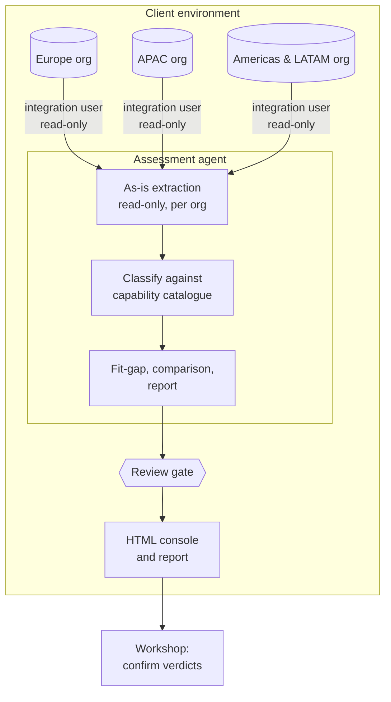
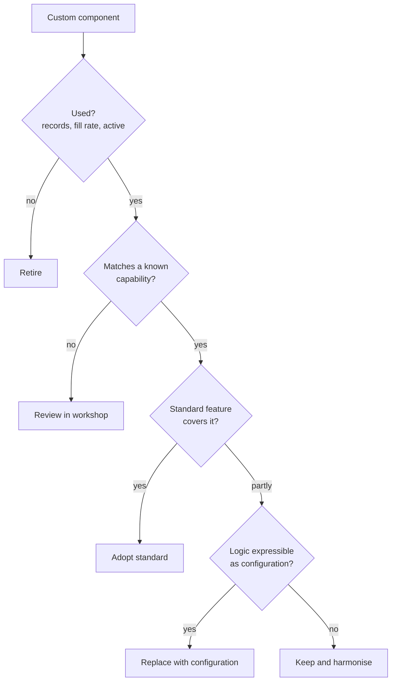
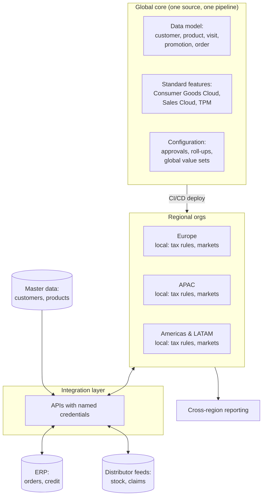

# Brightwell Consumer Goods: assessment architecture and target direction

Owner: Assessment agent · generated by `src/generators/emit-assessment.js`. Do not edit; re-run the agent.

## Principles

1. **Standard before custom.** Each capability is first matched to a standard Salesforce or Consumer Goods Cloud feature; custom build stays only where no standard feature fits.
2. **Configuration before code.** Approvals, roll-ups and thresholds move from Apex to configuration that the business can change without a release.
3. **One definition per business concept.** A store visit, a promotion or a tax ID is modelled once and shared by every org, so reporting and integrations work across regions.
4. **Retire before you move.** Unused objects, fields and automation are removed first; nothing unused is rebuilt.
5. **Integrations through one layer.** Outbound calls use named credentials through the integration layer; no endpoints or secrets in code.
6. **Data stays in the client environment.** The agents run there, read-only, with one least-privilege integration user per org; outputs hold names and counts, not records.
7. **Reviewed and repeatable.** Every output is generated from the extraction, versioned, and approved at a review gate before it is used.

## How the assessment runs

## How a verdict is reached

## Target direction

One global core shared by all regional orgs: the data model and configuration are built once, versioned, and deployed to every org through one pipeline. Regions keep only what is truly local (tax formats, market lists). Whether the three orgs later merge into one is a separate decision; a shared core makes either path cheaper.

## What moves where

| Verdict | Goes to | Components |
| --- | --- | --- |
| Adopt standard | Standard features in the global core | 23 |
| Replace with configuration | Configuration in the global core | 8 |
| Keep and harmonise | Custom, built once in the global core | 7 |
| Retire | Removed before the move | 1 |
| Review in workshop | Workshop agenda | 29 |
