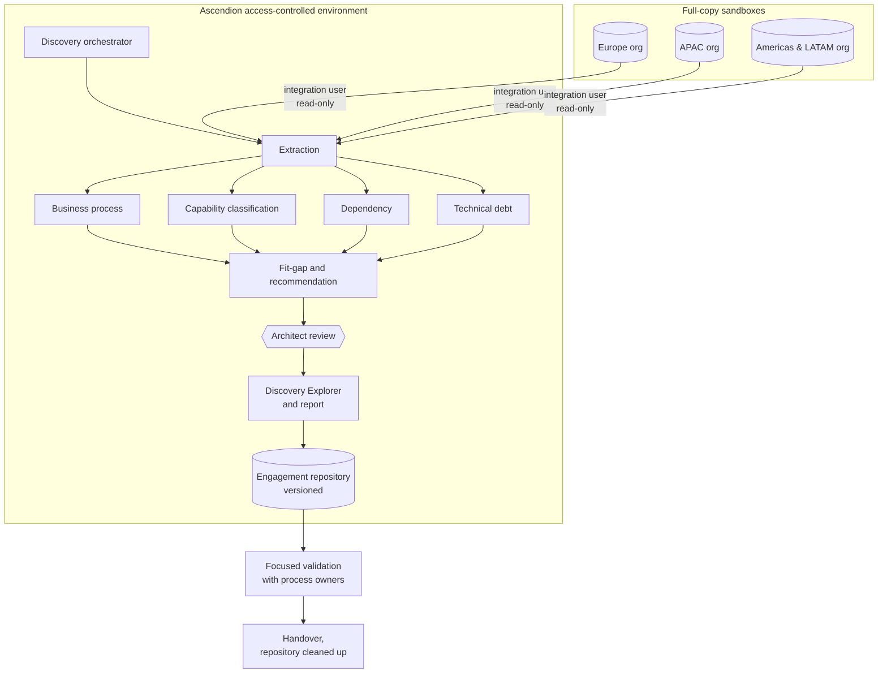
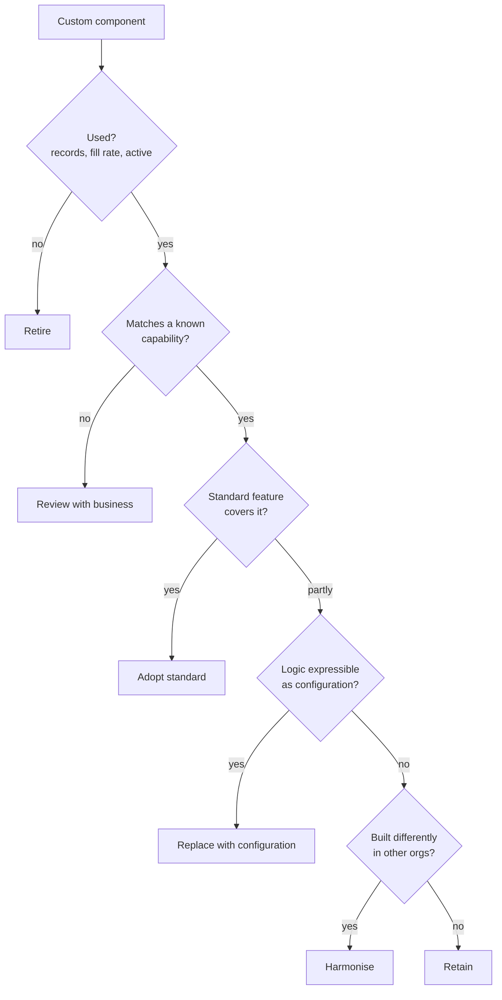
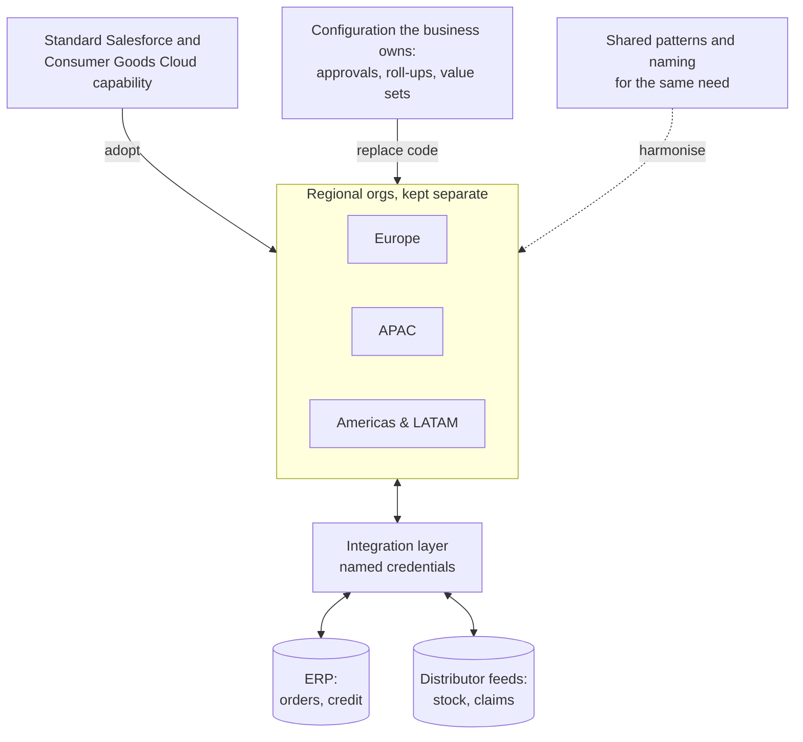

# Brightwell Consumer Goods: assessment architecture and target direction

Owner: Assessment agent · generated by `src/generators/emit-assessment.js`. Do not edit; re-run the agent.

## Principles

1. **Standard before custom.** Each capability is first matched to a standard Salesforce or Consumer Goods Cloud feature; custom build stays only where no standard feature fits.
2. **Configuration before code.** Approvals, roll-ups and thresholds move from Apex to configuration that the business can change without a release.
3. **Harmonise patterns, keep the orgs.** Each org is assessed in its own context. Where regions solve the same need differently, the pattern is aligned while the orgs stay separate; consolidation is not an objective of Discovery.
4. **Retire before you move.** Unused objects, fields and automation are removed first; nothing unused is rebuilt.
5. **Integrations through one layer.** Outbound calls use named credentials through the integration layer; no endpoints or secrets in code.
6. **Minimum data, read-only.** One least-privilege integration user per org, on a full-copy sandbox; outputs hold configuration, names and counts, never record contents.
7. **Reviewed and repeatable.** Every output is generated from the extraction, versioned, and approved at a review gate before it is used.

## How the assessment runs

## How a verdict is reached

Every disposition is weighed on business value, standard fit, technical risk, change impact and evidence confidence, and confirmed by the decision owner.

## Target direction

Each regional org stays a separate org, assessed in its own implementation context. Discovery points each org towards standard Salesforce and Consumer Goods Cloud capability, moves rules from code to configuration, and aligns patterns that regions built differently. Cross-org patterns are surfaced as insights; consolidation of the orgs is not an objective.

## What happens to each disposition

| Disposition | What follows | Components |
| --- | --- | --- |
| Adopt standard | Use the native Salesforce or Consumer Goods Cloud capability | 36 |
| Replace with configuration | Remove custom code; use supported configuration | 7 |
| Retain | Keep as valuable, supportable differentiation | 7 |
| Harmonise | Align the pattern across orgs while retaining separate orgs | 0 |
| Retire | Remove unused, duplicated or obsolete components | 1 |
| Review with business | Validate intent, regulatory context, usage or licensing | 29 |
