# Brightwell Consumer Goods: Salesforce Discovery Report

Owner: Assessment agent · generated by `src/generators/emit-discovery.js` from the read-only discovery of each org and the fit-gap. Reviewed at the Discover gate before it is shared. Do not edit; re-run the agent.

> Fictional company and sample markets, built in three Developer Edition orgs for the demo.

## 1. Executive summary

| Org | Status | Markets | Custom objects | Custom fields | Own flows | Own Apex classes | Packages | Debt items |
| --- | --- | --- | --- | --- | --- | --- | --- | --- |
| Europe | Discovered | 14 | 11 | 115 | 1 | 8 | 2 | 13 |
| APAC | Not yet connected |  |  |  |  |  |  |  |
| Americas & LATAM | Not yet connected |  |  |  |  |  |  |  |

**Fit-gap across the orgs:** 35 adopt standard, 7 replace with configuration, 7 retain, 0 harmonise, 2 retire, 29 review with business.

**Key findings**

- **High risk · Europe calls external systems without a named credential in the org.** Endpoints or credentials may be managed outside Salesforce, which is a security and run risk.
- **Low risk · 4 unused components in Europe.** Clutter slows every change and would be migrated for nothing.
- **Medium risk · 2 installed packages in Europe.** Package code cannot be read or exported; behaviour must be confirmed and a keep, replace or rebuild decision taken.
- **Medium risk · Apex in Europe without enough test coverage.** Changes to this code cannot be deployed safely.
- **Medium risk · Apex logic in Europe that configuration can replace.** Business rules such as thresholds and totals need a developer and a release to change.
- **Medium risk · Custom objects in Europe open to every internal user for editing.** Any user can change any record of these objects.

**Decisions needed:** confirm the market list per org; confirm licence fit for the standard features proposed (Consumer Goods Cloud, Trade Promotion Management); name an owner for each review item; agree the retirement of unused components.

## 2. Scope and method

- Orgs in scope: Europe, APAC (not yet connected), Americas & LATAM (not yet connected). Expected markets: 37.
- Read-only, through one integration user per org: describe, SOQL counts, Tooling API and the dependency index. No record contents are copied; this report holds configuration, names and counts.
- Every component is labelled by origin: custom (built in the org), installed package, or standard and provided by Salesforce.
- Each org is assessed in its own implementation context, on a recently refreshed full-copy sandbox. Cross-org patterns are surfaced as insights; consolidation is not an objective.
- Supporting information (architecture and integration diagrams, process documentation, user training manuals, known customisation lists) is read by the architects and cited as evidence next to the system findings.
- Not visible in metadata, and routed to focused validation with process experts: business intent, regulatory context, report usage by person, data quality beyond fill rates, and managed-package internals.

## 3. System landscape (current)

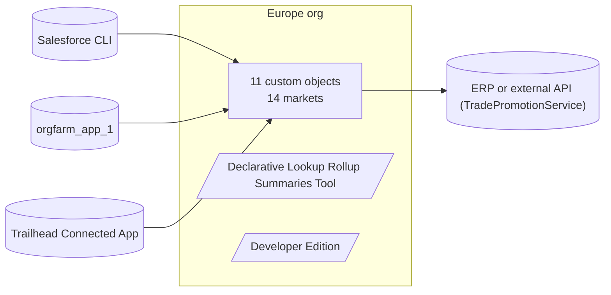

## 4. Findings by area

Each finding has a risk level, its business impact, the evidence from the orgs, a recommendation and a priority tier.

### Governance and technical debt

| Finding and evidence | Affected capability | Risk and business impact | Root cause | Recommended treatment | Priority |
| --- | --- | --- | --- | --- | --- |
| 4 unused components in Europe. Account.Old_Segment__c, Contact.Consent_Date__c, Contact.GDPR_Consent__c, Trade_Promotion__c.ERP_Synced__c | Contact consent | Low: Clutter slows every change and would be migrated for nothing. | Components were created for needs that changed and were never removed | Confirm with the business owner and remove before any move. | Quick win |

### Integrations

| Finding and evidence | Affected capability | Risk and business impact | Root cause | Recommended treatment | Priority |
| --- | --- | --- | --- | --- | --- |
| Europe calls external systems without a named credential in the org. TradePromotionService | Integrations | High: Endpoints or credentials may be managed outside Salesforce, which is a security and run risk. | Endpoints and credentials are handled in code | Route calls through named credentials and the integration layer; confirm owner and endpoint. | Immediate |

### Architecture and data model

| Finding and evidence | Affected capability | Risk and business impact | Root cause | Recommended treatment | Priority |
| --- | --- | --- | --- | --- | --- |
| 2 installed packages in Europe. Declarative Lookup Rollup Summaries Tool (9 objects, 134 classes); Developer Edition (0 objects, 4 classes) | Installed packages | Medium: Package code cannot be read or exported; behaviour must be confirmed and a keep, replace or rebuild decision taken. | Functionality bought as a package; its internals are not visible | Record package behaviour as test cases; decide per package in focused validation. | Immediate |

### Code

| Finding and evidence | Affected capability | Risk and business impact | Root cause | Recommended treatment | Priority |
| --- | --- | --- | --- | --- | --- |
| Apex in Europe without enough test coverage. PromotionClaimService (0% covered), PromotionClaimTrigger (0% covered), ShelfCheckTrigger (0% covered), StoreVisitLegacyHandler (0% covered), StoreVisitService (0% covered), StoreVisitTrigger (0% covered), TradePromotionApproval (0% covered), TradePromotionService (0% covered), TradePromotionTrigger (0% covered) | Distributor and customer claims, Store visits, Promotion approval, Trade promotions and deals, Shelf checks and in-store audits | Medium: Changes to this code cannot be deployed safely. | Tests were not kept up to date with code changes | Add tests, or retire the code if the fit-gap replaces it. | Immediate |

### Automation and business processes

| Finding and evidence | Affected capability | Risk and business impact | Root cause | Recommended treatment | Priority |
| --- | --- | --- | --- | --- | --- |
| Apex logic in Europe that configuration can replace. TradePromotionApproval | Promotion approval | Medium: Business rules such as thresholds and totals need a developer and a release to change. | Business rules were written in code rather than configuration | Move to approval processes, flows or roll-up summaries owned by the business. | Medium term |

### Security

| Finding and evidence | Affected capability | Risk and business impact | Root cause | Recommended treatment | Priority |
| --- | --- | --- | --- | --- | --- |
| Custom objects in Europe open to every internal user for editing. Promotion_Claim__c, Sales_Target__c, Store_Assortment__c, Store_Visit__c, Trade_Fund__c, Trade_Promotion__c | Distributor and customer claims, Sales targets, Store assortment and must-stock lists, Store visits, Trade funds, Trade promotions and deals | Medium: Any user can change any record of these objects. | Default sharing was set wide when the objects were built | Review the org-wide default per object with the data owner. | Medium term |

## 5. Customised versus standard

### Europe

| Component | Custom | Installed packages | Standard or provided by Salesforce |
| --- | --- | --- | --- |
| Objects | 11 | 6 | 16 |
| Fields (on described objects) | 115 | 41 | 930 |
| Validation rules | 13 | 1 | 0 |
| Flows | 1 | 0 | 115 |
| Apex classes | 13 | 138 | 0 |
| Apex triggers | 6 | 1 | 0 |
| Lightning components | 0 | 17 | 0 |
| Visualforce pages | 0 | 14 | 0 |
| Permission sets | 4 | 3 | 120 |
| Apps | 0 | 3 | 31 |
| Lightning pages | 14 | 3 | 0 |

## 6. Data model

Custom objects and the objects they relate to. Standard objects are shown where custom objects point at them.

### Europe


## 7. Fit-gap and cross-org comparison

| Capability | Europe | Standard feature | Verdict |
| --- | --- | --- | --- |
| Store visits | Store_Visit__c, StoreVisitLegacyHandler, StoreVisitService, StoreVisitTrigger | Consumer Goods Cloud: Visit and Retail Store, with visit tasks on the mobile app | Adopt standard |
| Visit tasks | Visit_Task__c | Consumer Goods Cloud: action plan templates create the tasks of each visit (assessment, inventory and price checks) | Adopt standard |
| Shelf checks and in-store audits | Shelf_Check__c, ShelfCheckTrigger | Consumer Goods Cloud: assessment tasks and retail store KPIs recorded during a visit | Adopt standard |
| Store assortment and must-stock lists | Store_Assortment__c | Consumer Goods Cloud: product assortments assigned to retail store groups | Adopt standard |
| Trade promotions and deals | Promotion_Product__c, Trade_Promotion__c, TradePromotionService, TradePromotionTrigger | Consumer Goods Cloud Trade Promotion Management: promotion planning, funds and post-event analysis | Adopt standard |
| Trade funds | Trade_Fund__c | Trade Promotion Management: funds with allocated, committed and spent amounts kept by the platform | Adopt standard |
| Distributor and customer claims | Promotion_Claim__c, PromotionClaimService, PromotionClaimTrigger | Trade Promotion Management: claims and payments checked against promotion funds | Adopt standard |
| Promotion approval | TradePromotionApproval | Approval processes or Flow approval orchestration, with the threshold held as configuration | Replace with configuration |
| Sales targets | Sales_Target__c | Collaborative Forecasts with quotas by user, territory or product family | Replace with configuration |
| Market and channel segmentation | Account.Customer_Channel__c, Account.Customer_Tier__c, Account.Market__c, Account.Store_Format__c | Global value sets shared by all orgs, with Enterprise Territory Management for market ownership | Replace with configuration |
| Customer tax registration | Account.VAT_Number__c | No standard tax ID field on Account: keep one global field with per-market format rules | Retain |
| ERP customer key | Account.Legacy_ERP_Code__c | Keep as an external ID field so integrations can upsert by the ERP key | Retain |
| Contact consent | Contact.Consent_Date__c, Contact.GDPR_Consent__c | Individual and contact point consent objects with data use purposes | Adopt standard |
| Product attributes | Product2.Brand__c, Product2.Case_Size__c, Product2.Category__c, Product2.EAN__c | Keep as fields on Product, owned by the product master (one definition for all orgs) | Retain |
| Subscriptions | Subscription_Line__c, Subscription__c, OpportunityService, SubscriptionRenewalBatch | Revenue Cloud subscription management | Adopt standard |
| Roll-ups between related records | — | Roll-up summary fields where the relationship is master-detail, record-triggered flows elsewhere | Replace with configuration |

The complete component-level fit-gap is in `fit-gap.json` and in the Org assessment view.

## 8. Prioritised roadmap

### Quick win

- Confirm with the business owner and remove before any move. *(4 unused components in Europe; low risk)*

### Immediate

- Route calls through named credentials and the integration layer; confirm owner and endpoint. *(Europe calls external systems without a named credential in the org; high risk)*
- Record package behaviour as test cases; decide per package in focused validation. *(2 installed packages in Europe; medium risk)*
- Add tests, or retire the code if the fit-gap replaces it. *(Apex in Europe without enough test coverage; medium risk)*

### Medium term

- Move to approval processes, flows or roll-up summaries owned by the business. *(Apex logic in Europe that configuration can replace; medium risk)*
- Review the org-wide default per object with the data owner. *(Custom objects in Europe open to every internal user for editing; medium risk)*

## 9. Target direction

Each regional org stays a separate org, assessed in its own implementation context. Discovery points each org towards standard Salesforce and Consumer Goods Cloud capability, moves rules from code to configuration, and aligns patterns that regions built differently. Cross-org patterns are surfaced as insights; consolidation of the orgs is not an objective.

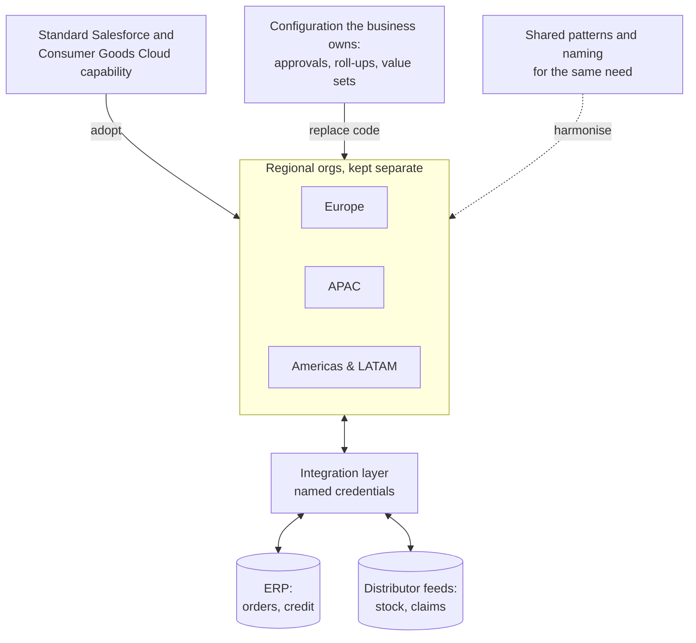

### What happens to each disposition

| Disposition | What follows | Components |
| --- | --- | --- |
| Adopt standard | Use the native Salesforce or Consumer Goods Cloud capability | 35 |
| Replace with configuration | Remove custom code; use supported configuration | 7 |
| Retain | Keep as valuable, supportable differentiation | 7 |
| Harmonise | Align the pattern across orgs while retaining separate orgs | 0 |
| Retire | Remove unused, duplicated or obsolete components | 2 |
| Review with business | Validate intent, regulatory context, usage or licensing | 29 |

## Appendices: detail per org

The same detail is interactive in the Discovery explorer (Org Compiler) and machine-readable in `discovery/<org>/discovery.json`.

## Appendix A: Europe

### A.1 Org profile

| Setting | Value |
| --- | --- |
| Edition | Developer Edition |
| Locale | en_US |
| Language | en_US |
| Time zone | America/Los_Angeles |
| Currencies | Single currency |

#### Limits

| Limit | Used | Maximum |
| --- | --- | --- |
| DataStorageMB | 2 | 5 |
| FileStorageMB | 0 | 20 |
| DailyApiRequests | 2913 | 15000 |
| DailyBulkV2QueryJobs | 0 | 10000 |
| DailyAsyncApexExecutions | 0 | 250000 |

#### User licences in use

| Licence | Used | Total |
| --- | --- | --- |
| Analytics Cloud Integration User | 2 | 2 |
| Chatter Free | 1 | 5000 |
| Salesforce | 2 | 4 |

#### Feature licences in use

| Licence | Used | Total |
| --- | --- | --- |
| Agentforce (Default) | 1 | 5 |
| Agentforce Service Agent Builder | 1 | 10000 |
| Data Cloud | 2 | 200000 |
| Einstein Prompt Templates | 1 | 5000 |
| Enhanced Chat User | 1 | 11 |
| Service User | 1 | 2 |

#### Active users by profile

| Profile | Users |
| --- | --- |
| Analytics Cloud Integration User | 1 |
| Analytics Cloud Security User | 1 |
| System Administrator | 2 |

#### Markets

| Market | Customers |
| --- | --- |
| Austria | 4 |
| Belgium | 4 |
| Denmark | 4 |
| France | 4 |
| Germany | 4 |
| Ireland | 4 |
| Italy | 4 |
| Netherlands | 4 |
| Poland | 4 |
| Portugal | 4 |
| Spain | 4 |
| Sweden | 4 |
| Switzerland | 4 |
| United Kingdom | 4 |

### A.2 Customised versus standard

#### By component type

| Component | Custom | Installed packages | Standard or provided by Salesforce |
| --- | --- | --- | --- |
| Objects | 11 | 6 | 16 |
| Fields (on described objects) | 115 | 41 | 930 |
| Validation rules | 13 | 1 | 0 |
| Flows | 1 | 0 | 115 |
| Apex classes | 13 | 138 | 0 |
| Apex triggers | 6 | 1 | 0 |
| Lightning components | 0 | 17 | 0 |
| Visualforce pages | 0 | 14 | 0 |
| Permission sets | 4 | 3 | 120 |
| Apps | 0 | 3 | 31 |
| Lightning pages | 14 | 3 | 0 |

#### By object

Standard fields come with Salesforce; custom fields were added in this org or by a package.

| Object | Origin | Records | Standard fields | Custom fields | Package fields |
| --- | --- | --- | --- | --- | --- |
| Account | Standard Salesforce | 78 | 63 | 16 | 0 |
| Campaign | Standard Salesforce | 4 | 33 | 0 | 0 |
| Case | Standard Salesforce | 26 | 36 | 4 | 0 |
| Contact | Standard Salesforce | 20 | 65 | 4 | 0 |
| Contract | Standard Salesforce | 0 | 41 | 0 | 0 |
| Event | Standard Salesforce | 0 | 49 | 0 | 0 |
| Lead | Standard Salesforce | 22 | 57 | 5 | 0 |
| Opportunity | Standard Salesforce | 31 | 41 | 6 | 0 |
| OpportunityLineItem | Standard Salesforce | 0 | 21 | 0 | 0 |
| Order | Standard Salesforce | 0 | 57 | 0 | 0 |
| OrderItem | Standard Salesforce | 0 | 20 | 0 | 0 |
| Pricebook2 | Standard Salesforce | 2 | 14 | 0 | 0 |
| PricebookEntry | Standard Salesforce | 34 | 15 | 0 | 0 |
| Product2 | Standard Salesforce | 27 | 22 | 4 | 0 |
| Promotion_Claim__c | Custom (built in this org) | 9 | 10 | 5 | 0 |
| Promotion_Product__c | Custom (built in this org) | 56 | 8 | 3 | 0 |
| Sales_Target__c | Custom (built in this org) | 28 | 10 | 4 | 0 |
| Shelf_Check__c | Custom (built in this org) | 378 | 8 | 5 | 0 |
| Store_Assortment__c | Custom (built in this org) | 168 | 10 | 3 | 0 |
| Store_Visit__c | Custom (built in this org) | 252 | 10 | 11 | 0 |
| Subscription_Line__c | Custom (built in this org) | 219 | 8 | 6 | 0 |
| Subscription__c | Custom (built in this org) | 107 | 11 | 15 | 0 |
| Task | Standard Salesforce | 49 | 39 | 0 | 0 |
| Trade_Fund__c | Custom (built in this org) | 56 | 10 | 6 | 0 |
| Trade_Promotion__c | Custom (built in this org) | 28 | 10 | 13 | 0 |
| User | Standard Salesforce | 8 | 192 | 0 | 0 |
| Visit_Task__c | Custom (built in this org) | 336 | 8 | 5 | 0 |
| dlrs__LookupChild__c | Installed package | 0 | 9 | 0 | 6 |
| dlrs__LookupParent__c | Installed package | 0 | 9 | 0 | 5 |
| dlrs__LookupRollupCalculateJob__c | Installed package | 0 | 11 | 0 | 1 |
| dlrs__LookupRollupSummaryLog__c | Installed package | 0 | 11 | 0 | 4 |
| dlrs__LookupRollupSummaryScheduleItems__c | Installed package | 0 | 11 | 0 | 5 |
| dlrs__LookupRollupSummary__c | Installed package | 2 | 11 | 0 | 20 |

#### Custom fields

| Object | Field | Label | Type | Filled |
| --- | --- | --- | --- | --- |
| Account | Active__c | Active | picklist | 13% |
| Account | Customer_Channel__c | Customer Channel | picklist | 72% |
| Account | Customer_Tier__c | Customer Tier | picklist | 72% |
| Account | CustomerPriority__c | Customer Priority | picklist | 12% |
| Account | Legacy_ERP_Code__c | Legacy ERP Code | string | 44% |
| Account | Market__c | Market | picklist | 72% |
| Account | NumberofLocations__c | Number of Locations | double | 14% |
| Account | Old_Segment__c | Old Segment (unused) | string | 0% |
| Account | SLA__c | SLA | picklist | 14% |
| Account | SLAExpirationDate__c | SLA Expiration Date | date | 14% |
| Account | SLASerialNumber__c | SLA Serial Number | string | 14% |
| Account | Store_Format__c | Store Format | picklist | 54% |
| Account | UpsellOpportunity__c | Upsell Opportunity | picklist | 14% |
| Account | VAT_Number__c | VAT Number | string | 36% |
| Account | Won_Opportunity_Amount__c | Won Opportunity Amount | currency | 28% |
| Account | Won_Opportunity_Count__c | Won Opportunity Count | double | 28% |
| Case | EngineeringReqNumber__c | Engineering Req Number | string | 85% |
| Case | PotentialLiability__c | Potential Liability | picklist | 100% |
| Case | Product__c | Product | picklist | 100% |
| Case | SLAViolation__c | SLA Violation | picklist | 96% |
| Contact | Consent_Date__c | Consent Date | date | 0% |
| Contact | GDPR_Consent__c | GDPR Consent | boolean | 0% |
| Contact | Languages__c | Languages | string | 85% |
| Contact | Level__c | Level | picklist | 85% |
| Lead | CurrentGenerators__c | Current Generator(s) | string | 100% |
| Lead | NumberofLocations__c | Number of Locations | double | 100% |
| Lead | Primary__c | Primary | picklist | 100% |
| Lead | ProductInterest__c | Product Interest | picklist | 100% |
| Lead | SICCode__c | SIC Code | string | 100% |
| Opportunity | CurrentGenerators__c | Current Generator(s) | string | 52% |
| Opportunity | DeliveryInstallationStatus__c | Delivery/Installation Status | picklist | 74% |
| Opportunity | Loss_Reason__c | Loss Reason | picklist | 13% |
| Opportunity | MainCompetitors__c | Main Competitor(s) | string | 58% |
| Opportunity | OrderNumber__c | Order Number | string | 58% |
| Opportunity | TrackingNumber__c | Tracking Number | string | 29% |
| Product2 | Brand__c | Brand | picklist | 37% |
| Product2 | Case_Size__c | Case Size | double | 37% |
| Product2 | Category__c | Category | picklist | 37% |
| Product2 | EAN__c | EAN | string | 37% |
| Promotion_Claim__c | Account__c | Customer | reference | 100% |
| Promotion_Claim__c | Claim_Amount__c | Claim Amount | currency | 100% |
| Promotion_Claim__c | Invoice_Number__c | Invoice Number | string | 100% |
| Promotion_Claim__c | Status__c | Status | picklist | 100% |
| Promotion_Claim__c | Trade_Promotion__c | Trade Promotion | reference | 100% |
| Promotion_Product__c | Discount_Pct__c | Discount | percent | 100% |
| Promotion_Product__c | Product__c | Product | reference | 100% |
| Promotion_Product__c | Trade_Promotion__c | Trade Promotion | reference | 100% |
| Sales_Target__c | Account__c | Customer | reference | 100% |
| Sales_Target__c | Category__c | Category | picklist | 100% |
| Sales_Target__c | Period_Start__c | Period Start | date | 100% |
| Sales_Target__c | Target_Amount__c | Target Amount | currency | 100% |
| Shelf_Check__c | Facings__c | Facings | double | 100% |
| Shelf_Check__c | On_Shelf__c | On Shelf | boolean | 86% |
| Shelf_Check__c | Product__c | Product | reference | 100% |
| Shelf_Check__c | Shelf_Price__c | Shelf Price | currency | 100% |
| Shelf_Check__c | Store_Visit__c | Store Visit | reference | 100% |
| Store_Assortment__c | Account__c | Store | reference | 100% |
| Store_Assortment__c | Must_Stock__c | Must Stock | boolean | 50% |
| Store_Assortment__c | Product__c | Product | reference | 100% |
| Store_Visit__c | Account__c | Store | reference | 100% |
| Store_Visit__c | Check_In_Latitude__c | Check-in Latitude | double | 42% |
| Store_Visit__c | Check_In_Longitude__c | Check-in Longitude | double | 42% |
| Store_Visit__c | Checked_In__c | Checked In | boolean | 42% |
| Store_Visit__c | Compliance_Pct__c | Shelf Compliance | percent | 42% |
| Store_Visit__c | Notes__c | Notes | textarea |  |
| Store_Visit__c | Out_Of_Stocks__c | Out of Stocks | double | 50% |
| Store_Visit__c | Shelf_Checks__c | Shelf Checks | roll-up |  |
| Store_Visit__c | Status__c | Status | picklist | 100% |
| Store_Visit__c | Visit_Date__c | Visit Date | date | 100% |
| Store_Visit__c | Visit_Type__c | Visit Type | picklist | 100% |
| Subscription_Line__c | Account_Name__c | Account Name | formula |  |
| Subscription_Line__c | Line_Total__c | Line Total | formula |  |
| Subscription_Line__c | Product__c | Product | reference | 100% |
| Subscription_Line__c | Quantity__c | Quantity | double | 100% |
| Subscription_Line__c | Subscription__c | Subscription | reference | 100% |
| Subscription_Line__c | Unit_Price__c | Unit Price | currency | 100% |
| Subscription__c | Account__c | Account | reference | 100% |
| Subscription__c | Annual_Value__c | Annual Value | formula |  |
| Subscription__c | Auto_Renew__c | Auto Renew | boolean | 52% |
| Subscription__c | Cancellation_Reason__c | Cancellation Reason | string | 21% |
| Subscription__c | Days_To_Renewal__c | Days To Renewal | formula |  |
| Subscription__c | End_Date__c | End Date | date | 100% |
| Subscription__c | Health_Score__c | Health Score | double | 100% |
| Subscription__c | Line_Count__c | Line Count | roll-up |  |
| Subscription__c | MRR__c | MRR | currency | 93% |
| Subscription__c | Primary_Contact__c | Primary Contact | reference | 34% |
| Subscription__c | Source_Opportunity__c | Source Opportunity | reference | 5% |
| Subscription__c | Start_Date__c | Start Date | date | 100% |
| Subscription__c | Status__c | Status | picklist | 100% |
| Subscription__c | Term_Months__c | Term (Months) | double | 100% |
| Subscription__c | Total_Line_Value__c | Total Line Value | roll-up |  |
| Trade_Fund__c | Account__c | Customer | reference | 100% |
| Trade_Fund__c | Amount__c | Amount | currency | 100% |
| Trade_Fund__c | Committed__c | Committed | currency | 50% |
| Trade_Fund__c | Fund_Type__c | Fund Type | picklist | 100% |
| Trade_Fund__c | Status__c | Status | picklist | 100% |
| Trade_Fund__c | Year__c | Year | double | 100% |
| Trade_Promotion__c | Account__c | Customer | reference | 100% |
| Trade_Promotion__c | Actual_Spend__c | Actual Spend | currency | 64% |
| Trade_Promotion__c | Actual_Volume__c | Actual Volume (cases) | double | 64% |
| Trade_Promotion__c | Baseline_Volume__c | Baseline Volume (cases) | double | 64% |
| Trade_Promotion__c | Budget__c | Budget | currency | 100% |
| Trade_Promotion__c | End_Date__c | End Date | date | 100% |
| Trade_Promotion__c | ERP_Synced__c | Sent to ERP | boolean | 0% |
| Trade_Promotion__c | Mechanic__c | Mechanic | picklist | 100% |
| Trade_Promotion__c | ROI__c | Return on Investment | percent | 64% |
| Trade_Promotion__c | Start_Date__c | Start Date | date | 100% |
| Trade_Promotion__c | Status__c | Status | picklist | 100% |
| Trade_Promotion__c | Trade_Fund__c | Trade Fund | reference | 100% |
| Trade_Promotion__c | Uplift_Pct__c | Expected Uplift | percent | 100% |
| Visit_Task__c | Done__c | Done | boolean | 60% |
| Visit_Task__c | Product__c | Product | reference | 25% |
| Visit_Task__c | Result__c | Result | string | 75% |
| Visit_Task__c | Store_Visit__c | Store Visit | reference | 100% |
| Visit_Task__c | Task_Type__c | Task Type | picklist | 100% |

### A.3 Data model

#### Custom objects and their relationships

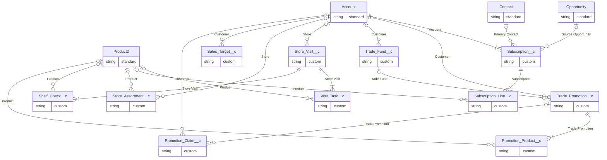

#### Objects

| Object | Origin | Records | Sharing | Standard fields | Added fields |
| --- | --- | --- | --- | --- | --- |
| Account | Standard Salesforce | 78 | ReadWrite | 63 | 16 |
| Campaign | Standard Salesforce | 4 | FullAccess | 33 | 0 |
| Case | Standard Salesforce | 26 | ReadWriteTransfer | 36 | 4 |
| Contact | Standard Salesforce | 20 | ReadWrite | 65 | 4 |
| Contract | Standard Salesforce | 0 | ReadWrite | 41 | 0 |
| Event | Standard Salesforce | 0 | Private | 49 | 0 |
| Lead | Standard Salesforce | 22 | ReadWriteTransfer | 57 | 5 |
| Opportunity | Standard Salesforce | 31 | ReadWrite | 41 | 6 |
| OpportunityLineItem | Standard Salesforce | 0 | ReadWrite | 21 | 0 |
| Order | Standard Salesforce | 0 | ReadWrite | 57 | 0 |
| OrderItem | Standard Salesforce | 0 | ReadWrite | 20 | 0 |
| Pricebook2 | Standard Salesforce | 2 | ReadSelect | 14 | 0 |
| PricebookEntry | Standard Salesforce | 34 | ReadWrite | 15 | 0 |
| Product2 | Standard Salesforce | 27 | ReadWrite | 22 | 4 |
| Promotion_Claim__c | Custom (built in this org) | 9 | ReadWrite | 10 | 5 |
| Promotion_Product__c | Custom (built in this org) | 56 | ControlledByParent | 8 | 3 |
| Sales_Target__c | Custom (built in this org) | 28 | ReadWrite | 10 | 4 |
| Shelf_Check__c | Custom (built in this org) | 378 | ControlledByParent | 8 | 5 |
| Store_Assortment__c | Custom (built in this org) | 168 | ReadWrite | 10 | 3 |
| Store_Visit__c | Custom (built in this org) | 252 | ReadWrite | 10 | 11 |
| Subscription_Line__c | Custom (built in this org) | 219 | ControlledByParent | 8 | 6 |
| Subscription__c | Custom (built in this org) | 107 | ControlledByParent | 11 | 15 |
| Task | Standard Salesforce | 49 | Private | 39 | 0 |
| Trade_Fund__c | Custom (built in this org) | 56 | ReadWrite | 10 | 6 |
| Trade_Promotion__c | Custom (built in this org) | 28 | ReadWrite | 10 | 13 |
| User | Standard Salesforce | 8 | Read | 192 | 0 |
| Visit_Task__c | Custom (built in this org) | 336 | ControlledByParent | 8 | 5 |
| dlrs__LookupChild__c | Installed package | 0 | Private | 9 | 6 |
| dlrs__LookupParent__c | Installed package | 0 | Read | 9 | 5 |
| dlrs__LookupRollupCalculateJob__c | Installed package | 0 | ReadWrite | 11 | 1 |
| dlrs__LookupRollupSummaryLog__c | Installed package | 0 | ReadWrite | 11 | 4 |
| dlrs__LookupRollupSummaryScheduleItems__c | Installed package | 0 | ReadWrite | 11 | 5 |
| dlrs__LookupRollupSummary__c | Installed package | 2 | ReadWrite | 11 | 20 |

##### Account (`Account`)

Standard Salesforce · 78 records · sharing ReadWrite · 0 record types · 4 page layouts

| Field | Label | Type | Origin | Required | References / formula | Filled |
| --- | --- | --- | --- | --- | --- | --- |
| Active__c | Active | picklist | custom |  |  | 13% |
| Customer_Channel__c | Customer Channel | picklist | custom |  |  | 72% |
| Customer_Tier__c | Customer Tier | picklist | custom |  |  | 72% |
| CustomerPriority__c | Customer Priority | picklist | custom |  |  | 12% |
| Legacy_ERP_Code__c | Legacy ERP Code | string | custom |  |  | 44% |
| Market__c | Market | picklist | custom |  |  | 72% |
| NumberofLocations__c | Number of Locations | double | custom |  |  | 14% |
| Old_Segment__c | Old Segment (unused) | string | custom |  |  | 0% |
| SLA__c | SLA | picklist | custom |  |  | 14% |
| SLAExpirationDate__c | SLA Expiration Date | date | custom |  |  | 14% |
| SLASerialNumber__c | SLA Serial Number | string | custom |  |  | 14% |
| Store_Format__c | Store Format | picklist | custom |  |  | 54% |
| UpsellOpportunity__c | Upsell Opportunity | picklist | custom |  |  | 14% |
| VAT_Number__c | VAT Number | string | custom |  |  | 36% |
| Won_Opportunity_Amount__c | Won Opportunity Amount | currency | custom |  |  | 28% |
| Won_Opportunity_Count__c | Won Opportunity Count | double | custom |  |  | 28% |

##### Case (`Case`)

Standard Salesforce · 26 records · sharing ReadWriteTransfer · 0 record types · 4 page layouts

| Field | Label | Type | Origin | Required | References / formula | Filled |
| --- | --- | --- | --- | --- | --- | --- |
| EngineeringReqNumber__c | Engineering Req Number | string | custom |  |  | 85% |
| PotentialLiability__c | Potential Liability | picklist | custom |  |  | 100% |
| Product__c | Product | picklist | custom |  |  | 100% |
| SLAViolation__c | SLA Violation | picklist | custom |  |  | 96% |

##### Contact (`Contact`)

Standard Salesforce · 20 records · sharing ReadWrite · 0 record types · 4 page layouts

| Field | Label | Type | Origin | Required | References / formula | Filled |
| --- | --- | --- | --- | --- | --- | --- |
| Consent_Date__c | Consent Date | date | custom |  |  | 0% |
| GDPR_Consent__c | GDPR Consent | boolean | custom |  |  | 0% |
| Languages__c | Languages | string | custom |  |  | 85% |
| Level__c | Level | picklist | custom |  |  | 85% |

##### Lead (`Lead`)

Standard Salesforce · 22 records · sharing ReadWriteTransfer · 0 record types · 4 page layouts

| Field | Label | Type | Origin | Required | References / formula | Filled |
| --- | --- | --- | --- | --- | --- | --- |
| CurrentGenerators__c | Current Generator(s) | string | custom |  |  | 100% |
| NumberofLocations__c | Number of Locations | double | custom |  |  | 100% |
| Primary__c | Primary | picklist | custom |  |  | 100% |
| ProductInterest__c | Product Interest | picklist | custom |  |  | 100% |
| SICCode__c | SIC Code | string | custom |  |  | 100% |

##### Opportunity (`Opportunity`)

Standard Salesforce · 31 records · sharing ReadWrite · 0 record types · 4 page layouts

| Field | Label | Type | Origin | Required | References / formula | Filled |
| --- | --- | --- | --- | --- | --- | --- |
| CurrentGenerators__c | Current Generator(s) | string | custom |  |  | 52% |
| DeliveryInstallationStatus__c | Delivery/Installation Status | picklist | custom |  |  | 74% |
| Loss_Reason__c | Loss Reason | picklist | custom |  |  | 13% |
| MainCompetitors__c | Main Competitor(s) | string | custom |  |  | 58% |
| OrderNumber__c | Order Number | string | custom |  |  | 58% |
| TrackingNumber__c | Tracking Number | string | custom |  |  | 29% |

##### Product (`Product2`)

Standard Salesforce · 27 records · sharing ReadWrite · 0 record types · 1 page layout

| Field | Label | Type | Origin | Required | References / formula | Filled |
| --- | --- | --- | --- | --- | --- | --- |
| Brand__c | Brand | picklist | custom |  |  | 37% |
| Case_Size__c | Case Size | double | custom |  |  | 37% |
| Category__c | Category | picklist | custom |  |  | 37% |
| EAN__c | EAN | string | custom |  |  | 37% |

##### Promotion Claim (`Promotion_Claim__c`)

Custom (built in this org) · 9 records · sharing ReadWrite · 0 record types · 1 page layout

| Field | Label | Type | Origin | Required | References / formula | Filled |
| --- | --- | --- | --- | --- | --- | --- |
| Account__c | Customer | reference | custom |  | Account | 100% |
| Claim_Amount__c | Claim Amount | currency | custom |  |  | 100% |
| Invoice_Number__c | Invoice Number | string | custom |  |  | 100% |
| Status__c | Status | picklist | custom |  |  | 100% |
| Trade_Promotion__c | Trade Promotion | reference | custom |  | Trade_Promotion__c | 100% |

##### Promotion Product (`Promotion_Product__c`)

Custom (built in this org) · 56 records · sharing ControlledByParent · 0 record types · 1 page layout

| Field | Label | Type | Origin | Required | References / formula | Filled |
| --- | --- | --- | --- | --- | --- | --- |
| Discount_Pct__c | Discount | percent | custom |  |  | 100% |
| Product__c | Product | reference | custom |  | Product2 | 100% |
| Trade_Promotion__c | Trade Promotion | reference | custom | yes | Trade_Promotion__c | 100% |

##### Sales Target (`Sales_Target__c`)

Custom (built in this org) · 28 records · sharing ReadWrite · 0 record types · 1 page layout

| Field | Label | Type | Origin | Required | References / formula | Filled |
| --- | --- | --- | --- | --- | --- | --- |
| Account__c | Customer | reference | custom |  | Account | 100% |
| Category__c | Category | picklist | custom |  |  | 100% |
| Period_Start__c | Period Start | date | custom | yes |  | 100% |
| Target_Amount__c | Target Amount | currency | custom |  |  | 100% |

##### Shelf Check (`Shelf_Check__c`)

Custom (built in this org) · 378 records · sharing ControlledByParent · 0 record types · 1 page layout

| Field | Label | Type | Origin | Required | References / formula | Filled |
| --- | --- | --- | --- | --- | --- | --- |
| Facings__c | Facings | double | custom |  |  | 100% |
| On_Shelf__c | On Shelf | boolean | custom |  |  | 86% |
| Product__c | Product | reference | custom |  | Product2 | 100% |
| Shelf_Price__c | Shelf Price | currency | custom |  |  | 100% |
| Store_Visit__c | Store Visit | reference | custom | yes | Store_Visit__c | 100% |

##### Store Assortment (`Store_Assortment__c`)

Custom (built in this org) · 168 records · sharing ReadWrite · 0 record types · 1 page layout

| Field | Label | Type | Origin | Required | References / formula | Filled |
| --- | --- | --- | --- | --- | --- | --- |
| Account__c | Store | reference | custom |  | Account | 100% |
| Must_Stock__c | Must Stock | boolean | custom |  |  | 50% |
| Product__c | Product | reference | custom |  | Product2 | 100% |

##### Store Visit (`Store_Visit__c`)

Custom (built in this org) · 252 records · sharing ReadWrite · 0 record types · 1 page layout

| Field | Label | Type | Origin | Required | References / formula | Filled |
| --- | --- | --- | --- | --- | --- | --- |
| Account__c | Store | reference | custom |  | Account | 100% |
| Check_In_Latitude__c | Check-in Latitude | double | custom |  |  | 42% |
| Check_In_Longitude__c | Check-in Longitude | double | custom |  |  | 42% |
| Checked_In__c | Checked In | boolean | custom |  |  | 42% |
| Compliance_Pct__c | Shelf Compliance | percent | custom |  |  | 42% |
| Notes__c | Notes | textarea | custom |  |  |  |
| Out_Of_Stocks__c | Out of Stocks | double | custom |  |  | 50% |
| Shelf_Checks__c | Shelf Checks | roll-up | custom |  |  |  |
| Status__c | Status | picklist | custom |  |  | 100% |
| Visit_Date__c | Visit Date | date | custom | yes |  | 100% |
| Visit_Type__c | Visit Type | picklist | custom |  |  | 100% |

##### Subscription Line (`Subscription_Line__c`)

Custom (built in this org) · 219 records · sharing ControlledByParent · 0 record types · 1 page layout

| Field | Label | Type | Origin | Required | References / formula | Filled |
| --- | --- | --- | --- | --- | --- | --- |
| Account_Name__c | Account Name | formula | custom |  | Subscription__r.Account__r.Name |  |
| Line_Total__c | Line Total | formula | custom |  | Quantity__c * Unit_Price__c |  |
| Product__c | Product | reference | custom |  | Product2 | 100% |
| Quantity__c | Quantity | double | custom | yes |  | 100% |
| Subscription__c | Subscription | reference | custom | yes | Subscription__c | 100% |
| Unit_Price__c | Unit Price | currency | custom | yes |  | 100% |

##### Subscription (`Subscription__c`)

Custom (built in this org) · 107 records · sharing ControlledByParent · 0 record types · 1 page layout

| Field | Label | Type | Origin | Required | References / formula | Filled |
| --- | --- | --- | --- | --- | --- | --- |
| Account__c | Account | reference | custom | yes | Account | 100% |
| Annual_Value__c | Annual Value | formula | custom |  | MRR__c * 12 |  |
| Auto_Renew__c | Auto Renew | boolean | custom |  |  | 52% |
| Cancellation_Reason__c | Cancellation Reason | string | custom |  |  | 21% |
| Days_To_Renewal__c | Days To Renewal | formula | custom |  | End_Date__c - TODAY() |  |
| End_Date__c | End Date | date | custom | yes |  | 100% |
| Health_Score__c | Health Score | double | custom |  |  | 100% |
| Line_Count__c | Line Count | roll-up | custom |  |  |  |
| MRR__c | MRR | currency | custom |  |  | 93% |
| Primary_Contact__c | Primary Contact | reference | custom |  | Contact | 34% |
| Source_Opportunity__c | Source Opportunity | reference | custom |  | Opportunity | 5% |
| Start_Date__c | Start Date | date | custom | yes |  | 100% |
| Status__c | Status | picklist | custom |  |  | 100% |
| Term_Months__c | Term (Months) | double | custom |  |  | 100% |
| Total_Line_Value__c | Total Line Value | roll-up | custom |  |  |  |

##### Trade Fund (`Trade_Fund__c`)

Custom (built in this org) · 56 records · sharing ReadWrite · 0 record types · 1 page layout

| Field | Label | Type | Origin | Required | References / formula | Filled |
| --- | --- | --- | --- | --- | --- | --- |
| Account__c | Customer | reference | custom |  | Account | 100% |
| Amount__c | Amount | currency | custom |  |  | 100% |
| Committed__c | Committed | currency | custom |  |  | 50% |
| Fund_Type__c | Fund Type | picklist | custom |  |  | 100% |
| Status__c | Status | picklist | custom |  |  | 100% |
| Year__c | Year | double | custom |  |  | 100% |

##### Trade Promotion (`Trade_Promotion__c`)

Custom (built in this org) · 28 records · sharing ReadWrite · 0 record types · 1 page layout

| Field | Label | Type | Origin | Required | References / formula | Filled |
| --- | --- | --- | --- | --- | --- | --- |
| Account__c | Customer | reference | custom |  | Account | 100% |
| Actual_Spend__c | Actual Spend | currency | custom |  |  | 64% |
| Actual_Volume__c | Actual Volume (cases) | double | custom |  |  | 64% |
| Baseline_Volume__c | Baseline Volume (cases) | double | custom |  |  | 64% |
| Budget__c | Budget | currency | custom |  |  | 100% |
| End_Date__c | End Date | date | custom | yes |  | 100% |
| ERP_Synced__c | Sent to ERP | boolean | custom |  |  | 0% |
| Mechanic__c | Mechanic | picklist | custom |  |  | 100% |
| ROI__c | Return on Investment | percent | custom |  |  | 64% |
| Start_Date__c | Start Date | date | custom | yes |  | 100% |
| Status__c | Status | picklist | custom |  |  | 100% |
| Trade_Fund__c | Trade Fund | reference | custom |  | Trade_Fund__c | 100% |
| Uplift_Pct__c | Expected Uplift | percent | custom |  |  | 100% |

##### Visit Task (`Visit_Task__c`)

Custom (built in this org) · 336 records · sharing ControlledByParent · 0 record types · 1 page layout

| Field | Label | Type | Origin | Required | References / formula | Filled |
| --- | --- | --- | --- | --- | --- | --- |
| Done__c | Done | boolean | custom |  |  | 60% |
| Product__c | Product | reference | custom |  | Product2 | 25% |
| Result__c | Result | string | custom |  |  | 75% |
| Store_Visit__c | Store Visit | reference | custom | yes | Store_Visit__c | 100% |
| Task_Type__c | Task Type | picklist | custom |  |  | 100% |

##### Lookup Child (`dlrs__LookupChild__c`)

Installed package · 0 records · sharing Private · 0 record types · 1 page layout

| Field | Label | Type | Origin | Required | References / formula | Filled |
| --- | --- | --- | --- | --- | --- | --- |
| dlrs__Amount__c | Amount | double | package |  |  |  |
| dlrs__Color__c | Color | picklist | package |  |  |  |
| dlrs__Description__c | Description | string | package |  |  |  |
| dlrs__Description2__c | Description 2 | string | package |  |  |  |
| dlrs__LookupParent__c | Lookup Parent | reference | package |  | dlrs__LookupParent__c |  |
| dlrs__LookupParent2__c | Lookup Parent 2 | reference | package |  | dlrs__LookupParent__c |  |

##### Lookup Parent (`dlrs__LookupParent__c`)

Installed package · 0 records · sharing Read · 0 record types · 1 page layout

| Field | Label | Type | Origin | Required | References / formula | Filled |
| --- | --- | --- | --- | --- | --- | --- |
| dlrs__Colours__c | Colours | multipicklist | package |  |  |  |
| dlrs__Descriptions__c | Descriptions | string | package |  |  |  |
| dlrs__Descriptions2__c | Descriptions 2 | string | package |  |  |  |
| dlrs__Total__c | Total | double | package |  |  |  |
| dlrs__Total2__c | Total 2 | double | package |  |  |  |

##### Lookup Rollup Calculate Job (`dlrs__LookupRollupCalculateJob__c`)

Installed package · 0 records · sharing ReadWrite · 0 record types · 1 page layout

| Field | Label | Type | Origin | Required | References / formula | Filled |
| --- | --- | --- | --- | --- | --- | --- |
| dlrs__LookupRollupSummaryId__c | Lookup Rollup Summary Id | string | package | yes |  |  |

##### Lookup Rollup Summary Log (`dlrs__LookupRollupSummaryLog__c`)

Installed package · 0 records · sharing ReadWrite · 0 record types · 1 page layout

| Field | Label | Type | Origin | Required | References / formula | Filled |
| --- | --- | --- | --- | --- | --- | --- |
| dlrs__ErrorMessage__c | Error Message | textarea | package |  |  |  |
| dlrs__ParentId__c | Parent Id | string | package | yes |  |  |
| dlrs__ParentObject__c | Parent Object | string | package |  |  |  |
| dlrs__ParentRecord__c | Parent Record | formula | package |  | HYPERLINK( dlrs__ParentId__c , 'Parent Record') |  |

##### Lookup Rollup Summary Schedule Item (`dlrs__LookupRollupSummaryScheduleItems__c`)

Installed package · 0 records · sharing ReadWrite · 0 record types · 1 page layout

| Field | Label | Type | Origin | Required | References / formula | Filled |
| --- | --- | --- | --- | --- | --- | --- |
| dlrs__LookupRollupSummary2__c | Lookup Rollup Summary 2 | string | package |  |  |  |
| dlrs__ParentId__c | Parent Id | string | package |  |  |  |
| dlrs__ParentKeyPrefix__c | Parent Key Prefix | formula | package |  | LEFT( dlrs__ParentId__c , 3) |  |
| dlrs__ParentRecord__c | Parent Record | formula | package |  | HYPERLINK( dlrs__ParentId__c , 'Parent Record') |  |
| dlrs__QualifiedParentID__c | Qualified Parent ID | string | package | yes |  |  |

##### Lookup Rollup Summary (`dlrs__LookupRollupSummary__c`)

Installed package · 2 records · sharing ReadWrite · 0 record types · 1 page layout

| Field | Label | Type | Origin | Required | References / formula | Filled |
| --- | --- | --- | --- | --- | --- | --- |
| dlrs__Active__c | Active | boolean | package |  |  | 100% |
| dlrs__AggregateAllRows__c | Aggregate All Rows | boolean | package |  |  | 0% |
| dlrs__AggregateOperation__c | Aggregate Operation | picklist | package |  |  | 100% |
| dlrs__AggregateResultField__c | Aggregate Result Field | string | package | yes |  | 100% |
| dlrs__CalculateJobId__c | Calculate Job Id | string | package |  |  | 100% |
| dlrs__CalculationMode__c | Calculation Mode | picklist | package |  |  | 100% |
| dlrs__CalculationSharingMode__c | Calculation Sharing Mode | picklist | package |  |  | 100% |
| dlrs__ChildObject__c | Child Object | string | package | yes |  | 100% |
| dlrs__ConcatenateDelimiter__c | Concatenate Delimiter | string | package |  |  | 0% |
| dlrs__Description__c | Description | textarea | package |  |  |  |
| dlrs__FieldToAggregate__c | Field to Aggregate | string | package | yes |  | 100% |
| dlrs__FieldToOrderBy__c | Field to Order By | string | package |  |  | 0% |
| dlrs__ParentObject__c | Parent Object | string | package | yes |  | 100% |
| dlrs__RelationshipCriteria__c | Relationship Criteria | string | package |  |  | 100% |
| dlrs__RelationshipCriteriaFields__c | Relationship Criteria Fields | textarea | package |  |  |  |
| dlrs__RelationshipField__c | Relationship Field | string | package | yes |  | 100% |
| dlrs__RowLimit__c | Row Limit | double | package |  |  | 0% |
| dlrs__TestCode__c | Test Code | textarea | package |  |  |  |
| dlrs__TestCodeSeeAllData__c | Test Code See All Data | boolean | package |  |  | 0% |
| dlrs__UniqueName__c | Lookup Rollup Summary Unique Name | string | package |  |  | 100% |

### A.4 Validation rules

#### Account · VAT_Format

Active · Custom (built in this org) · message shown on `VAT Number`

**Blocks the save when:**

```
AND(NOT(ISBLANK(VAT_Number__c)), NOT(REGEX(VAT_Number__c, "[A-Z]{2}[0-9A-Z]{2,13}")))
```

**Message:** VAT number must start with the two-letter country code.

#### dlrs__LookupParent__c · Not_42

Active · Installed package · message shown on `Total`

**Blocks the save when:**

```
dlrs__Total__c !=42
```

**Message:** The answer is not 42!

#### Opportunity · Closed_Won_Requires_Amount

Active · Custom (built in this org) · message shown on `Amount`

**Blocks the save when:**

```
AND( ISPICKVAL(StageName, "Closed Won"), OR( ISBLANK(Amount), Amount <= 0 ) )
```

**Message:** A won opportunity must have an Amount greater than zero.

#### Opportunity · Loss_Reason_Required_When_Lost

Active · Custom (built in this org) · message shown on `Loss Reason`

**Blocks the save when:**

```
AND( ISPICKVAL(StageName, "Closed Lost"), ISBLANK(TEXT(Loss_Reason__c)) )
```

**Message:** A Loss Reason is required before an opportunity can be marked Closed Lost.

#### Promotion_Claim__c · Claim_Positive

Active · Custom (built in this org) · message shown on `Claim Amount`

**Blocks the save when:**

```
Claim_Amount__c <= 0
```

**Message:** Claim amount must be greater than zero.

#### Subscription__c · Active_Requires_MRR

Active · Custom (built in this org) · message shown on `MRR`

**Blocks the save when:**

```
AND( ISPICKVAL(Status__c, "Active"), OR( ISBLANK(MRR__c), MRR__c <= 0 ) )
```

**Message:** An active subscription must have an MRR greater than zero.

#### Subscription__c · Cancellation_Reason_Required

Active · Custom (built in this org) · message shown on `Cancellation Reason`

**Blocks the save when:**

```
AND( ISPICKVAL(Status__c, "Cancelled"), ISBLANK(Cancellation_Reason__c) )
```

**Message:** Cancellation Reason is required when Status is Cancelled.

#### Subscription__c · End_Date_After_Start_Date

Active · Custom (built in this org) · message shown on `End Date`

**Blocks the save when:**

```
AND( NOT(ISBLANK(Start_Date__c)), NOT(ISBLANK(End_Date__c)), End_Date__c <= Start_Date__c )
```

**Message:** End Date must be after Start Date.

#### Subscription__c · No_Reactivation_After_Cancel

Active · Custom (built in this org) · message shown on `Status`

**Blocks the save when:**

```
AND( ISCHANGED(Status__c), ISPICKVAL(PRIORVALUE(Status__c), "Cancelled"), NOT(ISPICKVAL(Status__c, "Cancelled")) )
```

**Message:** A cancelled subscription cannot be reactivated. Create a new subscription instead.

#### Subscription_Line__c · Parent_Not_Cancelled

Active · Custom (built in this org) · message shown on `Top of Page`

**Blocks the save when:**

```
ISPICKVAL(Subscription__r.Status__c, "Cancelled")
```

**Message:** You cannot add or change lines on a cancelled subscription.

#### Subscription_Line__c · Quantity_Must_Be_Positive

Active · Custom (built in this org) · message shown on `Quantity`

**Blocks the save when:**

```
Quantity__c <= 0
```

**Message:** Quantity must be greater than zero.

#### Trade_Fund__c · Amount_Positive

Active · Custom (built in this org) · message shown on `Amount`

**Blocks the save when:**

```
Amount__c <= 0
```

**Message:** The fund amount must be greater than zero.

#### Trade_Promotion__c · Budget_Required_To_Submit

Active · Custom (built in this org) · message shown on `Budget`

**Blocks the save when:**

```
AND(ISPICKVAL(Status__c, 'Submitted'), ISBLANK(Budget__c))
```

**Message:** Add a budget before submitting the promotion.

#### Trade_Promotion__c · End_After_Start

Active · Custom (built in this org) · message shown on `End Date`

**Blocks the save when:**

```
End_Date__c < Start_Date__c
```

**Message:** End Date must be on or after Start Date.

### A.5 Business processes and automation

#### What runs when a record is saved

For each object with automation, the steps run in this order (Salesforce order of execution, configurable steps only).

##### Account

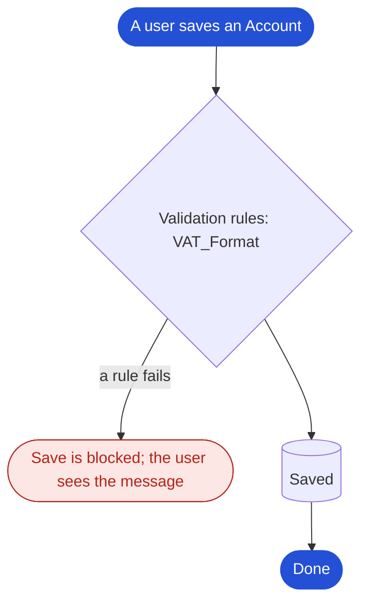

| Step | What runs |
| --- | --- |
| Before-save flows | — |
| Before triggers | — |
| Validation rules | VAT_Format |
| Record saved (not committed) | — |
| After triggers | — |
| Workflow rules and approvals | — |
| After-save flows | — |
| Roll-up summaries to parent | — |

##### Opportunity

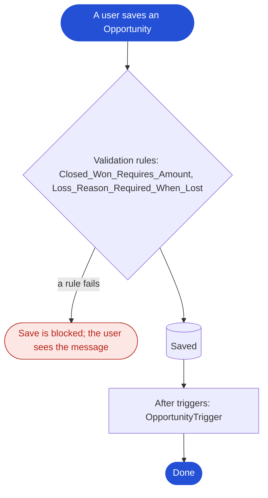

| Step | What runs |
| --- | --- |
| Before-save flows | — |
| Before triggers | — |
| Validation rules | Closed_Won_Requires_Amount, Loss_Reason_Required_When_Lost |
| Record saved (not committed) | — |
| After triggers | OpportunityTrigger |
| Workflow rules and approvals | — |
| After-save flows | — |
| Roll-up summaries to parent | — |

##### Promotion Claim

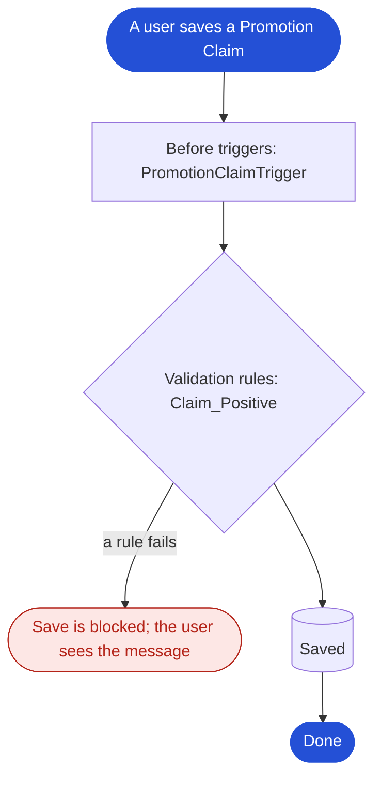

| Step | What runs |
| --- | --- |
| Before-save flows | — |
| Before triggers | PromotionClaimTrigger |
| Validation rules | Claim_Positive |
| Record saved (not committed) | — |
| After triggers | — |
| Workflow rules and approvals | — |
| After-save flows | — |
| Roll-up summaries to parent | — |

##### Shelf Check

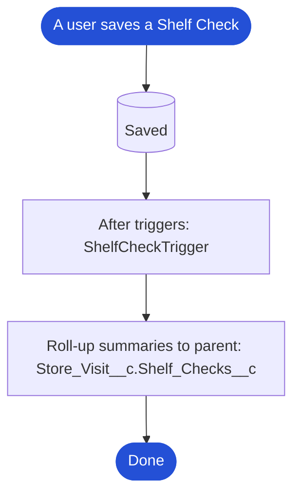

| Step | What runs |
| --- | --- |
| Before-save flows | — |
| Before triggers | — |
| Validation rules | — |
| Record saved (not committed) | — |
| After triggers | ShelfCheckTrigger |
| Workflow rules and approvals | — |
| After-save flows | — |
| Roll-up summaries to parent | Store_Visit__c.Shelf_Checks__c |

##### Store Visit

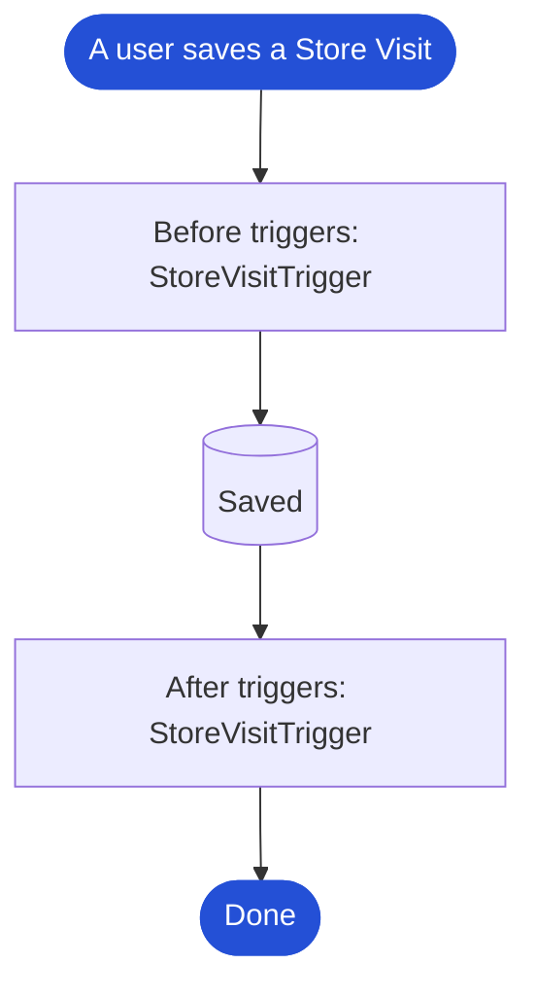

| Step | What runs |
| --- | --- |
| Before-save flows | — |
| Before triggers | StoreVisitTrigger |
| Validation rules | — |
| Record saved (not committed) | — |
| After triggers | StoreVisitTrigger |
| Workflow rules and approvals | — |
| After-save flows | — |
| Roll-up summaries to parent | — |

##### Subscription Line

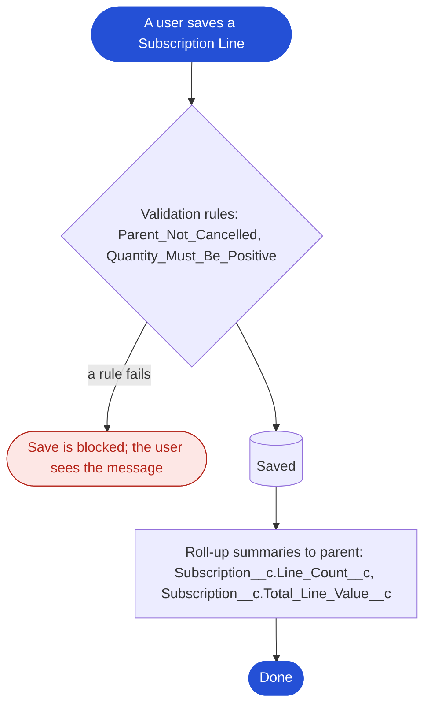

| Step | What runs |
| --- | --- |
| Before-save flows | — |
| Before triggers | — |
| Validation rules | Parent_Not_Cancelled, Quantity_Must_Be_Positive |
| Record saved (not committed) | — |
| After triggers | — |
| Workflow rules and approvals | — |
| After-save flows | — |
| Roll-up summaries to parent | Subscription__c.Line_Count__c, Subscription__c.Total_Line_Value__c |

##### Subscription

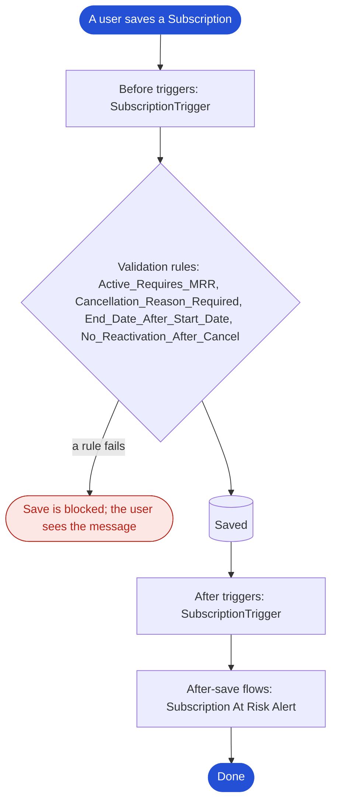

| Step | What runs |
| --- | --- |
| Before-save flows | — |
| Before triggers | SubscriptionTrigger |
| Validation rules | Active_Requires_MRR, Cancellation_Reason_Required, End_Date_After_Start_Date, No_Reactivation_After_Cancel |
| Record saved (not committed) | — |
| After triggers | SubscriptionTrigger |
| Workflow rules and approvals | — |
| After-save flows | Subscription At Risk Alert |
| Roll-up summaries to parent | — |

##### Trade Fund

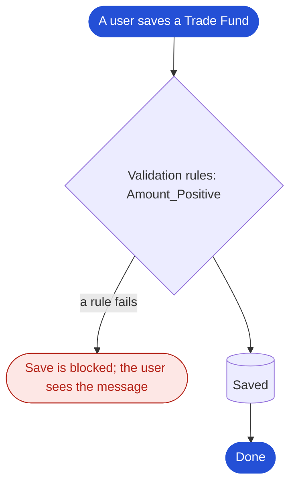

| Step | What runs |
| --- | --- |
| Before-save flows | — |
| Before triggers | — |
| Validation rules | Amount_Positive |
| Record saved (not committed) | — |
| After triggers | — |
| Workflow rules and approvals | — |
| After-save flows | — |
| Roll-up summaries to parent | — |

##### Trade Promotion

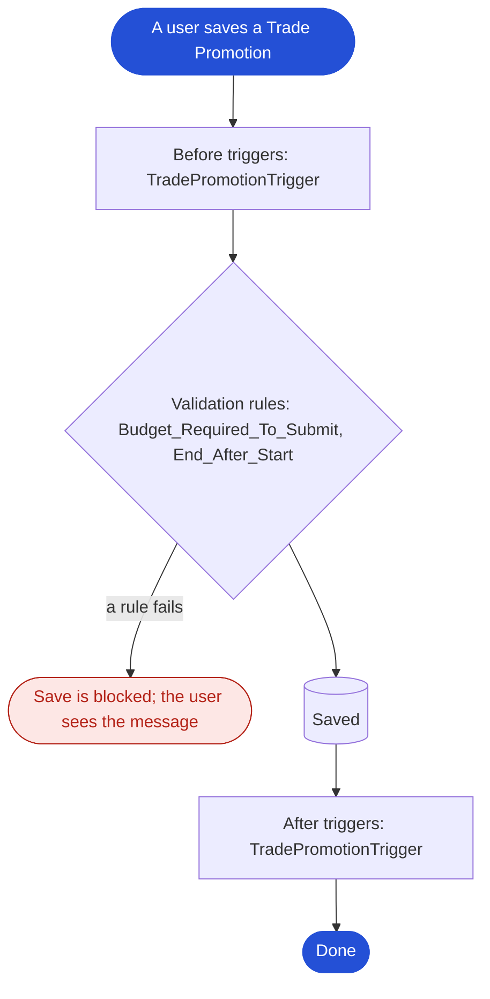

| Step | What runs |
| --- | --- |
| Before-save flows | — |
| Before triggers | TradePromotionTrigger |
| Validation rules | Budget_Required_To_Submit, End_After_Start |
| Record saved (not committed) | — |
| After triggers | TradePromotionTrigger |
| Workflow rules and approvals | — |
| After-save flows | — |
| Roll-up summaries to parent | — |

##### Visit Task

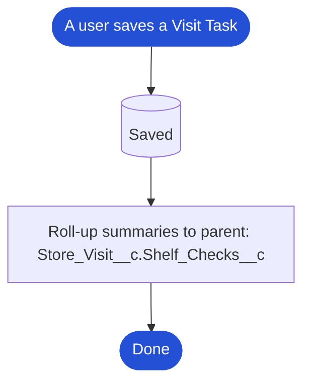

| Step | What runs |
| --- | --- |
| Before-save flows | — |
| Before triggers | — |
| Validation rules | — |
| Record saved (not committed) | — |
| After triggers | — |
| Workflow rules and approvals | — |
| After-save flows | — |
| Roll-up summaries to parent | Store_Visit__c.Shelf_Checks__c |

#### Flows built in this org

##### Subscription At Risk Alert (`Subscription_At_Risk_Alert`)

AutoLaunchedFlow · RecordAfterSave on Subscription · active

Raises a check-in task when an active subscription drops below the at-risk health threshold.

Starts when: `AND( {!$Record.Health_Score__c} < 50, ISPICKVAL({!$Record.Status__c}, "Active") )`

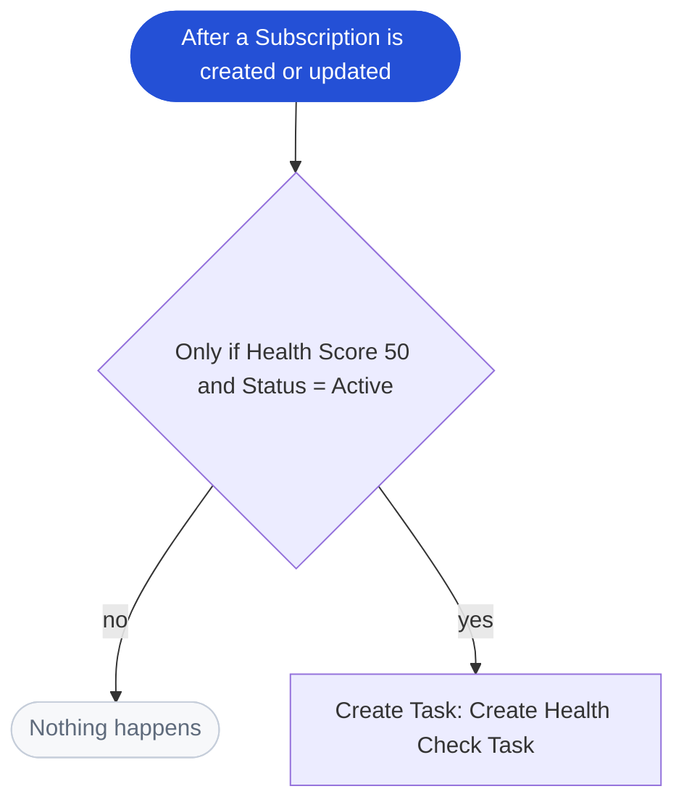

#### Approval processes

_None._

#### Scheduled processing

| Job | Type | State | Schedule | Next run |
| --- | --- | --- | --- | --- |
| System job (type K) 1 | System job (type K) | WAITING | 0 54 10 ? * 1,2,3,4,5,6,7 | 2026-10-14 |
| System job (type P) 1 | System job (type P) | WAITING | 0 59 6,11,16,23 ? * * | 2026-10-14 |
| System job (type S) 1 | System job (type S) | WAITING | 0 0 5,20 ? * * | 2026-10-15 |

#### Workflow rules

_None._

#### Apex triggers

| Trigger | Object | Runs on | Active | Lines | Coverage |
| --- | --- | --- | --- | --- | --- |
| OpportunityTrigger | Opportunity | after update | yes | 3 | 100% |
| PromotionClaimTrigger | Promotion_Claim__c | before insert, before update | yes | 4 | 0% |
| RollupSummariesTrigger | dlrs__LookupRollupSummary__c | before insert, after insert, before update, after update, before delete, after delete | yes |  |  |
| ShelfCheckTrigger | Shelf_Check__c | after insert, after update, after delete | yes | 5 | 0% |
| StoreVisitTrigger | Store_Visit__c | after insert, before update, after update | yes | 5 | 0% |
| SubscriptionTrigger | Subscription__c | before insert, before update, after update | yes | 7 | 100% |
| TradePromotionTrigger | Trade_Promotion__c | before insert, after insert, before update, after update | yes | 19 | 0% |

#### Flows provided by Salesforce or packages

115 flows (templates for features such as appointments, service and approvals). Active: 91.

### A.6 Code inventory

| Kind | Own | From packages or Salesforce |
| --- | --- | --- |
| Apex classes | 13 | 138 |
| Apex triggers | 6 | 1 |
| Lightning web components | 0 | 15 |
| Aura components | 0 | 2 |
| Visualforce pages | 0 | 14 |

#### Apex classes built in this org

| Class | Kind | API | Lines | Coverage | Notes |
| --- | --- | --- | --- | --- | --- |
| OpportunityService | Class | 67 | 50 | 87% |  |
| PromotionClaimService | Class | 67 | 23 | 0% |  |
| PromotionClaimServiceTest | Test | 67 | 27 |  |  |
| StoreVisitLegacyHandler | Class | 67 | 9 | 0% |  |
| StoreVisitService | Class | 67 | 64 | 0% |  |
| StoreVisitServiceTest | Test | 67 | 47 |  |  |
| SubscriptionRenewalBatch | Class | 67 | 41 | 89% | batch, scheduled |
| SubscriptionService | Class | 67 | 70 | 81% |  |
| SubscriptionServiceTest | Test | 67 | 104 |  |  |
| TradePromotionApproval | Class | 67 | 10 | 0% |  |
| TradePromotionApprovalTest | Test | 67 | 33 |  |  |
| TradePromotionService | Class | 67 | 99 | 0% | calls out |
| TradePromotionServiceTest | Test | 67 | 61 |  |  |

#### Lightning components and Visualforce built in this org

_None._

### A.7 Installed packages

| Package | Namespace | Version | Objects | Fields | Apex classes |
| --- | --- | --- | --- | --- | --- |
| Declarative Lookup Rollup Summaries Tool | dlrs | 2.25 | 9 | 72 | 134 |
| Developer Edition | devedapp | 0.9 | 0 | 0 | 4 |

#### Configuration held as records

Packages and Salesforce features keep much of their set-up as records (templates, definitions, settings). The code stays hidden; this set-up shows how each feature is configured and used.

| Owner | Set-up object | Records | Examples |
| --- | --- | --- | --- |
| Declarative Lookup Rollup Summaries Tool | dlrs__DeclarativeLookupRollupSummaries__c | 0 |  |
| Declarative Lookup Rollup Summaries Tool | dlrs__LookupRollupCalculateJob__c | 0 |  |
| Declarative Lookup Rollup Summaries Tool | dlrs__LookupRollupSummary__c | 2 | Account Won Opportunity Amount, Account Won Opportunity Count |
| Declarative Lookup Rollup Summaries Tool | dlrs__LookupRollupSummary2__mdt | 0 |  |
| Declarative Lookup Rollup Summaries Tool | dlrs__LookupRollupSummaryLog__c | 0 |  |
| Declarative Lookup Rollup Summaries Tool | dlrs__LookupRollupSummaryScheduleItems__c | 0 |  |
| Salesforce feature | ProductCategory | 0 |  |

### A.8 Security model

#### Org-wide defaults

| Object | Internal | External |
| --- | --- | --- |
| Account | ReadWrite | Private |
| Campaign | FullAccess | Private |
| Case | ReadWriteTransfer | Private |
| Contact | ReadWrite | Private |
| Contract | ReadWrite | Private |
| Event | Private | Private |
| Lead | ReadWriteTransfer | Private |
| Opportunity | ReadWrite | Private |
| OpportunityLineItem | ReadWrite | ReadWrite |
| Order | ReadWrite | Private |
| OrderItem | ReadWrite | ReadWrite |
| Pricebook2 | ReadSelect | ReadSelect |
| PricebookEntry | ReadWrite | ReadWrite |
| Product2 | ReadWrite | ReadWrite |
| Promotion_Claim__c | ReadWrite | Private |
| Promotion_Product__c | ControlledByParent | ControlledByParent |
| Sales_Target__c | ReadWrite | Private |
| Shelf_Check__c | ControlledByParent | ControlledByParent |
| Store_Assortment__c | ReadWrite | Private |
| Store_Visit__c | ReadWrite | Private |
| Subscription_Line__c | ControlledByParent | ControlledByParent |
| Subscription__c | ControlledByParent | ControlledByParent |
| Task | Private | Private |
| Trade_Fund__c | ReadWrite | Private |
| Trade_Promotion__c | ReadWrite | Private |
| User | Read | Private |
| Visit_Task__c | ControlledByParent | ControlledByParent |
| dlrs__LookupChild__c | Private | Private |
| dlrs__LookupParent__c | Read | Private |
| dlrs__LookupRollupCalculateJob__c | ReadWrite | Private |
| dlrs__LookupRollupSummaryLog__c | ReadWrite | Private |
| dlrs__LookupRollupSummaryScheduleItems__c | ReadWrite | Private |
| dlrs__LookupRollupSummary__c | ReadWrite | Private |

#### Profiles with active users

| Profile | Licence | Users |
| --- | --- | --- |
| Analytics Cloud Integration User | Analytics Cloud Integration User | 1 |
| Analytics Cloud Security User | Analytics Cloud Integration User | 1 |
| System Administrator | Salesforce | 2 |

44 profiles in total.

#### Permission sets

| Permission set | Label | Origin | Assignments |
| --- | --- | --- | --- |
| AgentforceServiceAgentBuilder | Agentforce Service Agent Configuration | Provided by Salesforce | 1 |
| Brightwell_Sales | Brightwell Sales | Custom (built in this org) | 1 |
| CopilotSalesforceAdmin | Agentforce Default Admin | Provided by Salesforce | 1 |
| Developer_Edition | Developer Edition | Installed package | 1 |
| DLRS_Rollup_Fields | DLRS Rollup Fields | Custom (built in this org) | 1 |
| EinsteinGPTPromptTemplateManager | Prompt Template Manager | Provided by Salesforce | 1 |
| Experience_Profile_Manager | Experience Profile Manager | Custom (built in this org) | 1 |
| GenieAdmin | Data Cloud Architect | Provided by Salesforce | 2 |
| ServiceUserPsl | Service Cloud User | Provided by Salesforce | 1 |
| sfdc_platformmetabolism_slagent | Platform Metabolism Slagent Permset | Provided by Salesforce | 1 |
| sfdc_scrt2 | SCRT2 Integration User | Provided by Salesforce | 1 |
| Subscription_Management | Subscription Management | Custom (built in this org) | 1 |

Permission set groups: 22. Roles: 18, hierarchy depth 5. Sharing rules: 0.

#### Field-level access to custom fields

How many profiles and permission sets can read and edit each custom field.

| Field | Can read | Can edit | Through profiles | Through permission sets |
| --- | --- | --- | --- | --- |
| Account.Active__c | 43 | 42 | 42 | 1 |
| Account.Customer_Channel__c | 2 | 1 | 0 | 2 |
| Account.Customer_Tier__c | 2 | 1 | 0 | 2 |
| Account.CustomerPriority__c | 43 | 42 | 42 | 1 |
| Account.Legacy_ERP_Code__c | 2 | 1 | 0 | 2 |
| Account.Market__c | 2 | 1 | 0 | 2 |
| Account.NumberofLocations__c | 43 | 42 | 42 | 1 |
| Account.Old_Segment__c | 2 | 1 | 0 | 2 |
| Account.SLA__c | 43 | 42 | 42 | 1 |
| Account.SLAExpirationDate__c | 43 | 42 | 42 | 1 |
| Account.SLASerialNumber__c | 43 | 42 | 42 | 1 |
| Account.Store_Format__c | 2 | 1 | 0 | 2 |
| Account.UpsellOpportunity__c | 43 | 42 | 42 | 1 |
| Account.VAT_Number__c | 2 | 1 | 0 | 2 |
| Account.Won_Opportunity_Amount__c | 2 | 1 | 0 | 2 |
| Account.Won_Opportunity_Count__c | 2 | 1 | 0 | 2 |
| Case.EngineeringReqNumber__c | 40 | 40 | 40 | 0 |
| Case.PotentialLiability__c | 42 | 42 | 42 | 0 |
| Case.Product__c | 42 | 42 | 42 | 0 |
| Case.SLAViolation__c | 42 | 42 | 42 | 0 |
| Contact.Consent_Date__c | 2 | 1 | 0 | 2 |
| Contact.GDPR_Consent__c | 2 | 1 | 0 | 2 |
| Contact.Languages__c | 43 | 42 | 42 | 1 |
| Contact.Level__c | 43 | 42 | 42 | 1 |
| Lead.CurrentGenerators__c | 42 | 42 | 42 | 0 |
| Lead.NumberofLocations__c | 41 | 41 | 41 | 0 |
| Lead.Primary__c | 40 | 40 | 40 | 0 |
| Lead.ProductInterest__c | 42 | 42 | 42 | 0 |
| Lead.SICCode__c | 40 | 40 | 40 | 0 |
| Opportunity.CurrentGenerators__c | 42 | 42 | 42 | 0 |
| Opportunity.DeliveryInstallationStatus__c | 41 | 41 | 41 | 0 |
| Opportunity.Loss_Reason__c | 1 | 1 | 0 | 1 |
| Opportunity.MainCompetitors__c | 42 | 42 | 42 | 0 |
| Opportunity.OrderNumber__c | 41 | 41 | 41 | 0 |
| Opportunity.TrackingNumber__c | 41 | 41 | 41 | 0 |
| Product2.Brand__c | 1 | 1 | 0 | 1 |
| Product2.Case_Size__c | 1 | 1 | 0 | 1 |
| Product2.Category__c | 1 | 1 | 0 | 1 |
| Product2.EAN__c | 1 | 1 | 0 | 1 |
| Promotion_Claim__c.Account__c | 1 | 1 | 0 | 1 |
| Promotion_Claim__c.Claim_Amount__c | 1 | 1 | 0 | 1 |
| Promotion_Claim__c.Invoice_Number__c | 1 | 1 | 0 | 1 |
| Promotion_Claim__c.Status__c | 1 | 1 | 0 | 1 |
| Promotion_Claim__c.Trade_Promotion__c | 1 | 1 | 0 | 1 |
| Promotion_Product__c.Discount_Pct__c | 1 | 1 | 0 | 1 |
| Promotion_Product__c.Product__c | 1 | 1 | 0 | 1 |
| Promotion_Product__c.Trade_Promotion__c | 0 | 0 | 0 | 0 |
| Sales_Target__c.Account__c | 1 | 1 | 0 | 1 |
| Sales_Target__c.Category__c | 1 | 1 | 0 | 1 |
| Sales_Target__c.Period_Start__c | 0 | 0 | 0 | 0 |
| Sales_Target__c.Target_Amount__c | 1 | 1 | 0 | 1 |
| Shelf_Check__c.Facings__c | 1 | 1 | 0 | 1 |
| Shelf_Check__c.On_Shelf__c | 1 | 1 | 0 | 1 |
| Shelf_Check__c.Product__c | 1 | 1 | 0 | 1 |
| Shelf_Check__c.Shelf_Price__c | 1 | 1 | 0 | 1 |
| Shelf_Check__c.Store_Visit__c | 0 | 0 | 0 | 0 |
| Store_Assortment__c.Account__c | 1 | 1 | 0 | 1 |
| Store_Assortment__c.Must_Stock__c | 1 | 1 | 0 | 1 |
| Store_Assortment__c.Product__c | 1 | 1 | 0 | 1 |
| Store_Visit__c.Account__c | 1 | 1 | 0 | 1 |
| Store_Visit__c.Check_In_Latitude__c | 1 | 1 | 0 | 1 |
| Store_Visit__c.Check_In_Longitude__c | 1 | 1 | 0 | 1 |
| Store_Visit__c.Checked_In__c | 1 | 1 | 0 | 1 |
| Store_Visit__c.Compliance_Pct__c | 1 | 1 | 0 | 1 |
| Store_Visit__c.Notes__c | 1 | 1 | 0 | 1 |
| Store_Visit__c.Out_Of_Stocks__c | 1 | 1 | 0 | 1 |
| Store_Visit__c.Shelf_Checks__c | 1 | 0 | 0 | 1 |
| Store_Visit__c.Status__c | 1 | 1 | 0 | 1 |
| Store_Visit__c.Visit_Date__c | 0 | 0 | 0 | 0 |
| Store_Visit__c.Visit_Type__c | 1 | 1 | 0 | 1 |
| Subscription_Line__c.Account_Name__c | 1 | 0 | 0 | 1 |
| Subscription_Line__c.Line_Total__c | 1 | 0 | 0 | 1 |
| Subscription_Line__c.Product__c | 1 | 1 | 0 | 1 |
| Subscription_Line__c.Quantity__c | 0 | 0 | 0 | 0 |
| Subscription_Line__c.Subscription__c | 0 | 0 | 0 | 0 |
| Subscription_Line__c.Unit_Price__c | 0 | 0 | 0 | 0 |
| Subscription__c.Account__c | 0 | 0 | 0 | 0 |
| Subscription__c.Annual_Value__c | 1 | 0 | 0 | 1 |
| Subscription__c.Auto_Renew__c | 1 | 1 | 0 | 1 |
| Subscription__c.Cancellation_Reason__c | 1 | 1 | 0 | 1 |
| Subscription__c.Days_To_Renewal__c | 1 | 0 | 0 | 1 |
| Subscription__c.End_Date__c | 0 | 0 | 0 | 0 |
| Subscription__c.Health_Score__c | 1 | 1 | 0 | 1 |
| Subscription__c.Line_Count__c | 1 | 0 | 0 | 1 |
| Subscription__c.MRR__c | 1 | 1 | 0 | 1 |
| Subscription__c.Primary_Contact__c | 1 | 1 | 0 | 1 |
| Subscription__c.Source_Opportunity__c | 1 | 1 | 0 | 1 |
| Subscription__c.Start_Date__c | 0 | 0 | 0 | 0 |
| Subscription__c.Status__c | 0 | 0 | 0 | 0 |
| Subscription__c.Term_Months__c | 1 | 1 | 0 | 1 |
| Subscription__c.Total_Line_Value__c | 1 | 0 | 0 | 1 |
| Trade_Fund__c.Account__c | 1 | 1 | 0 | 1 |
| Trade_Fund__c.Amount__c | 1 | 1 | 0 | 1 |
| Trade_Fund__c.Committed__c | 1 | 1 | 0 | 1 |
| Trade_Fund__c.Fund_Type__c | 1 | 1 | 0 | 1 |
| Trade_Fund__c.Status__c | 1 | 1 | 0 | 1 |
| Trade_Fund__c.Year__c | 1 | 1 | 0 | 1 |
| Trade_Promotion__c.Account__c | 1 | 1 | 0 | 1 |
| Trade_Promotion__c.Actual_Spend__c | 1 | 1 | 0 | 1 |
| Trade_Promotion__c.Actual_Volume__c | 1 | 1 | 0 | 1 |
| Trade_Promotion__c.Baseline_Volume__c | 1 | 1 | 0 | 1 |
| Trade_Promotion__c.Budget__c | 1 | 1 | 0 | 1 |
| Trade_Promotion__c.End_Date__c | 0 | 0 | 0 | 0 |
| Trade_Promotion__c.ERP_Synced__c | 1 | 1 | 0 | 1 |
| Trade_Promotion__c.Mechanic__c | 1 | 1 | 0 | 1 |
| Trade_Promotion__c.ROI__c | 1 | 1 | 0 | 1 |
| Trade_Promotion__c.Start_Date__c | 0 | 0 | 0 | 0 |
| Trade_Promotion__c.Status__c | 1 | 1 | 0 | 1 |
| Trade_Promotion__c.Trade_Fund__c | 1 | 1 | 0 | 1 |
| Trade_Promotion__c.Uplift_Pct__c | 1 | 1 | 0 | 1 |
| Visit_Task__c.Done__c | 1 | 1 | 0 | 1 |
| Visit_Task__c.Product__c | 1 | 1 | 0 | 1 |
| Visit_Task__c.Result__c | 1 | 1 | 0 | 1 |
| Visit_Task__c.Store_Visit__c | 0 | 0 | 0 | 0 |
| Visit_Task__c.Task_Type__c | 1 | 1 | 0 | 1 |

### A.9 Integrations

#### Outbound

| Kind | Name | Host |
| --- | --- | --- |
| Remote site | ApexDevNet | www.apexdevnet.com |
| Apex callout | TradePromotionService |  |

#### Inbound (logins in the last 90 days)

| Application | Login type | Logins |
| --- | --- | --- |
| Salesforce CLI | Remote Access 2.0 | 35 |
| Browser | Application | 12 |
| Browser | Remote Access Client | 5 |
| orgfarm_app_1 | Remote Access 2.0 | 3 |
| Trailhead Connected App | Remote Access 2.0 | 2 |

Connected apps: 1.

### A.10 User interface

#### Apps

| App | Navigation | Origin |
| --- | --- | --- |
| Agentforce Studio | Console | Provided by Salesforce |
| AIWorkbench | Console | Provided by Salesforce |
| AllTabSet |  | Provided by Salesforce |
| appexchange default |  | Provided by Salesforce |
| AppLauncher |  | Provided by Salesforce |
| Approvals | Console | Provided by Salesforce |
| Audience360 | Standard | Provided by Salesforce |
| Collaboration |  | Provided by Salesforce |
| Community |  | Provided by Salesforce |
| Content |  | Provided by Salesforce |
| Data Manager | Standard | Provided by Salesforce |
| Declarative Lookup Rollup Summaries |  | Installed package |
| Declarative Lookup Rollup Summaries-DLRS | Standard | Installed package |
| Developer Edition | Standard | Installed package |
| DevOps Center | Standard | Provided by Salesforce |
| FlowsApp | Standard | Provided by Salesforce |
| Insights |  | Provided by Salesforce |
| LightningBolt | Standard | Provided by Salesforce |
| LightningInstrumentation | Standard | Provided by Salesforce |
| Marketing |  | Provided by Salesforce |
| MSJ App | Console | Provided by Salesforce |
| Queue Management | Standard | Provided by Salesforce |
| Sales | Standard | Provided by Salesforce |
| Sales Cloud Mobile | Standard | Provided by Salesforce |
| Sales Console | Console | Provided by Salesforce |
| salesforce |  | Provided by Salesforce |
| Salesforce CMS | Console | Provided by Salesforce |
| Salesforce Scheduler Setup | Standard | Provided by Salesforce |
| Service Console | Console | Provided by Salesforce |
| ServiceCloudConsole |  | Provided by Salesforce |
| Shield | Standard | Provided by Salesforce |
| Sites |  | Provided by Salesforce |
| Subscription Management | Console | Provided by Salesforce |
| supportforce |  | Provided by Salesforce |

#### Lightning pages built in this org

| Page | Type | Object |
| --- | --- | --- |
| Academic Operations App Utility Bar | UtilityBar |  |
| Advertising Inventory Calendar App Utility Bar | UtilityBar |  |
| Command Center App Utility Bar | UtilityBar |  |
| ContactCenter App Utility Bar | UtilityBar |  |
| CrisisCenter App Utility Bar | UtilityBar |  |
| Policy Center App Utility Bar | UtilityBar |  |
| Business Rules Engine App Utility Bar | UtilityBar |  |
| FlowsApp App Utility Bar | UtilityBar |  |
| Sales App Utility Bar | UtilityBar |  |
| Sales Console App Utility Bar | UtilityBar |  |
| Service Console App Utility Bar | UtilityBar |  |
| Media Ad Sales Management App Utility Bar | UtilityBar |  |
| Subscription Management App Utility Bar | UtilityBar |  |
| Sales Cloud Mobile App Utility Bar | UtilityBar |  |

#### Record types and page layouts

| Object | Record types | Page layouts |
| --- | --- | --- |
| Account | — | 4 |
| Campaign | — | 1 |
| Case | — | 4 |
| Contact | — | 4 |
| Contract | — | 1 |
| Event | — | 1 |
| Lead | — | 4 |
| Opportunity | — | 4 |
| OpportunityLineItem | — | 1 |
| Order | — | 1 |
| OrderItem | — | 1 |
| Pricebook2 | — | 1 |
| PricebookEntry | — | 1 |
| Product2 | — | 1 |
| Promotion_Claim__c | — | 1 |
| Promotion_Product__c | — | 1 |
| Sales_Target__c | — | 1 |
| Shelf_Check__c | — | 1 |
| Store_Assortment__c | — | 1 |
| Store_Visit__c | — | 1 |
| Subscription_Line__c | — | 1 |
| Subscription__c | — | 1 |
| Task | — | 1 |
| Trade_Fund__c | — | 1 |
| Trade_Promotion__c | — | 1 |
| User | — | 1 |
| Visit_Task__c | — | 1 |
| dlrs__LookupChild__c | — | 1 |
| dlrs__LookupParent__c | — | 1 |
| dlrs__LookupRollupCalculateJob__c | — | 1 |
| dlrs__LookupRollupSummaryLog__c | — | 1 |
| dlrs__LookupRollupSummaryScheduleItems__c | — | 1 |
| dlrs__LookupRollupSummary__c | — | 1 |

### A.11 Reports and usage

| Measure | Value |
| --- | --- |
| Active users | 4 |
| Reports | 30 |
| Reports run in the last 90 days | 0 |
| Dashboards | 2 |
| Email templates | 28 |

#### Records per object

| Object | Records |
| --- | --- |
| Shelf_Check__c | 378 |
| Visit_Task__c | 336 |
| Store_Visit__c | 252 |
| Subscription_Line__c | 219 |
| Store_Assortment__c | 168 |
| Subscription__c | 107 |
| Account | 78 |
| Promotion_Product__c | 56 |
| Trade_Fund__c | 56 |
| Task | 49 |
| PricebookEntry | 34 |
| Opportunity | 31 |
| Sales_Target__c | 28 |
| Trade_Promotion__c | 28 |
| Product2 | 27 |
| Case | 26 |
| Lead | 22 |
| Contact | 20 |
| Promotion_Claim__c | 9 |
| User | 8 |
| Campaign | 4 |
| Pricebook2 | 2 |
| dlrs__LookupRollupSummary__c | 2 |

#### Report folders

- Enablement Dashboard Reports Spring '24
- Enablement Dashboard Reports Summer '24
- Public Reports

### A.12 Technical debt

| Kind | Component | Why |
| --- | --- | --- |
| Low test coverage | PromotionClaimService | 0% covered |
| Low test coverage | PromotionClaimTrigger | 0% covered |
| Low test coverage | ShelfCheckTrigger | 0% covered |
| Low test coverage | StoreVisitLegacyHandler | 0% covered |
| Low test coverage | StoreVisitService | 0% covered |
| Low test coverage | StoreVisitTrigger | 0% covered |
| Low test coverage | TradePromotionApproval | 0% covered |
| Low test coverage | TradePromotionService | 0% covered |
| Low test coverage | TradePromotionTrigger | 0% covered |
| Unused field | Account.Old_Segment__c | Filled on 0% of 78 records |
| Unused field | Contact.Consent_Date__c | Filled on 0% of 20 records |
| Unused field | Contact.GDPR_Consent__c | Filled on 0% of 20 records |
| Unused field | Trade_Promotion__c.ERP_Synced__c | Filled on 0% of 28 records |

