# High-level design: CRM platform on Azure, Subscription domain

Owner: Modelling agent · generated by `src/generators/emit-docs.js` from blueprint `49f2c22e6c8f` · regenerated whenever the org changes

Structure follows arc42; context and container views follow C4; decisions are recorded as ADRs. The platform is designed to receive every module of the Salesforce org; Subscription Management is its first domain.

## 1. Introduction and goals

|  |  |
|---|---|
| Source | Salesforce org, 505 objects described |
| Platform scope | Every module of the org, domain by domain: Core customer, Sales, Service, Subscriptions, Activities |
| First domain | Subscription, Subscription Line (pilot) |
| Reference objects | Account, Contact, Opportunity, Product |
| Target | Microsoft Azure: Container Apps, Azure Database for PostgreSQL, Service Bus, Event Hubs, API Management, Front Door, Entra ID, Key Vault, Azure Monitor |
| Data in the first domain | Account 22 · Contact 20 · Opportunity 31 · Product 17 · Subscription 107 · Subscription Line 219 |

Quality goals, in priority order: **behavioural parity** with Salesforce, **security** at least equal to the org’s, **modularity** so any module can be added or moved on its own, **availability** through a zone failure, **operability** with everything as code.

## 2. Constraints

- Each object has exactly one master at any time: Salesforce until its domain cuts over, Azure after.
- After the last wave the platform has no dependency on Salesforce.
- Salesforce record IDs are kept, so integrations, links and reports keep working.
- Platform services only (no virtual machines), in the client’s own tenant and subscription; data stays in the chosen region.
- Open standards throughout (PostgreSQL, containers, OpenAPI, CloudEvents, OpenID Connect), so the platform is portable.

## 3. Context and scope (C4 level 1)

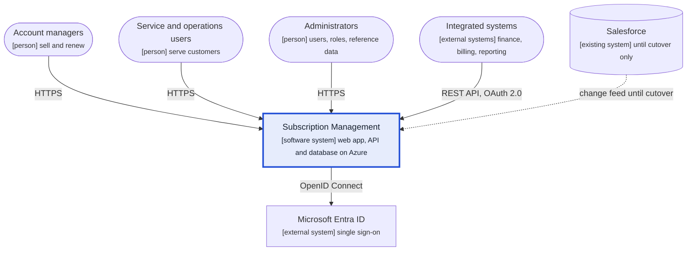

Users and integrated systems use the platform directly. Salesforce feeds changes to it only until each domain is cut over.

## 4. Solution strategy

| Concern | Approach | Decision |
|---|---|---|
| Modules | Business domains around a shared core customer domain | [ADR-015](adr/ADR-015-domains-with-shared-core.md) |
| Structure | Modular monolith: one deployable, one database, one schema per domain | [ADR-016](adr/ADR-016-modular-monolith.md) |
| Dependencies between domains | Published read views and events with a transactional outbox | [ADR-017](adr/ADR-017-outbox-events.md) |
| Coexistence with Salesforce | One master per object; change feed and gateway routing | [ADR-018](adr/ADR-018-single-master-coexistence.md) |
| Security | One access model for every domain, enforced by row-level security | [ADR-019](adr/ADR-019-central-access-model.md), [ADR-009](adr/ADR-009-roles-and-rls.md) |
| Identity | Entra ID for staff, External ID for portal users, managed identities for services | [ADR-013](adr/ADR-013-entra-id-sso.md) |
| Hosting and network | Container Apps and PostgreSQL; private endpoints; Front Door with WAF | [ADR-012](adr/ADR-012-azure-paas-hosting.md), [ADR-014](adr/ADR-014-private-networking.md) |
| Portability | Open standards; only infrastructure templates are Azure-specific | [ADR-020](adr/ADR-020-open-standards.md) |
| Records, calculations and rules | Salesforce IDs as keys; calculations and rules in the database | ADR-002 to ADR-008 |

## 5. Building block view

### 5.1 Domain map

Domains and the links between them, counted from the relationships in this org. Every domain may use the core customer domain; other links go through read views and events.

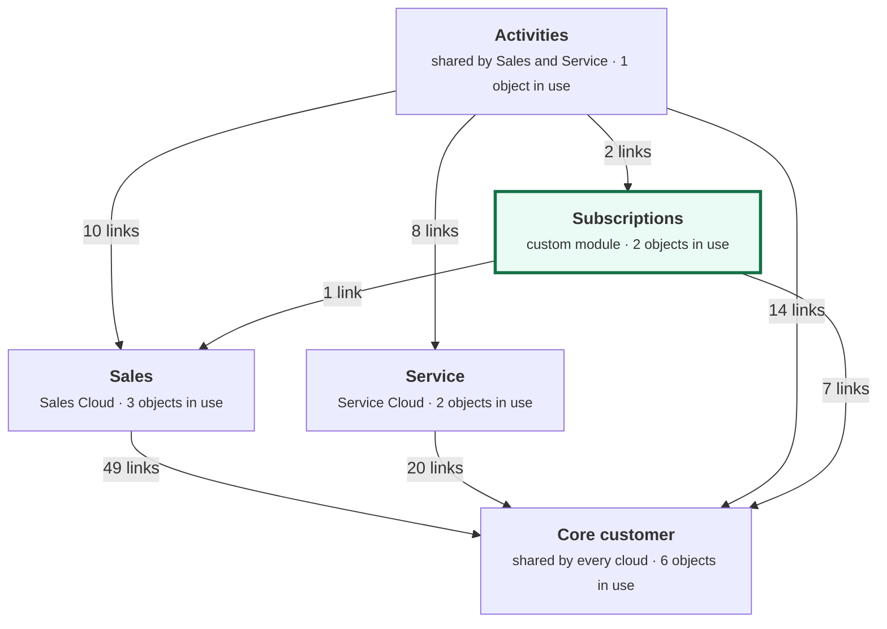

| Domain | Salesforce cloud | Objects in this org | Records | Depends on |
|---|---|---|---|---|
| Core customer | shared by every cloud | Account, Contact, User, Product, Price Book, Price Book Entry | 103 | — |
| Sales | Sales Cloud | Lead, Opportunity, Campaign | 57 | Core customer |
| Service | Service Cloud | Case, Entitlement | 27 | Core customer |
| Subscriptions | custom module | Subscription, Subscription Line | 326 | Core customer, Sales |
| Activities | shared by Sales and Service | Task | 49 | Core customer, Sales, Service, Subscriptions |
| Field service | Field Service | — | 0 | not in use in this org |

### 5.2 Containers (C4 level 2)

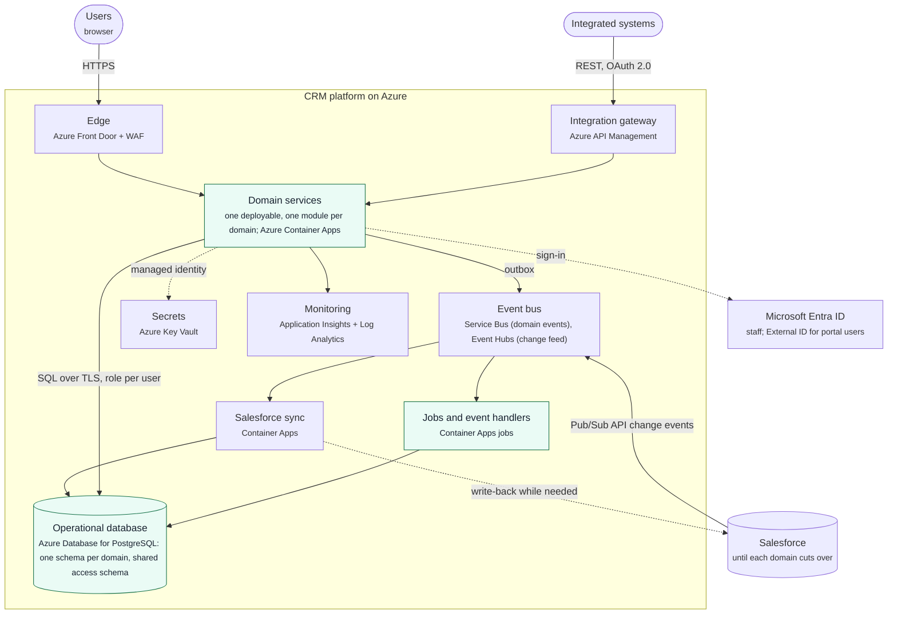

| Container | Technology | Responsibility |
|---|---|---|
| Edge | Azure Front Door Premium with WAF | Single public entry point, TLS, protection against common web attacks |
| Integration gateway | Azure API Management | Salesforce-compatible REST API for integrated systems; routes each object to its current master; OAuth 2.0, throttling, versioning |
| Domain services | Node.js on Azure Container Apps | Screens and APIs of every domain, one module per domain; sets the database role of the signed-in user on every request |
| Jobs and event handlers | Container Apps jobs | Scheduled work such as renewal reminders; consumers of domain events |
| Salesforce sync | Container Apps | Applies the Salesforce change feed to read copies; writes back while Salesforce features still need it |
| Event bus | Service Bus Premium, Event Hubs | Domain events between domains; the Salesforce change feed |
| Operational database | Azure Database for PostgreSQL, Flexible Server | One schema per domain plus the shared access schema; rules, calculations and access enforced for every client |
| Secrets and monitoring | Key Vault; Application Insights and Log Analytics | Credentials read with managed identities; traces, metrics, logs, alerts and audit |

### 5.3 Inside a domain

Every domain is built from the same template, so adding a module repeats a known pattern.

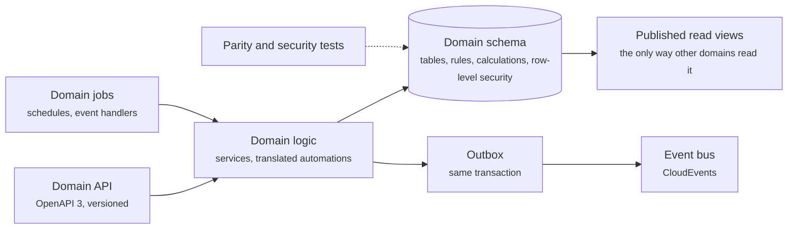

## 6. Runtime view: business processes

### 6.1 Subscription lifecycle

Statuses come from the Status picklist; the notes come from the validation rules that guard each status.

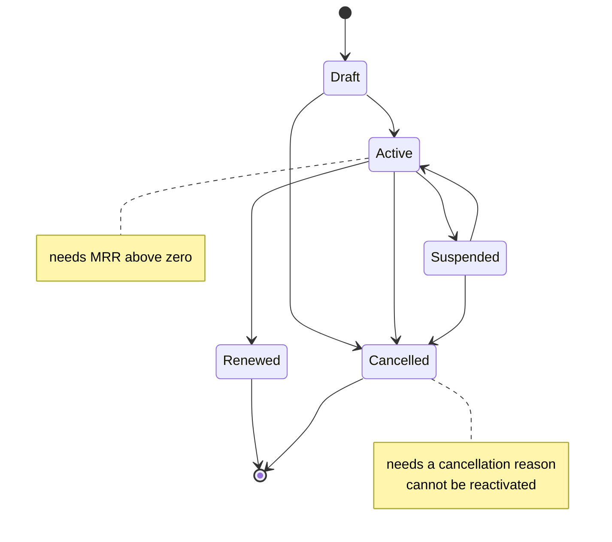

### 6.2 Won deal becomes a subscription

When an opportunity is marked Closed Won, a subscription is created for the account, once per deal. In the target, Sales publishes an "opportunity won" event and Subscriptions creates the subscription (section 6.7).

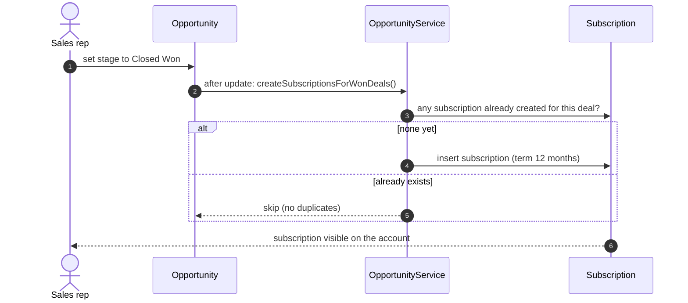

### 6.3 Saving a subscription

What happens, in Salesforce’s order, every time a subscription is saved.

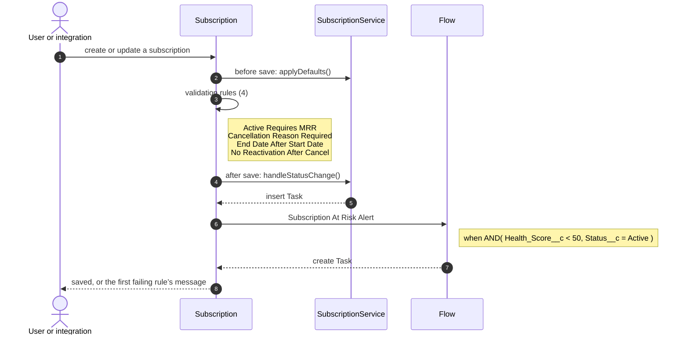

### 6.4 Subscription At Risk Alert

Raises a check-in task when an active subscription drops below the at-risk health threshold.

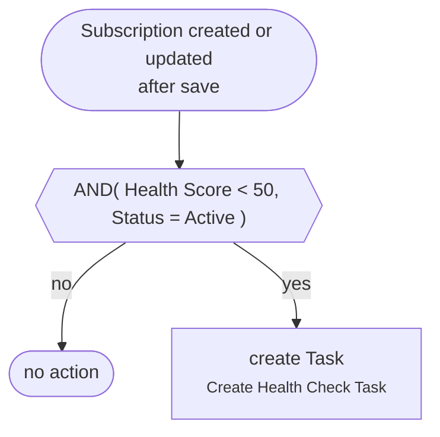

### 6.5 Renewal reminders

A scheduled job raises a renewal task before each active subscription ends.

### 6.6 Case routing and escalation

Assignment rules route each new case; escalation rules raise cases that miss their target time. These belong to the Service domain.

| Escalation rule | Applies when |
|---|---|
| 1 | BillingCountry = US; SLA = Platinum; Priority = High |
| 2 | BillingCountry = US; SLA = Platinum; Priority = Medium,Low |
| 3 | BillingCountry = US; SLA = Gold; Priority = High |
| 4 | BillingCountry = US; SLA = Gold; Priority = Medium,Low |
| 5 | BillingCountry = US; SLA = Silver |
| 6 | BillingCountry = US; SLA = Bronze |
| 7 | BillingCountry ≠ US; SLA = Gold,Platinum |
| 8 | BillingCountry ≠ US; SLA = Silver,Bronze |

### 6.7 Working alongside Salesforce

While Sales is still on Salesforce, its changes reach the platform through the change feed; once Subscriptions has moved, its changes go back to Salesforce only where Salesforce features still read them.

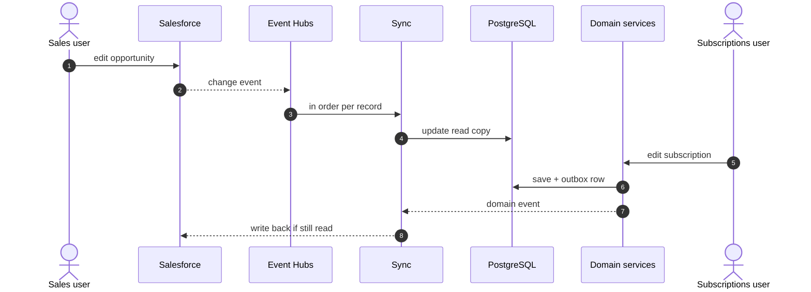

## 7. Deployment view

### 7.1 Target deployment on Azure

One region with three availability zones, a paired region for backups, and private networking in a spoke virtual network connected to the client’s landing zone. Every domain runs in the same Container Apps environment.

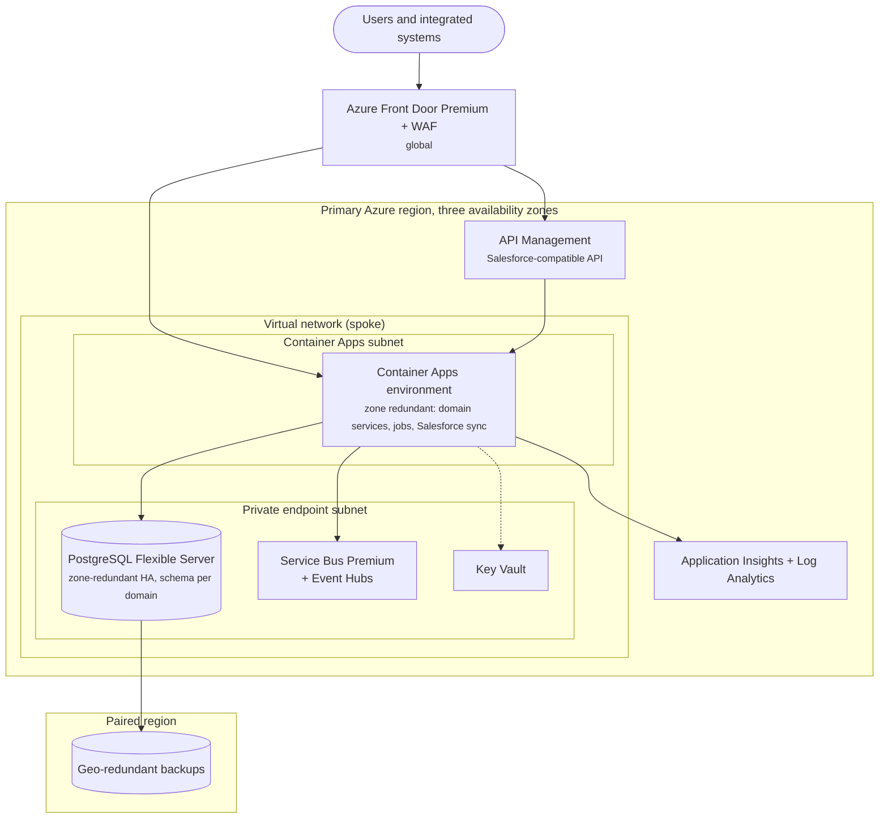

### 7.2 Services and sizing

| Component | Azure service | Production | Proof of concept today |
|---|---|---|---|
| Edge | Front Door Premium + WAF | Managed rule set, bot protection | not deployed |
| Domain services, jobs, sync | Container Apps | Dedicated workload profile, zone redundant, 2+ replicas, scale rules per app | App Service B1, single instance |
| Database | Azure Database for PostgreSQL, Flexible Server | General Purpose, zone-redundant HA, geo-redundant backups | Standard_B1ms (Burstable), 7-day backups |
| Event bus | Service Bus Premium, Event Hubs Standard | Private endpoints, geo-disaster recovery pairing | not deployed |
| Integration gateway | API Management | Standard v2, VNet integrated | not deployed |
| Secrets | Key Vault | Private endpoint, RBAC, purge protection | secrets set at deploy time |
| Identity | Entra ID, Entra External ID | Single sign-on, conditional access, managed identities | in-app sign-in |
| Monitoring | Application Insights + Log Analytics | Alerts, dashboards, 90-day retention; Microsoft Sentinel | health check |
| Infrastructure | Bicep, GitHub Actions | One template per environment: development, test, production | one Bicep template |

### 7.3 Environments and release

| Environment | Purpose | Data |
|---|---|---|
| Development | Build and unit tests | Synthetic |
| Test | Parity, security and user acceptance tests | Masked copy of production |
| Production | Live service | Live |

Each release is built once as a container image, deployed as a new revision with no traffic, smoke tested, then given the traffic; moving traffic back is the rollback. Domains release together while they share one deployable.

### 7.4 Availability and recovery

| Event | What happens | Target |
|---|---|---|
| Replica failure | Container Apps replaces the replica; others keep serving | no downtime |
| Zone failure | Replicas in other zones serve; the database fails over to its standby zone | about 2 minutes, no data loss |
| Region failure | Restore from geo-redundant backup in the paired region | RTO hours, RPO under 1 hour |
| Bad release | Move traffic back to the previous revision | minutes |

## 8. Cross-cutting concepts

### 8.1 Data model of the first domain

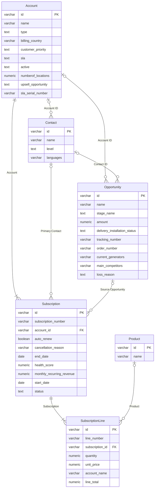

### 8.2 Security across domains

Identity, roles and sharing are one shared model. Every domain schema enforces it with row-level security that calls the same access functions, so a user sees the same records in every module and through every client of the data.

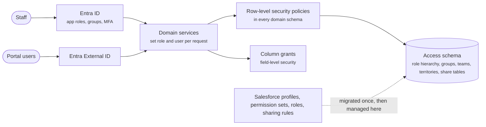

| Salesforce concept | Target |
|---|---|
| Users, single sign-on | Entra ID (staff), Entra External ID (customer and partner portals) |
| Profiles and permission sets | Entra app roles and database roles |
| Field-level security | Column grants per role |
| Org-wide defaults, role hierarchy, sharing rules, teams, territories | Access schema (groups, hierarchy closure, share tables) used by row-level security |
| Shield Platform Encryption | Encryption at rest with customer-managed keys in Key Vault |
| Field Audit Trail, setup audit | Audit tables and Log Analytics, kept as long as policy requires |
| Personal data in sandboxes | Microsoft Purview classification; masked copies in test |

#### Roles in the first domain

Each profile or permission set becomes a database role; field-level security becomes column grants; subscriptions inherit access from their account.

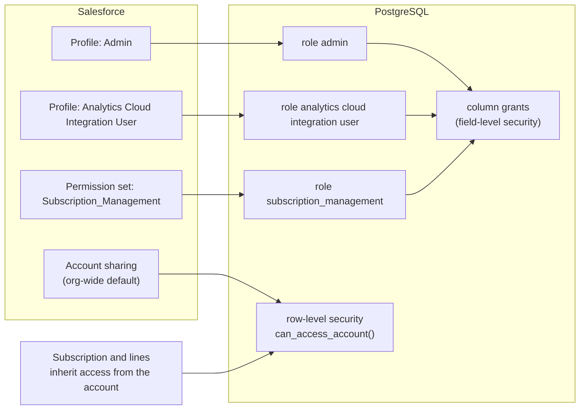

### 8.3 Migration waves and system of record

Domains move one at a time. Core customer data and every in-use domain start as read copies fed by the change feed; a domain becomes master in Azure in its wave; the core moves last, when nothing left in Salesforce writes to it.

| Wave | What happens |
|---|---|
| Wave 0: foundation | Landing zone, platform services, identity; Core customer and every in-use domain as read copies fed by the Salesforce change feed |
| Wave 1: Subscriptions (pilot) | Subscriptions becomes master in Azure; its users and integrations switch; Salesforce keeps a read-only copy |
| Wave 2: Sales | Sales becomes master in Azure; its users and integrations switch; Salesforce keeps a read-only copy |
| Wave 3: Service | Service becomes master in Azure; its users and integrations switch; Salesforce keeps a read-only copy |
| Wave 4: core and activities | Core customer and activities become master in Azure; Salesforce is read-only |
| Wave 5: decommission | Final archive taken; licences reduced at renewal |

| Domain | Wave 1 | Wave 2 | Wave 3 | Wave 4 |
|---|---|---|---|---|
| Core customer | Salesforce | Salesforce | Salesforce | Azure |
| Sales | Salesforce | Azure | Azure | Azure |
| Service | Salesforce | Salesforce | Azure | Azure |
| Subscriptions | Azure | Azure | Azure | Azure |
| Activities | Salesforce | Salesforce | Salesforce | Azure |

#### Load order in the first domain

Records load parent first, in dependency order, keeping every Salesforce record ID.

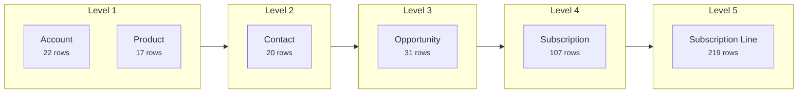

### 8.4 Integration and events

| Concern | Standard |
|---|---|
| External APIs | REST with OpenAPI 3, versioned, through API Management; a Salesforce-compatible facade so callers keep working during the move |
| Events between domains | CloudEvents on Service Bus, written through a transactional outbox; consumers are idempotent |
| Salesforce change feed | Pub/Sub API (Change Data Capture) into Event Hubs, applied in order per record |
| Reads across domains | Published read views only; no domain writes into another domain’s schema |

### 8.5 Adding the next module

1. Discover and design it as a domain; place it on the domain map and the system-of-record matrix.
2. Generate its schema, rules, access policies and API from the same template; publish its read views and events.
3. Start it as a read copy fed by the change feed; run the parity and security tests.
4. Switch its users and integrations in its wave; Salesforce keeps a read-only copy until decommission.

### 8.6 Salesforce products outside the core org

| Product | Kind | Route |
|---|---|---|
| Marketing Cloud Engagement | separate platform | replace with a marketing product, or retain and integrate through the gateway |
| Commerce Cloud (B2C) | separate platform | retain and integrate, or replace with a commerce platform |
| Data Cloud, Tableau | separate platforms | replace with Microsoft Fabric and Power BI on the new database |
| MuleSoft | integration platform | its flows move to API Management, Service Bus and Logic Apps |
| Managed packages (for example CPQ) | on the core org | settings and data taken; behaviour rebuilt, replaced or retained per package |

### 8.7 Observability

Services and jobs send traces, metrics and logs to Application Insights; Azure resources send diagnostics to Log Analytics; Microsoft Sentinel watches security events. Alerts cover availability, error rate, response time, event backlog, sync lag, database CPU and storage, and failed sign-ins.

### 8.8 Traceability

The LLD’s traceability matrix links each Salesforce element to its target design, database object and test.

## 9. Architecture decisions

| ADR | Decision |
|---|---|
| [ADR-002](adr/ADR-002-keep-salesforce-ids.md) | Keep the 18-character Salesforce ID as the primary key |
| [ADR-003](adr/ADR-003-generated-columns.md) | Row-local formulas become stored generated columns |
| [ADR-004](adr/ADR-004-cross-object-views.md) | Cross-object formulas become views |
| [ADR-005](adr/ADR-005-compute-on-read.md) | Date-dependent formulas are computed when read |
| [ADR-006](adr/ADR-006-trigger-maintained-rollups.md) | Roll-up summaries are trigger-maintained columns with a recompute job |
| [ADR-007](adr/ADR-007-check-constraints.md) | Row-local validation rules become CHECK constraints |
| [ADR-008](adr/ADR-008-guard-triggers.md) | Rules needing the previous row or a parent record become BEFORE-trigger guards |
| [ADR-009](adr/ADR-009-roles-and-rls.md) | Profiles and permission sets become roles; sharing becomes row-level security |
| [ADR-012](adr/ADR-012-azure-paas-hosting.md) | Host on Azure Container Apps and Azure Database for PostgreSQL |
| [ADR-013](adr/ADR-013-entra-id-sso.md) | Staff sign in with Entra ID, portal users with Entra External ID; services use managed identities |
| [ADR-014](adr/ADR-014-private-networking.md) | Data services are reachable only on private endpoints; the edge is Front Door with WAF |
| [ADR-015](adr/ADR-015-domains-with-shared-core.md) | The platform is split into business domains around a shared core customer domain |
| [ADR-016](adr/ADR-016-modular-monolith.md) | Start as a modular monolith: one deployable and one database, one schema per domain |
| [ADR-017](adr/ADR-017-outbox-events.md) | Domains talk through events written with a transactional outbox |
| [ADR-018](adr/ADR-018-single-master-coexistence.md) | Each object has exactly one master at any time; Salesforce and Azure coexist through the change feed |
| [ADR-019](adr/ADR-019-central-access-model.md) | One access model for every domain, enforced by row-level security |
| [ADR-020](adr/ADR-020-open-standards.md) | Build on open standards so the platform is portable |

## 10. Quality requirements

| Quality | Scenario | How it is measured |
|---|---|---|
| Parity | Every calculated value and rule outcome matches Salesforce | Automated parity tests, blocking in the release pipeline |
| Security | A user sees and edits only what Salesforce allows, in every domain | Security tests per role and domain; row-level security and column grants |
| Modularity | A new module is added without changing existing domains | Contract tests on read views and events; schema permissions between domains |
| Availability | The service keeps running through the loss of a zone | Zone-redundant services and database; failover drill each quarter |
| Performance | Screens respond in under 2 seconds at peak load; sync lag under 1 minute | Application Insights and event-backlog alerts; load test before each wave |
| Operability | Any environment can be rebuilt from source | Bicep templates and the pipeline; no manual changes |

## 11. Risks and technical debt

| Item | Status |
|---|---|
| Cross-domain saves that Salesforce made in one transaction | Listed per wave and covered by parity tests (ADR-017) |
| Activities refer to records in every domain | Activities move with the core in the last wave |
| Custom code translated | SubscriptionService.applyDefaults |
| Automations still to translate | OpportunityTrigger, SubscriptionTrigger, SubscriptionRenewalBatch |
| Production services not yet deployed | Front Door, API Management, Container Apps, event bus, private networking (section 7.2) |

## 12. Glossary

| Business term | Salesforce object | Target table |
|---|---|---|
| Account | Account | account |
| Contact | Contact | contact |
| Opportunity | Opportunity | opportunity |
| Product | Product2 | product2 |
| Subscription | Subscription__c | subscription |
| Subscription Line | Subscription_Line__c | subscription_line |
