# High-level design: Subscription domain

Owner: Modelling agent · generated by `src/generators/emit-docs.js` from blueprint `fc71a1458dce` · regenerated whenever the org changes

Structure follows arc42; context and container views follow C4; decisions are recorded as ADRs.

## 1. Introduction and goals

|  |  |
|---|---|
| Source | Salesforce org, 505 objects described |
| Domain in scope | Subscription, Subscription Line |
| Reference objects | Account, Contact, Opportunity, Product |
| Target | PostgreSQL on Azure, services and admin app, released by CI/CD |
| Data | Account 22 · Contact 20 · Opportunity 31 · Product 17 · Subscription 107 · Subscription Line 219 |

Quality goals, in priority order: **behavioural parity** with Salesforce, **security** equal to the org’s, **traceability** from every artifact to its source, **repeatability** of every phase.

## 2. Constraints

- Salesforce stays the system of record until each domain is cut over.
- Only Salesforce-supported APIs and the Salesforce CLI are used to read the org; nothing is written back.
- Generated code is reviewed at a gate before it merges; the model never sits in the runtime path.
- Items Salesforce does not hand over are handled through the gap register (`adlc/1-discover/extraction/inventory/gap-register.md`).

## 3. Context and scope (C4 level 1)

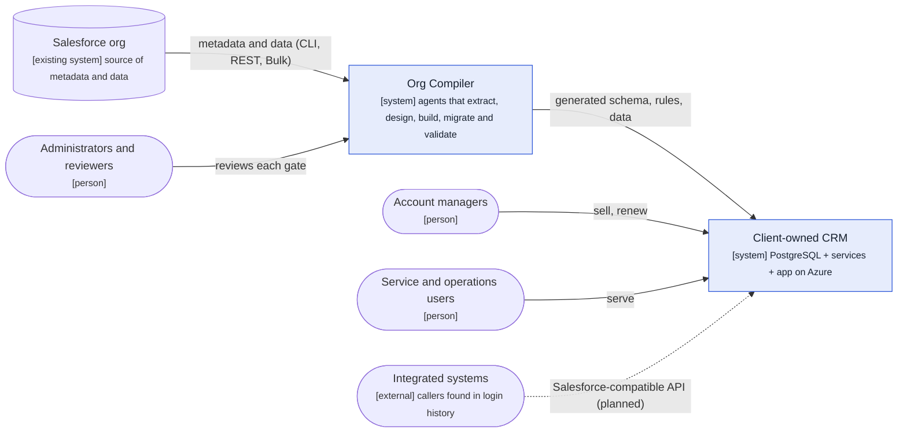

## 4. Solution strategy

| Concern | Approach | Decision |
|---|---|---|
| One source of truth | Vendor-neutral blueprint between extraction and generation | [ADR-001](adr/ADR-001-blueprint-contract.md) |
| Identity of records | Salesforce IDs kept as keys | [ADR-002](adr/ADR-002-keep-salesforce-ids.md) |
| Calculated fields | Generated columns, views, computed on read, trigger-maintained roll-ups | ADR-003 to ADR-006 |
| Business rules | CHECK constraints and BEFORE-trigger guards | ADR-007, ADR-008 |
| Access | Roles, column grants and row-level security | [ADR-009](adr/ADR-009-roles-and-rls.md) |
| Custom code | AI-translated, reviewed before merge | [ADR-010](adr/ADR-010-reviewed-llm-translation.md) |
| Acceptance | Parity with Salesforce’s own values | [ADR-011](adr/ADR-011-parity-as-acceptance.md) |

## 5. Building block view (C4 level 2)

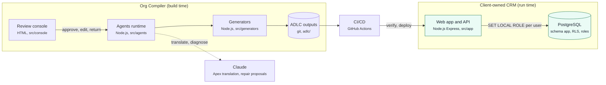

How the agents move it, phase by phase:

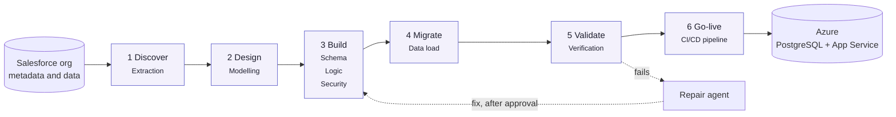

## 6. Runtime view: business processes

### 6.1 Subscription lifecycle

Statuses come from the Status picklist; the notes come from the validation rules that guard each status.

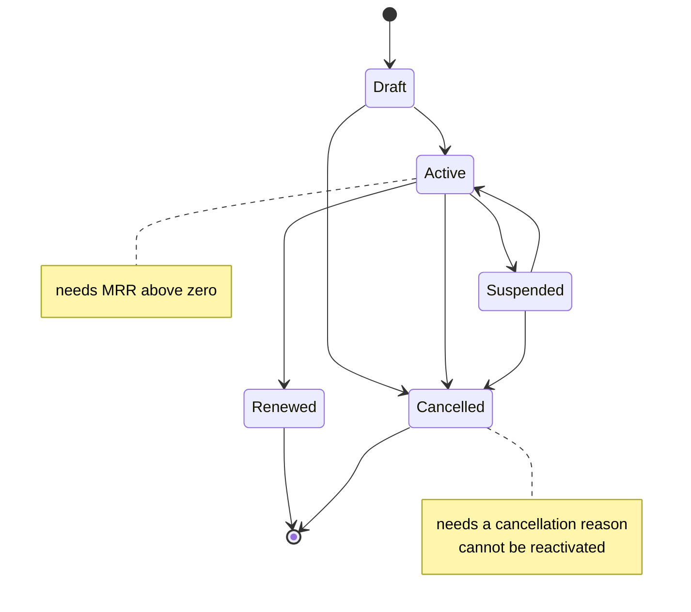

### 6.2 Won deal becomes a subscription

When an opportunity is marked Closed Won, a subscription is created for the account, once per deal.

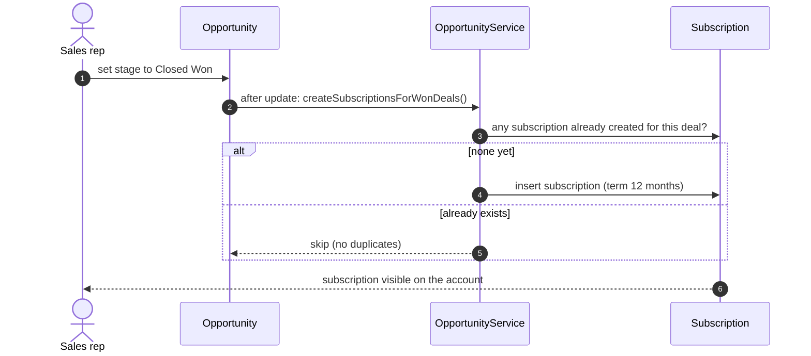

### 6.3 Saving a subscription

What happens, in Salesforce’s order, every time a subscription is saved.

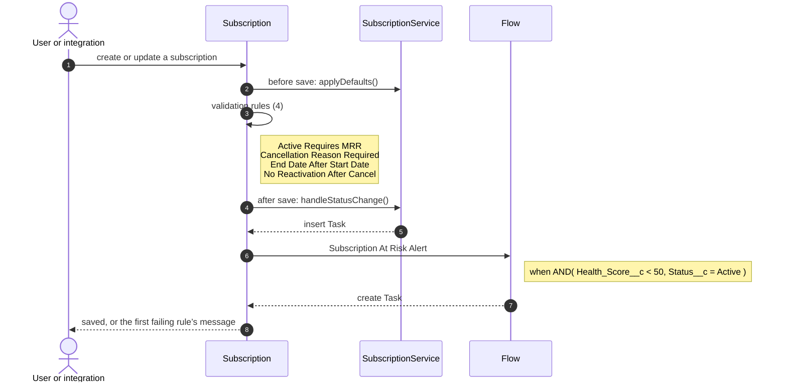

### 6.4 Subscription At Risk Alert

Raises a check-in task when an active subscription drops below the at-risk health threshold.

### 6.5 Renewal reminders

A scheduled job raises a renewal task before each active subscription ends.

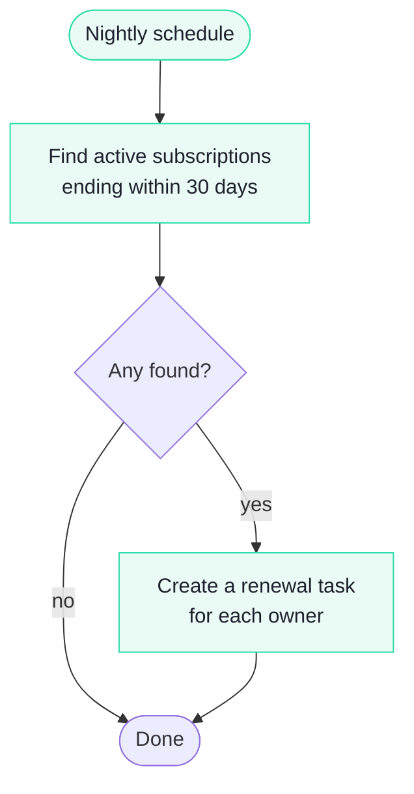

### 6.6 Case routing and escalation

Assignment rules route each new case; escalation rules raise cases that miss their target time (outside the subscription domain; listed for completeness).

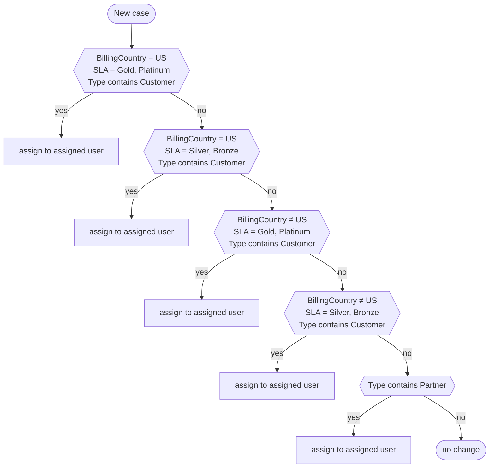

| Escalation rule | Applies when |
|---|---|
| 1 | BillingCountry = US; SLA = Platinum; Priority = High |
| 2 | BillingCountry = US; SLA = Platinum; Priority = Medium,Low |
| 3 | BillingCountry = US; SLA = Gold; Priority = High |
| 4 | BillingCountry = US; SLA = Gold; Priority = Medium,Low |
| 5 | BillingCountry = US; SLA = Silver |
| 6 | BillingCountry = US; SLA = Bronze |
| 7 | BillingCountry ≠ US; SLA = Gold,Platinum |
| 8 | BillingCountry ≠ US; SLA = Silver,Bronze |

## 7. Deployment view

Resources parsed from `adlc/6-go-live/infra/main.bicep`.

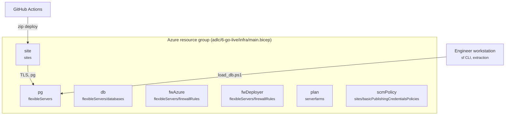

## 8. Cross-cutting concepts

### 8.1 Data model

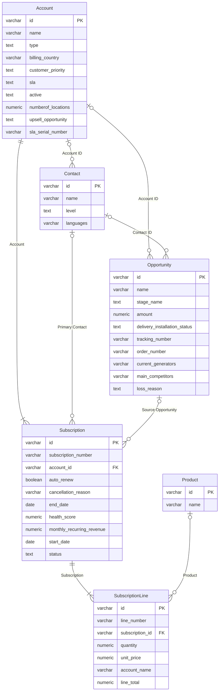

### 8.2 Security model

Each profile or permission set becomes a database role; field-level security becomes column grants; subscriptions inherit access from their account.

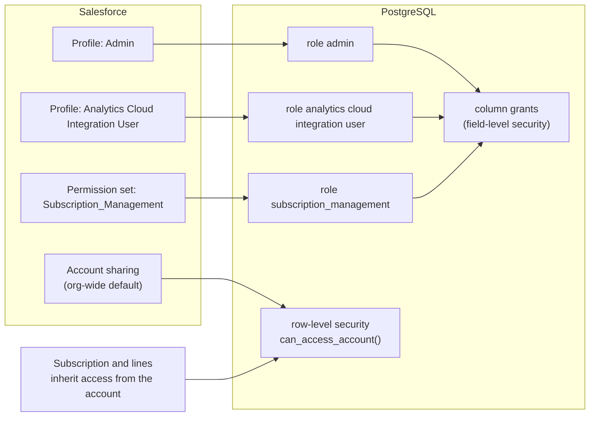

### 8.3 Data migration

Records load parent first, in dependency order, keeping every Salesforce record ID.

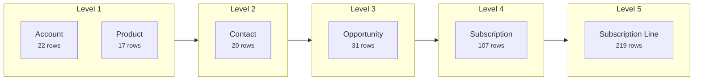

### 8.4 Traceability

Every generated file names its owning agent and blueprint; the LLD’s traceability matrix links each Salesforce element to its design decision, artifact and test.

## 9. Architecture decisions

| ADR | Decision | Applies to |
|---|---|---|
| [ADR-001](adr/ADR-001-blueprint-contract.md) | A vendor-neutral blueprint is the contract between extraction and generation | 1 |
| [ADR-002](adr/ADR-002-keep-salesforce-ids.md) | Keep the 18-character Salesforce ID as the primary key | 6 |
| [ADR-003](adr/ADR-003-generated-columns.md) | Row-local formulas become stored generated columns | 2 |
| [ADR-004](adr/ADR-004-cross-object-views.md) | Cross-object formulas become views | 1 |
| [ADR-005](adr/ADR-005-compute-on-read.md) | Date-dependent formulas are computed when read | 1 |
| [ADR-006](adr/ADR-006-trigger-maintained-rollups.md) | Roll-up summaries are trigger-maintained columns with a recompute job | 2 |
| [ADR-007](adr/ADR-007-check-constraints.md) | Row-local validation rules become CHECK constraints | 6 |
| [ADR-008](adr/ADR-008-guard-triggers.md) | Rules needing the previous row or a parent record become BEFORE-trigger guards | 2 |
| [ADR-009](adr/ADR-009-roles-and-rls.md) | Profiles and permission sets become roles; sharing becomes row-level security | 3 |
| [ADR-010](adr/ADR-010-reviewed-llm-translation.md) | Apex is translated by an AI agent and merged only after review | 2 |
| [ADR-011](adr/ADR-011-parity-as-acceptance.md) | Behaviour is accepted only when it matches Salesforce’s own values | 1 |

## 10. Quality requirements

| Quality | Scenario | How it is measured |
|---|---|---|
| Parity | Every calculated value and rule outcome matches Salesforce | Verification agent, blocking in CI |
| Security | A user sees and edits only what Salesforce allows | Security parity cases, RLS and column grants |
| Repeatability | Same org in, same outputs out | CI regenerates blueprint, SQL and documents and fails on any difference |
| Traceability | Any artifact leads back to its Salesforce source | Provenance headers and the LLD traceability matrix, checked in CI |

## 11. Risks and technical debt

| Item | Status |
|---|---|
| Apex translated | SubscriptionService.applyDefaults |
| Automations still to translate | OpportunityTrigger, SubscriptionTrigger, SubscriptionRenewalBatch |
| Items Salesforce keeps | gap register (adlc/1-discover/extraction/inventory/gap-register.md) |

## 12. Glossary

| Business term | Salesforce object | Target table |
|---|---|---|
| Account | Account | account |
| Contact | Contact | contact |
| Opportunity | Opportunity | opportunity |
| Product | Product2 | product2 |
| Subscription | Subscription__c | subscription |
| Subscription Line | Subscription_Line__c | subscription_line |
