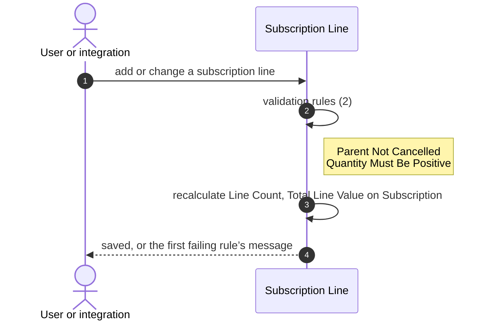

# Low-level design: Subscription domain

Owner: Modelling agent · generated by `src/generators/emit-docs.js` from blueprint `49f2c22e6c8f` · regenerated whenever the org changes

Field lists, rules and automations are read from the org; each item shows its target design on Azure Database for PostgreSQL and the decision record behind it.

## 1. Tables

### Account (`Account` → `account`)

22 rows. Sharing: ReadWrite.

| Salesforce field | Label | Salesforce type | Column | PostgreSQL type | Required | Notes |
|---|---|---|---|---|---|---|
| Id | Account ID | id | id | varchar(18) | yes |  |
| Name | Account Name | string | name | varchar(255) | yes |  |
| Type | Account Type | picklist | type | text |  | values: Prospect, Customer - Direct, Customer - Channel, Channel Partner / Reseller, Installation Partner, Technology Partner, Other |
| BillingCountry | Billing Country | string | billing_country | varchar(80) |  |  |
| SLA__c | SLA | picklist | sla | text |  | values: Gold, Silver, Platinum, Bronze |

### Contact (`Contact` → `contact`)

20 rows. Sharing: ControlledByParent.

| Salesforce field | Label | Salesforce type | Column | PostgreSQL type | Required | Notes |
|---|---|---|---|---|---|---|
| Id | Contact ID | id | id | varchar(18) | yes |  |
| Name | Full Name | string | name | varchar(121) |  |  |

### Opportunity (`Opportunity` → `opportunity`)

31 rows. Sharing: ReadWrite.

| Salesforce field | Label | Salesforce type | Column | PostgreSQL type | Required | Notes |
|---|---|---|---|---|---|---|
| Id | Opportunity ID | id | id | varchar(18) | yes |  |
| Name | Name | string | name | varchar(120) | yes |  |
| StageName | Stage | picklist | stage_name | text | yes | values: Prospecting, Qualification, Needs Analysis, Value Proposition, Id. Decision Makers, Perception Analysis, Proposal/Price Quote, Negotiation/Review, Closed Won, Closed Lost |
| Amount | Amount | currency | amount | numeric(18,2) |  |  |
| Loss_Reason__c | Loss Reason | picklist | loss_reason | text |  | values: Price, Timing, Competitor, No Budget, No Decision, Other |

### Product (`Product2` → `product2`)

17 rows. Sharing: ReadWrite.

| Salesforce field | Label | Salesforce type | Column | PostgreSQL type | Required | Notes |
|---|---|---|---|---|---|---|
| Id | Product ID | id | id | varchar(18) | yes |  |
| Name | Product Name | string | name | varchar(255) | yes |  |

### Subscription (`Subscription__c` → `subscription`)

107 rows. Sharing: ControlledByParent, inherited through Subscription__c.Account__c.

| Salesforce field | Label | Salesforce type | Column | PostgreSQL type | Required | Notes |
|---|---|---|---|---|---|---|
| Id | Record ID | id | id | varchar(18) | yes |  |
| Name | Subscription Number | string | subscription_number | varchar(80) |  |  |
| Account__c | Account | reference | account_id | varchar(18) | yes | →  |
| Auto_Renew__c | Auto Renew | boolean | auto_renew | boolean |  | default false |
| Cancellation_Reason__c | Cancellation Reason | string | cancellation_reason | varchar(255) |  |  |
| End_Date__c | End Date | date | end_date | date | yes |  |
| Health_Score__c | Health Score | double | health_score | numeric(3,0) |  |  |
| MRR__c | MRR | currency | monthly_recurring_revenue | numeric(16,2) |  |  |
| Primary_Contact__c | Primary Contact | reference | primary_contact_id | varchar(18) |  | →  |
| Source_Opportunity__c | Source Opportunity | reference | source_opportunity_id | varchar(18) |  | →  |
| Start_Date__c | Start Date | date | start_date | date | yes |  |
| Status__c | Status | picklist | status | text | yes | values: Draft, Active, Suspended, Cancelled, Renewed; default Draft |
| Term_Months__c | Term (Months) | double | term_months | numeric(4,0) |  |  |
| Line_Count__c | Line Count | double | line_count | numeric(18,0) |  |  |
| Annual_Value__c | Annual Value | currency | annual_value | numeric(18,2) |  |  |
| Days_To_Renewal__c | Days To Renewal | double | days_to_renewal | numeric(18,0) |  |  |
| Total_Line_Value__c | Total Line Value | currency | total_line_value | numeric(18,2) |  |  |

### Subscription Line (`Subscription_Line__c` → `subscription_line`)

219 rows. Sharing: ControlledByParent, inherited through Subscription_Line__c.Subscription__c.

| Salesforce field | Label | Salesforce type | Column | PostgreSQL type | Required | Notes |
|---|---|---|---|---|---|---|
| Id | Record ID | id | id | varchar(18) | yes |  |
| Name | Line Number | string | line_number | varchar(80) |  |  |
| Subscription__c | Subscription | reference | subscription_id | varchar(18) | yes | →  |
| Product__c | Product | reference | product_id | varchar(18) |  | →  |
| Quantity__c | Quantity | double | quantity | numeric(6,0) | yes |  |
| Unit_Price__c | Unit Price | currency | unit_price | numeric(16,2) | yes |  |
| Account_Name__c | Account Name | string | account_name | varchar(1300) |  |  |
| Line_Total__c | Line Total | currency | line_total | numeric(18,2) |  |  |

## 2. Calculated fields

| Field | Kind | Salesforce definition | Target design |
|---|---|---|---|
| Subscription_Line__c.Account_Name__c | formula | Subscription__r.Account__r.Name | view that joins the parent records [ADR-004](adr/ADR-004-cross-object-views.md) |
| Subscription_Line__c.Line_Total__c | formula | Quantity__c * Unit_Price__c | generated column, stored [ADR-003](adr/ADR-003-generated-columns.md) |
| Subscription__c.Line_Count__c | rollup | count of undefined | column kept current by triggers, with a recompute job [ADR-006](adr/ADR-006-trigger-maintained-rollups.md) |
| Subscription__c.Annual_Value__c | formula | MRR__c * 12 | generated column, stored [ADR-003](adr/ADR-003-generated-columns.md) |
| Subscription__c.Days_To_Renewal__c | formula | End_Date__c - TODAY() | computed when read (depends on today’s date) [ADR-005](adr/ADR-005-compute-on-read.md) |
| Subscription__c.Total_Line_Value__c | rollup | sum of Subscription_Line__c.Line_Total__c | column kept current by triggers, with a recompute job [ADR-006](adr/ADR-006-trigger-maintained-rollups.md) |

## 3. Validation rules

| Rule | Rejects when | Message | Target design |
|---|---|---|---|
| Opportunity: Closed_Won_Requires_Amount | AND( ISPICKVAL(StageName, "Closed Won"), OR( ISBLANK(Amount), Amount <= 0 ) ) | A won opportunity must have an Amount greater than zero. | CHECK constraint on the table [ADR-007](adr/ADR-007-check-constraints.md) |
| Opportunity: Loss_Reason_Required_When_Lost | AND( ISPICKVAL(StageName, "Closed Lost"), ISBLANK(TEXT(Loss_Reason__c)) ) | A Loss Reason is required before an opportunity can be marked Closed Lost. | CHECK constraint on the table [ADR-007](adr/ADR-007-check-constraints.md) |
| Subscription Line: Parent_Not_Cancelled | ISPICKVAL(Subscription__r.Status__c, "Cancelled") | You cannot add or change lines on a cancelled subscription. | BEFORE trigger guard (needs the previous row) [ADR-008](adr/ADR-008-guard-triggers.md) |
| Subscription Line: Quantity_Must_Be_Positive | Quantity__c <= 0 | Quantity must be greater than zero. | CHECK constraint on the table [ADR-007](adr/ADR-007-check-constraints.md) |
| Subscription: Active_Requires_MRR | AND( ISPICKVAL(Status__c, "Active"), OR( ISBLANK(MRR__c), MRR__c <= 0 ) ) | An active subscription must have an MRR greater than zero. | CHECK constraint on the table [ADR-007](adr/ADR-007-check-constraints.md) |
| Subscription: Cancellation_Reason_Required | AND( ISPICKVAL(Status__c, "Cancelled"), ISBLANK(Cancellation_Reason__c) ) | Cancellation Reason is required when Status is Cancelled. | CHECK constraint on the table [ADR-007](adr/ADR-007-check-constraints.md) |
| Subscription: End_Date_After_Start_Date | AND( NOT(ISBLANK(Start_Date__c)), NOT(ISBLANK(End_Date__c)), End_Date__c <= Start_Date__c ) | End Date must be after Start Date. | CHECK constraint on the table [ADR-007](adr/ADR-007-check-constraints.md) |
| Subscription: No_Reactivation_After_Cancel | AND( ISCHANGED(Status__c), ISPICKVAL(PRIORVALUE(Status__c), "Cancelled"), NOT(ISPICKVAL(Status__c, "Cancelled")) ) | A cancelled subscription cannot be reactivated. Create a new subscription instead. | BEFORE trigger guard (needs the previous row) [ADR-008](adr/ADR-008-guard-triggers.md) |

## 4. Automations

| Automation | Runs when | Does | Target design | Status |
|---|---|---|---|---|
| flow: Subscription At Risk Alert | after insert/update of Subscription | create Task | in-transaction hook after save | pending |
| apexTrigger: OpportunityTrigger | after update of Opportunity | OpportunityService.createSubscriptionsForWonDeals | service hook in the same transaction | pending |
| apexTrigger: SubscriptionTrigger | before/before/after insert/update/update of Subscription | SubscriptionService.applyDefaults, SubscriptionService.handleStatusChange | service hook in the same transaction | partly translated |
| apexClass: SubscriptionRenewalBatch | on a schedule | writes Task | scheduled worker job | pending |
| duplicateRule: Account.Standard_Account_Duplicate_Rule | before insert/update of Account |  | rule engine hook in the service layer | pending |
| duplicateRule: Contact.Standard_Contact_Duplicate_Rule | before insert/update of Contact |  | rule engine hook in the service layer | pending |

### 4.1 Order of execution: subscription

Shown in HLD section 6.3, Saving a subscription.

### 4.2 Order of execution: subscription line

### 4.3 Flow: Subscription At Risk Alert

Shown in HLD section 6.4, Subscription At Risk Alert.

## 5. Services

| Class | Methods | Reads | Writes | Called by | Constants |
|---|---|---|---|---|---|
| OpportunityService | createSubscriptionsForWonDeals | Subscription | Subscription | OpportunityTrigger | DEFAULT_TERM_MONTHS = 12 |
| SubscriptionService | applyDefaults, handleStatusChange, totalActiveMrr | Subscription | Task | SubscriptionTrigger | DEFAULT_HEALTH_SCORE = 70, AT_RISK_THRESHOLD = 50 |

## 6. Security

| Role (from Salesforce) | Subscription | Subscription Line |
|---|---|---|
| Profile: Admin | read, create, edit, delete, viewAll, modifyAll | read, create, edit, delete, viewAll, modifyAll |
| Profile: Analytics Cloud Integration User | read, viewAll | read, viewAll |
| Permission set: Subscription_Management | read, create, edit, delete | read, create, edit, delete |

How roles, column grants and row-level security fit together is shown in HLD section 8.2, Security across domains.

## 7. Data load

| Order | Object | Rows | Depends on |
|---|---|---|---|
| 1 | Account | 22 | — |
| 1 | Product | 17 | — |
| 2 | Contact | 20 | Account |
| 3 | Opportunity | 31 | Account, Contact |
| 4 | Subscription | 107 | Account, Contact, Opportunity |
| 5 | Subscription Line | 219 | Subscription, Product |

The load levels, and the migration waves this domain belongs to, are shown in HLD section 8.3.

## 8. Migrations

| Order | Script | Contents |
|---|---|---|
| 1 | `000_runtime.sql` | runtime helpers (time zone, load mode) |
| 2 | `010_tables.sql` | tables, keys, constraints and generated columns |
| 3 | `020_views.sql` | views for cross-object and date-dependent fields |
| 4 | `030_rollups.sql` | roll-up totals and their recompute function |
| 5 | `040_guards.sql` | rule guards that need the previous row or a parent |
| 6 | `050_translations.sql` | translated business logic |
| 7 | `060_security.sql` | roles, column grants and row-level security |

Scripts are numbered and applied in order by the release pipeline; each is idempotent, so any environment can be rebuilt.

## 9. Patterns used

| Pattern | Where | Why |
|---|---|---|
| Generated column | row-local formulas | Always correct without application code |
| Materialised aggregate with recompute backstop | roll-up summaries | Fast reads, self-healing after loads |
| Guard trigger | rules needing the previous row or a parent | Same rejection point and message as Salesforce |
| Role-based access + row-level security | `060_security.sql` | Access enforced in the database for every client |
| Idempotent, dependency-ordered load | data migration | Repeatable loads; triggers deferred, totals recomputed once |
| Golden-master testing (parity) | parity tests | Salesforce’s own values are the expected results |

## 10. Verification cases

| Case | Comes from |
|---|---|
| apex.appliesDefaultHealthScoreAndEndDate | apex-test:SubscriptionServiceTest#appliesDefaultHealthScoreAndEndDate |
| apex.blocksReactivationOfCancelledSubscription | apex-test:SubscriptionServiceTest#blocksReactivationOfCancelledSubscription |
| apex.rollsUpLineTotals | apex-test:SubscriptionServiceTest#rollsUpLineTotals |
| apex.createsSubscriptionWhenOpportunityIsWon | apex-test:SubscriptionServiceTest#createsSubscriptionWhenOpportunityIsWon |
| apex.renewalBatchRaisesTasks | apex-test:SubscriptionServiceTest#renewalBatchRaisesTasks |
| rule.Active_Requires_MRR.blank | rule |
| rule.Active_Requires_MRR.zero | rule |
| rule.Active_Requires_MRR.draftWithoutMrrAllowed | rule |
| rule.Cancellation_Reason_Required | rule |
| rule.End_Date_After_Start_Date | rule |
| rule.No_Reactivation_After_Cancel.toSuspended | rule |
| rule.Parent_Not_Cancelled | rule |
| rule.Quantity_Must_Be_Positive | rule |
| platform.restrictedPicklist | rule |
| platform.masterDetailCascade | rule |
| apex.applyDefaults.termFromDates | rule |
| security.permsetEditsAllowedFields | rule |
| security.readOnlyFieldsNotWritable | rule |
| security.readOnlyProfileCannotEdit | rule |

## 11. Traceability

Each Salesforce element, its blueprint ID, the design decision applied, the generated artifact, and the test that proves it.

| Salesforce element | Blueprint ID | Design | Artifact | Verified by |
|---|---|---|---|---|
| formula: `Subscription_Line__c.Account_Name__c` | Subscription_Line__c.Account_Name__c | view that joins the parent records [ADR-004](adr/ADR-004-cross-object-views.md) | `schema/sql/020_views.sql` | derived-value comparison (all rows) |
| formula: `Subscription_Line__c.Line_Total__c` | Subscription_Line__c.Line_Total__c | generated column, stored [ADR-003](adr/ADR-003-generated-columns.md) | `schema/sql/010_tables.sql`, `schema/sql/030_rollups.sql` | derived-value comparison (all rows) |
| rollup: `Subscription__c.Line_Count__c` | Subscription__c.Line_Count__c | column kept current by triggers, with a recompute job [ADR-006](adr/ADR-006-trigger-maintained-rollups.md) | `schema/sql/010_tables.sql`, `schema/sql/030_rollups.sql` | derived-value comparison (all rows) |
| formula: `Subscription__c.Annual_Value__c` | Subscription__c.Annual_Value__c | generated column, stored [ADR-003](adr/ADR-003-generated-columns.md) | `schema/sql/010_tables.sql` | derived-value comparison (all rows) |
| formula: `Subscription__c.Days_To_Renewal__c` | Subscription__c.Days_To_Renewal__c | computed when read (depends on today’s date) [ADR-005](adr/ADR-005-compute-on-read.md) | `schema/sql/020_views.sql` | derived-value comparison (all rows) |
| rollup: `Subscription__c.Total_Line_Value__c` | Subscription__c.Total_Line_Value__c | column kept current by triggers, with a recompute job [ADR-006](adr/ADR-006-trigger-maintained-rollups.md) | `schema/sql/010_tables.sql`, `schema/sql/030_rollups.sql` | derived-value comparison (all rows) |
| validation rule: `Opportunity.Closed_Won_Requires_Amount` | Opportunity.Closed_Won_Requires_Amount | CHECK constraint on the table [ADR-007](adr/ADR-007-check-constraints.md) | — | — |
| validation rule: `Opportunity.Loss_Reason_Required_When_Lost` | Opportunity.Loss_Reason_Required_When_Lost | CHECK constraint on the table [ADR-007](adr/ADR-007-check-constraints.md) | — | — |
| validation rule: `Subscription_Line__c.Parent_Not_Cancelled` | Subscription_Line__c.Parent_Not_Cancelled | BEFORE trigger guard (needs the previous row) [ADR-008](adr/ADR-008-guard-triggers.md) | `schema/sql/010_tables.sql`, `logic/sql/040_guards.sql` | `rule.Parent_Not_Cancelled` |
| validation rule: `Subscription_Line__c.Quantity_Must_Be_Positive` | Subscription_Line__c.Quantity_Must_Be_Positive | CHECK constraint on the table [ADR-007](adr/ADR-007-check-constraints.md) | `schema/sql/010_tables.sql` | `rule.Quantity_Must_Be_Positive` |
| validation rule: `Subscription__c.Active_Requires_MRR` | Subscription__c.Active_Requires_MRR | CHECK constraint on the table [ADR-007](adr/ADR-007-check-constraints.md) | `schema/sql/010_tables.sql` | `rule.Active_Requires_MRR.blank`, `rule.Active_Requires_MRR.zero`, `rule.Active_Requires_MRR.draftWithoutMrrAllowed` |
| validation rule: `Subscription__c.Cancellation_Reason_Required` | Subscription__c.Cancellation_Reason_Required | CHECK constraint on the table [ADR-007](adr/ADR-007-check-constraints.md) | `schema/sql/010_tables.sql` | `rule.Cancellation_Reason_Required` |
| validation rule: `Subscription__c.End_Date_After_Start_Date` | Subscription__c.End_Date_After_Start_Date | CHECK constraint on the table [ADR-007](adr/ADR-007-check-constraints.md) | `schema/sql/010_tables.sql` | `rule.End_Date_After_Start_Date` |
| validation rule: `Subscription__c.No_Reactivation_After_Cancel` | Subscription__c.No_Reactivation_After_Cancel | BEFORE trigger guard (needs the previous row) [ADR-008](adr/ADR-008-guard-triggers.md) | `schema/sql/010_tables.sql`, `logic/sql/040_guards.sql` | `rule.No_Reactivation_After_Cancel.toSuspended` |
| flow: `Subscription_At_Risk_Alert` | flow:Subscription_At_Risk_Alert | in-transaction hook after save  | pending | — |
| apexTrigger: `OpportunityTrigger` | apex-trigger:OpportunityTrigger | service hook in the same transaction [ADR-010](adr/ADR-010-reviewed-llm-translation.md) | pending | — |
| apexTrigger: `SubscriptionTrigger` | apex-trigger:SubscriptionTrigger | service hook in the same transaction [ADR-010](adr/ADR-010-reviewed-llm-translation.md) | `logic/sql/050_translations.sql` | `apex.applyDefaults.termFromDates` |
| apexClass: `SubscriptionRenewalBatch` | apex-job:SubscriptionRenewalBatch | scheduled worker job  | pending | — |
| duplicateRule: `Account.Standard_Account_Duplicate_Rule` | duplicateRule:Account.Standard_Account_Duplicate_Rule | rule engine hook in the service layer  | pending | — |
| duplicateRule: `Contact.Standard_Contact_Duplicate_Rule` | duplicateRule:Contact.Standard_Contact_Duplicate_Rule | rule engine hook in the service layer  | pending | — |
| profile: `Admin` | profile:Admin | role, column grants, RLS [ADR-009](adr/ADR-009-roles-and-rls.md) | `security/sql/060_security.sql` | `security.permsetEditsAllowedFields`, `security.readOnlyFieldsNotWritable`, `security.readOnlyProfileCannotEdit` |
| profile: `Analytics Cloud Integration User` | profile:Analytics Cloud Integration User | role, column grants, RLS [ADR-009](adr/ADR-009-roles-and-rls.md) | — | `security.permsetEditsAllowedFields`, `security.readOnlyFieldsNotWritable`, `security.readOnlyProfileCannotEdit` |
| permissionSet: `Subscription_Management` | permissionSet:Subscription_Management | role, column grants, RLS [ADR-009](adr/ADR-009-roles-and-rls.md) | `security/sql/060_security.sql` | `security.permsetEditsAllowedFields`, `security.readOnlyFieldsNotWritable`, `security.readOnlyProfileCannotEdit` |
