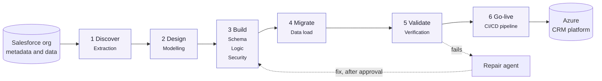

# Moving Subscription Management off Salesforce

## 1. Purpose and scope

This pack describes how we move the **Subscription Management** module from Salesforce to a client-owned platform on Azure. Subscription Management is a custom module built in the org (the Subscription and Subscription Line objects); it is not a Salesforce product. It is the first domain of a platform designed to take every module of the org, one wave at a time (HLD, sections 5 and 8.3).

- We move the module, its records, rules, calculations and permissions
- We keep every one of them working exactly as it does today
- We prove it with numbers before anyone switches over; Salesforce stays live until then

## 2. Six phases, one or more agents each

Each phase answers one question. Each phase is reviewed before the next begins.

| Phase | Question | Agents | Answer |
|---|---|---|---|
| 1 Discover | What is in the org? | Extraction | Objects, fields, rules, flows, Apex, security and data |
| 2 Design | What does it mean? | Modelling | One platform-independent model of the org |
| 3 Build | What replaces it? | Schema, Logic, Security | Database, business rules, security and services, generated from the model |
| 4 Migrate | How does the data move? | Data load | In dependency order, with Salesforce record IDs kept |
| 5 Validate | Does it behave the same? | Verification, Repair | Calculated values and rule outcomes checked against the org |
| 6 Go-live | How does it go live? | CI/CD pipeline | Released to the cloud through CI/CD, one domain at a time |

Figure: The agentic workflow: one or more agents per phase, with a repair loop when a check fails

## 3. Where we are today

| Phase | Status | Results in |
|---|---|---|
| 1 Discover | Complete | Agent 01 - Discover, section 4 |
| 2 Design | Complete | Agent 02 - Design, section 4 |
| 3 Build | Database, rules and access built; custom code translation in progress | Agent 03 - Build, section 4 |
| 4 Migrate | All module records loaded and reconciled | Agent 04 - Migrate, section 4 |
| 5 Validate | All calculated values match; two tests wait for custom code | Agent 05 - Validate, section 4 |
| 6 Go-live | Proof of concept running on Azure; cutover planned | Agent 06 - Go-live |

## 4. The documents in this pack

| Document | What it covers |
|---|---|
| Agent 01 - Discover | What we found in the org, and what Salesforce keeps |
| Agent 02 - Design | The model, vendor packages, and a guide to the design documents |
| Agent 02 - High-Level Design | arc42 architecture with C4 views, business processes and decisions |
| Agent 02 - Low-Level Design | Tables, rules, automations, security, load order and traceability |
| Agent 03 - Build | What we built, and the integration credentials to renew |
| Agent 04 - Migrate | Records moved, history archive and work in progress |
| Agent 05 - Validate | Parity results and built-in platform behaviour |
| Agent 06 - Go-live | Release pipeline and cutover |
| KB 01 - Best Practices | Engineering best practices we follow, with references |
| KB 02 - Architecture | Architecture best practices, patterns and standards, with references |

## 5. How we work

| Principle | What it means |
|---|---|
| Modular | We can run, re-run or replace any agent. A shared model decouples Salesforce from the target. |
| Scalable | We split large orgs into business domains. Domains migrate in parallel. |
| Controlled | We sign off every phase, fully audited. Automated checks run before every release. |
