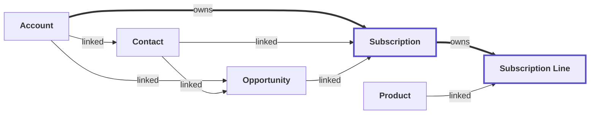

# Design: what does it mean?

## 1. Purpose and scope

We turn the extract into one platform-independent model of the org, and we decide how to rebuild Subscription Management. This document summarises the phase; the high-level design (HLD) and low-level design (LLD) in this pack hold the design itself.

## 2. The agents in this phase

### 2.1 Modelling agent

**What it does**

Turns the extract into one platform-independent model of the org, with business-friendly names for every object and field.

**What it produces**

- `blueprint.json` (the model)
- `normalise-report.md`
- `packages.md`
- High-level design, low-level design and 20 decision records

## 3. Inputs

- The Discover extract: schema, rules, flows, Apex and data counts
- Business vocabulary overrides that we agree with you

## 4. Outputs and results

| Output | Result |
|---|---|
| Objects in the model | 505 |
| Calculated fields designed | 6 |
| Business rules designed | 6 |
| Automations designed | 5 |
| Decision records | 20 |

## 5. Data model, business view

Figure: The objects of the module and how they relate (bold borders: in scope; thick arrows: the parent owns its children)

The full entity-relationship diagram, with columns and keys, is in the HLD, section 8.1.

## 6. Vendor packages

The vendor hides package code. We extract the settings and data, capture the behaviour as tests, then rebuild, replace or retain each package. In the demo we rebuilt DLRS from its settings: 44 of 44 values match.

| Package | In use | Our proposed route |
|---|---|---|
| Developer Edition | no records found | not needed: installed but holds no records |
| Declarative Lookup Rollup Summaries Tool | yes: 2 Lookup Rollup Summary | rebuild: the behaviour is fully described by its settings and matches the package output |

## 7. Where to find each design topic

| Topic | Document and section |
|---|---|
| Scope, context and quality goals | HLD, sections 1 to 3 |
| Target architecture on Azure: domains, services, deployment, environments, recovery | HLD, sections 5 and 7 |
| Migration waves, system of record, adding the next module | HLD, sections 8.3 to 8.6 |
| Business processes (lifecycle, won deal, save, alerts, renewals) | HLD, section 6 |
| Data model, security model, data migration | HLD, section 8 |
| Decisions and their reasons | HLD, sections 4 and 9 |
| Fields, calculated fields and business rules | LLD, sections 1 to 3 |
| Automations, services and access per role | LLD, sections 4 to 6 |
| Traceability from each Salesforce element to its test | LLD, section 11 |

## 8. Review gate and items to confirm

**What a person checks before the next phase starts**

- The model covers every object, field, rule and automation in scope
- Each decision has a record

**What we ask you to confirm**

- The processes in HLD section 6 match how the business works
- The business names for objects and fields are the ones your teams use
- Which vendor packages we rebuild, replace or retain

## 9. Where the artifacts live

| Artifact | Location |
|---|---|
| Blueprint (the model) | `adlc/2-design/modelling/blueprint/blueprint.json` |
| HLD, LLD and decision records | `adlc/2-design/modelling/design` |
| Vendor packages | `adlc/2-design/modelling/packages.md` |
