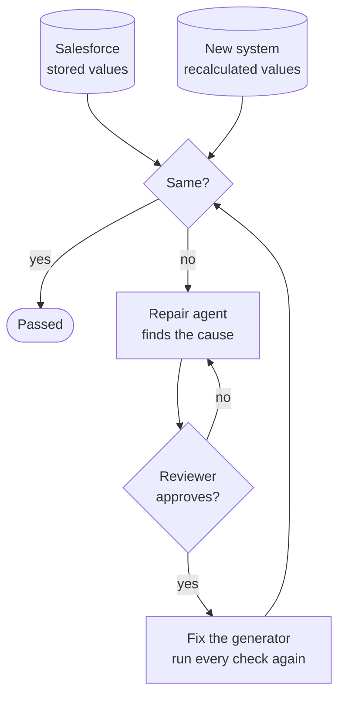

# Validate: does it behave the same?

## 1. Purpose and scope

Salesforce’s own values are the expected results. We release nothing unless they match.

## 2. The agents in this phase

### 2.1 Verification agent

**What it does**

Recomputes every calculated value and compares it with what Salesforce stored, then replays the business rule cases.

**What it produces**

- Parity report
- `platform-behaviour.md`

### 2.2 Repair agent

**What it does**

When a check fails, finds the root cause and proposes a fix to the generator, not to the output.

**What it produces**

- Diagnosis
- Proposed fix (patch)

## 3. Inputs

- The loaded database from Agent 04
- The values Salesforce stored for every calculated field
- Test cases from the org’s Apex tests, rules and security (listed in the LLD, section 10)

## 4. Outputs and results

| Check | Result |
|---|---|
| Calculated values compared with Salesforce | 866 of 866 values match |
| Business rule and security tests | 17 pass, 0 fail, 2 pending |
| Test cases written for testers | 19 (17 automated) |

### 4.1 Calculated values, field by field

| Field | Matched |
|---|---|
| Line Count | 107 of 107 |
| Annual Value | 107 of 107 |
| Days To Renewal | 107 of 107 |
| Total Line Value | 107 of 107 |
| Account Name | 219 of 219 |
| Line Total | 219 of 219 |

## 5. How a check runs

Figure: Every check compares the two systems; a failure goes through the repair loop

We apply a fix only after a reviewer approves it, then run every check again. The fix goes into the generator, never into the output.

## 6. What we test

| Level | What it proves |
|---|---|
| Functional | Each rule and automation gives Salesforce’s outcome |
| Data | Every record and calculated value matches |
| Security | Each role can do exactly what it can do today |
| User acceptance | Business users sign off business scenarios |
| Agents | Each agent’s output meets our quality bar |

## 7. Built-in platform behaviour

These behaviours are how Salesforce itself works, so no configuration describes them. We build each one into the platform once, and test it by running the same operation in both systems.

| Behaviour | How the target does it | Status |
|---|---|---|
| Restricted picklists reject unknown values | lookup table + foreign key | tested (`platform.restrictedPicklist`) |
| Master-detail delete removes the children | ON DELETE CASCADE | tested (`platform.masterDetailCascade`) |
| Blank numbers count as zero in formulas | COALESCE in the compiled expression | tested (formula values) |
| Roll-up summaries stay current | trigger-maintained column + recompute backstop | tested (roll-up values) |
| TODAY() in the org's time zone | app.today() evaluated in the org time zone | tested (Days_To_Renewal) |
| Field-level security | column grants per role | tested (`security.readOnlyFieldsNotWritable`) |
| Sharing inherited from the parent record | row-level security policy | tested (`security.permsetEditsAllowedFields`) |
| Order of execution on save | save pipeline calling generated hooks in Salesforce order, one transaction | planned |
| Lead conversion | service using the retrieved LeadConvertSettings field mapping | planned |
| Owner change moves open opportunities and cases | service rule on owner change | planned |
| Duplicate and matching rules | check before insert, using retrieved rule definitions | planned |
| Assignment and escalation rules | ordered rule engine + scheduler | planned (rules already extracted) |

## 8. Still to come

| Test | When |
|---|---|
| A won deal creates a subscription | Once the opportunity objects and the won-deal logic are rebuilt |
| The nightly renewal job raises tasks | Once tasks and the nightly renewal job are rebuilt |

## 9. Review gate and items to confirm

**What a person checks before the next phase starts**

- Every calculated value matches, field by field
- No test fails; pending tests have a date

**What we ask you to confirm**

- The business scenarios for user acceptance
- Which planned platform behaviours matter most to you

## 10. Where the artifacts live

| Artifact | Location |
|---|---|
| Test cases and parity report | `adlc/5-validate/verification` |
| Built-in platform behaviour | `adlc/5-validate/verification/platform-behaviour.md` |
| Repair proposals | `adlc/5-validate/repair` |
