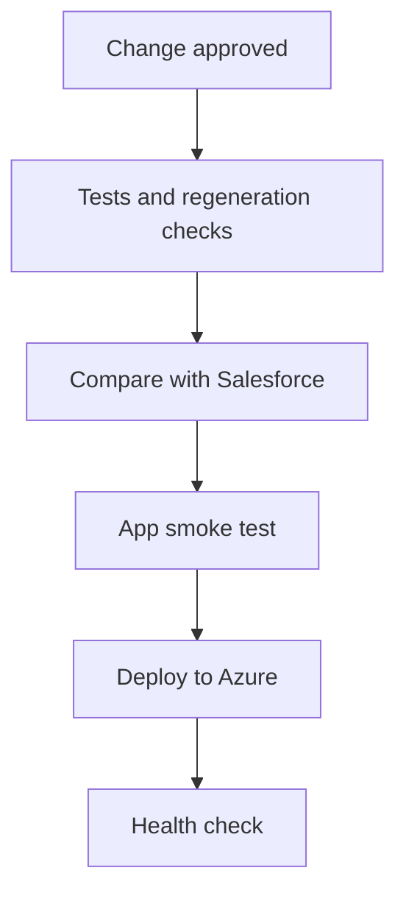

# Go-live: how does it go live?

## 1. Purpose and scope

We release the module to the cloud through CI/CD, one business domain at a time, with a way back at every step. The target deployment on Azure, its environments and its recovery targets are in the HLD, section 7.

## 2. The agents in this phase

### 2.1 CI/CD pipeline

**What it does**

Re-runs every check on each change and releases to the target cloud (Azure in the demo), one business domain at a time.

**What it produces**

- Tested release
- Health check after deploy

## 3. Inputs

- An approved change, with every check passing
- The infrastructure definition (Bicep) for the target

## 4. Outputs and results

- A tested release on Azure
- A health check after every deploy

## 5. Release pipeline

Figure: Every change passes every check before it reaches Azure

## 6. Cutover steps

Each domain goes through these steps in its wave; the waves and which system masters each domain are in the HLD, section 8.3.

| Step | What happens |
|---|---|
| 1 Shadow | Both systems run; we turn differences into new tests |
| 2 Reporting first | Reports move first, so the numbers are trusted |
| 3 Module switch | Writes move in a short freeze; Salesforce stays read-only |
| 4 Integrations | Other systems move one by one |
| 5 Decommission | Licences reduce at renewal |

## 7. Cutover checklist

We sign this off at go-live, for each domain.

| Item | Done when | Prepared in |
|---|---|---|
| Integration credentials | Every new credential is live and tested | Agent 03 - Build, section 5 |
| Scheduled jobs | Off in Salesforce and on in Azure, in one step | Agent 04 - Migrate, section 7 |
| Open approvals and paused flows | Finished or carried over | Agent 04 - Migrate, section 7 |
| History | Archive loaded | Agent 04 - Migrate, section 6 |
| Salesforce | Kept read-only until the domain has moved | This document, section 6 |

## 8. Review gate and items to confirm

**What a person checks before the next phase starts**

- Every check passes on the release candidate
- The rollback has been rehearsed

**What we ask you to confirm**

- The cutover date and freeze window for each domain
- Who signs off the cutover checklist
- The licence renewal date

## 9. Where the artifacts live

| Artifact | Location |
|---|---|
| Infrastructure and deploy scripts | `adlc/6-go-live/infra/` |
| Pipeline definition | `.github/workflows/crm-genie.yml` |
