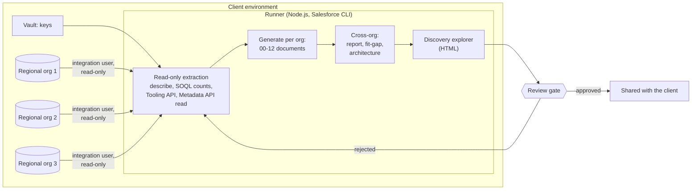
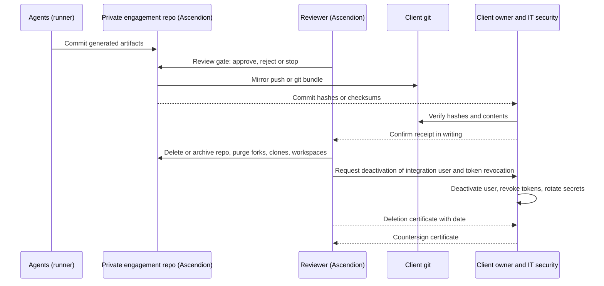

# Discovery Offer: Scope and Timeline

Owner: Ascendion engagement team · Status: draft for discussion · illustrative figures

This is the initial offer to the client: a fixed-price Discovery of every agreed regional Salesforce org. It ends
with a fact base, a fit-gap and a readout, and a decision by the client on whether and how to continue. Design,
build and data migration are not part of this offer; they are proposed after the readout, re-estimated from what
Discovery measures (see [01-offering-overview.md](01-offering-overview.md) and
[02-engagement-sizes.md](02-engagement-sizes.md)).

Discovery uses an agent-assisted approach. The agents are scripts that read each org read-only and write the
inventory and documents; experienced Salesforce architects and consultants review every output and run the
workshops with the client's regional owners. The example throughout is Brightwell Consumer Goods (illustrative),
with 3 regional orgs (Europe, APAC, Americas and LATAM) serving 37 markets.

## 1. Scope of Discovery

### 1.1 In scope, per regional org

| Area | What the client gets |
|---|---|
| Complete as-is picture | Edition, licences, users, limits and storage; data model; validation rules; business processes and automation; code; security model; integrations; user interface; reports and usage; technical debt |
| Customised versus standard | For each object and each component type: what is standard Salesforce, what is custom, and what extends a standard object (custom fields, rules, automation on Account, Product and so on) |
| Installed packages | Every managed and unmanaged package with namespace, version, licence counts and where it is used |
| Markets | Which markets each org serves, as found in the data (counts only), compared with the market list the client agrees at kickoff |

### 1.2 In scope, across the orgs

| Area | What the client gets |
|---|---|
| Cross-org comparison | Capability by capability: which org implements it, with which components, and whether the orgs built it differently |
| Fit-gap | A proposed verdict per custom component (adopt standard, replace with configuration, keep and harmonise, retire, review in workshop) with the reason and the standard feature it was matched to |
| Validation workshops | The proposed verdicts and the as-is picture confirmed or corrected with the regional owners |
| Readout | Findings, confirmed fit-gap, target direction, and a re-baselined estimate and size for the next phases |

### 1.3 Out of scope

- Target design (HLD, LLD, decisions), build of any component, and data migration or data export
- Changes of any kind to the client's orgs (the agents only read)
- Reading or exporting record contents; Discovery uses counts and fill rates only
- Performance testing, penetration testing or a security audit of the orgs
- Licence negotiation with Salesforce or package vendors
- Reading the source code of managed packages (Salesforce does not expose it; see section 7.3)

## 2. Deliverables

### 2.1 One Discovery Report

The main deliverable is **one Discovery Report for all orgs**, `adlc/1-discover/assessment/discovery-report.md`,
regenerated on every run and reviewed at the Discover gate. One report rather than a set of documents is
common practice for assessments: readers get one executive summary, findings tied to risk and business impact,
and one prioritised roadmap, with the detail in appendices. The report contains:

1. Executive summary: headline counts per org, the fit-gap totals, key findings, decisions needed from the client
2. Scope and method
3. System landscape (current), as a diagram
4. Findings by area (architecture and data model, automation, code, security, integrations, technical debt), each with risk level, business impact, evidence, recommendation and priority
5. Customised versus standard, per org
6. Data model diagrams (standard and custom objects distinguished)
7. Fit-gap and cross-org comparison
8. Prioritised roadmap: quick wins, immediate, medium term, strategic
9. Target direction
10. Appendix per org with the twelve detail sections below

The complete data behind the report is kept per org in `adlc/1-discover/assessment/discovery/<org>/discovery.json`
and is browsable in the Discovery explorer.

| Appendix section (per org) | What it contains | What the client validates in it |
|---|---|---|
| Org profile | Edition, licences by type (used and available), active users, org limits, data and file storage | Edition and licence counts match the client's contract; user counts match expectations |
| Customised versus standard | Custom against standard per object and per component type (fields, rules, flows, Apex, layouts, record types) | Nothing known to be custom is shown as standard, and the reverse |
| Data model | Objects, fields, relationships and an entity diagram, with record counts and field fill rates | The diagram reflects how the business understands its data; key objects are present |
| Validation rules | Every validation rule with object, formula, error message and active state | Rules still apply; inactive rules can be retired; messages are understood by users |
| Business processes and automation | Flows (with diagrams), approval processes, workflow rules, Apex triggers, and the order of execution per object | Processes match how each market works today; the order of execution explains known behaviour |
| Code inventory | Apex classes and triggers with API versions and size, Lightning components (Aura and Lightning Web Components), Visualforce pages and components | Code owners are known; nothing important is missing |
| Installed packages | Installed packages with namespace, version, publisher, licences assigned, and components that depend on them | Each package is still used and has a business owner and a contract renewal date |
| Security model | Profiles, permission sets, roles, org-wide defaults and sharing rules | The access model matches the client's policy; no unexpected broad access |
| Integrations | Named credentials, remote site settings, connected apps, Apex callouts, and inbound login sources by application (masked user names) | Every integration is known, with an owner on the client side; unknown callers are investigated |
| User interface | Apps, Lightning pages, page layouts and record types, with assignment per profile | The apps and layouts in use per market are the ones listed |
| Reports and usage | Reports and dashboards with last-run dates, report folders, subscriptions, and usage indicators | Reports still in use are flagged; unused ones can be retired |
| Technical debt | Unused fields (low or zero fill rate), inactive automation, old API versions, objects without records | The retire candidates are confirmed unused by the business owner |

### 2.2 Across the orgs

| Deliverable | What it contains | What the client validates in it |
|---|---|---|
| `adlc/1-discover/assessment/assessment-report.md` | Summary, as-is per org, cross-org comparison, fit-gap by org, workshop list | The comparison is fair to each region; the workshop list is complete |
| `adlc/1-discover/assessment/fit-gap.json` | Every custom component with its capability, proposed verdict, reason and cross-org matrix (machine-readable, for later phases) | Verdicts after the workshops; this file is the record of the decisions |
| `adlc/1-discover/assessment/architecture.md` | Principles, how Discovery runs, how a verdict is reached, target direction | The principles and target direction are acceptable to the architecture board |
| Discovery explorer (HTML, in the Org Compiler console) | An interactive page where the client clicks through each org's validation rules, processes, metadata, custom against standard, packages and custom fields, and compares orgs | The client's admins and regional owners can find their own org's components and check them before the workshops |

Every deliverable holds metadata names, configuration and counts. None holds record contents.

### 2.3 Readout pack

A short readout presentation built from the files above: findings per org, confirmed fit-gap, retire list,
target direction, risks, and the re-baselined size and estimate for the next phases.

## 3. Timeline with the agents, and without

### 3.1 Sizes

The sizes are those in [02-engagement-sizes.md](02-engagement-sizes.md), section 1 (S: 2-3 orgs and up to 5
markets; M: 4-6 orgs and 6-15 markets; L: 7 or more orgs and 16 or more markets). The example, with 3 orgs and
37 markets, scores a 3 on markets and so is at least Medium under the override rule in 02, section 4.

### 3.2 With the agents (the offer)

Week 0 depends on the client and is not counted in the elapsed weeks. Activities overlap: workshops for the first
org start while the last org is still in review.

| Activity | Small | Medium | Large |
|---|---|---|---|
| Week 0: access and setup (client-dependent) | 1-2 weeks before start | 2-3 weeks before start | 3-4 weeks before start |
| Agent extraction and generation | About 2-6 hours per org per run; all orgs in week 1 | All orgs in week 1 | Weeks 1-2, as access arrives |
| Expert review of the generated documents | Weeks 1-2 | Weeks 1-2 | Weeks 1-3 |
| Validation workshops with regional owners | Weeks 2-3 | Weeks 2-4 | Weeks 3-6 |
| Re-run after corrections, and final readout | End of week 3 | End of week 4 | End of week 6 |
| **Elapsed weeks (from week 1)** | **3** | **4** | **6** |
| **Ascendion effort** | **13 person-weeks** | **25 person-weeks** | **56 person-weeks** |

Effort breakdown (FTE during weeks 1 to the readout, plus week 0 setup support):

| Role | Small | Medium | Large |
|---|---|---|---|
| Engagement lead | 0.5 | 0.5 | 1.0 |
| Solution architect | 0.5 | 1.0 | 1.0 |
| Salesforce technical architect | 1.0 | 2 x 1.0 | 3 x 1.0 |
| Consumer Goods Cloud functional consultant | 1.0 | 1.0 | 2 x 1.0 |
| Agent operations / automation engineer | 1.0 | 1.0 | 1.0 |
| Integration architect | - | 0.25 | 0.5 |
| Data migration lead | - | 0.25 | 0.5 |
| **Average FTE x weeks** | **4 x 3 = 12** | **6 x 4 = 24** | **9 x 6 = 54** |
| Week 0 setup support (agent operations engineer, Salesforce technical architect, part-time) | 1 | 1 | 2 |
| **Total person-weeks** | **13** | **25** | **56** |

### 3.3 Without the agents (typical manual discovery)

The same scope done by hand: architects read Setup and the metadata of each org, write the inventory and
documents, and build the cross-org comparison in spreadsheets. These figures are Ascendion estimates for the
same deliverables, not measured benchmarks.

| Activity | Small | Medium | Large |
|---|---|---|---|
| Week 0: access and setup (client-dependent) | 1-2 weeks before start | 2-3 weeks before start | 3-4 weeks before start |
| Manual inventory and documentation, per org | 1.5-2 weeks per org, orgs in parallel | 1.5-2 weeks per org, orgs in parallel | 1.5-2 weeks per org, orgs in parallel |
| Cross-org comparison and fit-gap | 1-2 weeks | 2-3 weeks | 3-4 weeks |
| Validation workshops with regional owners | 1-2 weeks | 2-3 weeks | 3-5 weeks |
| Corrections and final readout | 1 week | 1 week | 1.5 weeks |
| **Elapsed weeks (from week 1)** | **6-7** | **9-10** | **14-15** |
| **Ascendion effort** | **about 32 person-weeks** | **about 70 person-weeks** | **about 150 person-weeks** |

### 3.4 Comparison

| | Small | Medium | Large |
|---|---|---|---|
| Elapsed weeks, agent-assisted | 3 | 4 | 6 |
| Elapsed weeks, manual | 6-7 | 9-10 | 14-15 |
| Person-weeks, agent-assisted | 13 | 25 | 56 |
| Person-weeks, manual | about 32 | about 70 | about 150 |
| Week 0 (both) | 1-2 | 2-3 | 3-4 |

Where the agents save time:

- **Inventory.** Counting and listing every object, field, rule, flow, class, package and permission takes hours
  per org instead of one to two weeks.
- **Documentation.** The Discovery Report and its appendices are written from the inventory in the same run, in the same format
  for every org, with diagrams.
- **Cross-org comparison.** Because every org is read by the same scripts, the comparison is a join, not a
  spreadsheet exercise.
- **Re-runs after changes.** When an admin fixes something, or a sandbox is refreshed, the documents are
  regenerated in hours; a manual inventory is usually not refreshed at all.

Where they do not:

- **Workshops and business process interviews.** Why a market works the way it does, and whether a process can
  change, is learned from people. Workshop time is the same in both columns.
- **Client access lead time.** Week 0 (integration user, permission set, OAuth app, network rules, security
  approval) is the same with or without agents and is often the longest wait.
- **Expert judgement.** The proposed verdicts are proposals. Architects still review every document and every
  verdict before it is shared.
- **Managed-package code.** Neither approach can read it (section 7.3).

## 4. What we need to connect to a real client environment

### 4.1 Per org

| Item | Detail |
|---|---|
| Read-only integration user | A dedicated user (an API-only or integration licence where available) used only for Discovery |
| Dedicated permission set | "API Enabled"; "View Setup and Configuration"; "View All Data", or a scoped alternative (Read and "View All" on the objects in scope), so record counts and fill rates are complete. "Modify All Data" and "Modify Metadata Through Metadata API Functions" are not requested by default (see the note below) |
| OAuth app | An External Client App (preferred on current orgs) or a Connected App using the JWT bearer flow for unattended runs, with a certificate whose private key sits in the client's vault; or, for a one-off run, a Salesforce CLI web login by a client admin for the integration user |
| Network | Login IP ranges on the integration user's profile, or the org's trusted IP ranges, allowing the runner's outbound IP address |
| API call budget | See section 4.2 |
| Tooling API and Metadata API | Available on the org edition (Enterprise, Unlimited and Performance editions include them) and not blocked by policy for the integration user |

Note on Metadata API retrieve: some orgs require "Modify Metadata Through Metadata API Functions" for the
integration user to retrieve metadata. We do not ask for it by default. If retrieve is refused in week 0, the
options are, in order of preference: (1) collect the same information through describe calls and the Tooling
API only, with the gaps listed in the coverage report; (2) a client admin runs the retrieve step and hands over
the files; (3) a time-boxed grant of the permission for the retrieve window, logged and removed afterwards.

### 4.2 API call budget

Estimate for one full run against one enterprise org (several hundred objects, 100-300 custom objects):

| Call type | Approximate calls per run |
|---|---|
| Describe (global and per object) | 300-900 |
| SOQL record counts and field fill rates (grouped per object) | 1,000-2,500 |
| Tooling API queries (Apex, triggers, validation rules, flows, components, API versions) | 500-2,000 |
| Metadata API (list, retrieve, status polling) | 100-300 |
| Reports, packages, login history, limits | 50-200 |
| **Total per org per run** | **about 2,000-6,000; planned at under 10,000** |

Enterprise and Unlimited Edition orgs have a daily API request allocation of at least 100,000, plus an allocation
per user licence; the agents read the actual allocation and current use from the org's limits at the start of
each run and stop if the remaining budget is below a set threshold. A run therefore uses well under 10% of a
typical daily allocation. Runs are scheduled outside the org's busiest integration hours, and re-runs are
spread across days if the client's integrations already use most of the allocation.

### 4.3 Where the agents run

| Option | Description | When to use |
|---|---|---|
| Client-hosted runner (preferred) | A VM or container in the client's cloud with Node.js and the Salesforce CLI, outbound HTTPS only to the Salesforce orgs and the client's git, no inbound ports; Ascendion engineers reach it through the client's remote access with MFA | Default. Org data and outputs never leave the client environment |
| Ascendion secured environment | A dedicated, access-restricted runner in Ascendion's environment, one per client, with the same controls | Only if the client agrees in writing, for example to save week 0 time |

### 4.4 Readiness checklist

| # | Item | Owner | When needed |
|---|---|---|---|
| 1 | Agreed list of orgs (production plus one full sandbox each) and markets | Client (product owner) | Week 0, day 1 |
| 2 | Data classification of Discovery outputs agreed (metadata names, configuration, counts; no record contents) | Client (IT security, data protection) with Ascendion | Week 0 |
| 3 | Integration user per org, with the dedicated read-only permission set | Client (Salesforce admins, IT security) | Week 0 |
| 4 | External Client App or Connected App per org (JWT bearer), certificate in the client's vault; or one-time CLI web login | Client (Salesforce admins), Ascendion provides the setup steps | Week 0 |
| 5 | Login IP ranges or trusted IP ranges for the runner's outbound IP | Client (Salesforce admins, network) | Week 0 |
| 6 | API allocation and current use checked per org; run windows agreed | Ascendion (agent operations), confirmed by client admins | Week 0 |
| 7 | Tooling API and Metadata API access confirmed with a test call | Ascendion (agent operations) | Week 0, last day |
| 8 | Runner VM or container provisioned with Node.js and the Salesforce CLI, outbound HTTPS only | Client (cloud team); Ascendion supplies the specification | Week 0 |
| 9 | Git repository for the deliverables, client-hosted preferred | Client (engineering) | Week 0 |
| 10 | Secrets (private keys, client IDs) stored in the client's vault, read by the runner at run time | Client (IT security) | Week 0 |
| 11 | Named Ascendion team members given MFA-protected access to the runner and repository | Client (IT security); Ascendion supplies the names | Week 0 |
| 12 | Audit: login history of the integration user and runner access logs available to the client | Client (IT security) | Throughout |
| 13 | Private engagement repository created, access limited to the named team (section 6) | Ascendion (engagement lead) | Week 0 |
| 14 | Regional owners named and workshop dates booked | Client (product owner) | Week 1 |
| 15 | Licence and package contracts with renewal dates | Client (procurement) | Week 2 |

## 5. How the agents produce the documents

The agents use the connections above, read-only:

- **Describe calls** for objects, fields, relationships and record types.
- **SOQL counts** for records per object, fill rate per custom field and records per market. No record contents
  are selected or stored.
- **Tooling API** for Apex classes and triggers, validation rules, flows, Lightning and Visualforce components, API
  versions and installed packages.
- **Metadata API read** (retrieve) for layouts, Lightning pages, permission sets, profiles, sharing rules,
  approval processes and other configuration.

From what they read, the agents generate the as-is files, the per-org documents (section 2.1), the cross-org
report and fit-gap (section 2.2), and the Discovery explorer. They are deterministic: the same org gives the same
output, so a re-run after a change shows exactly what changed. Every output passes a review gate, where an
Ascendion architect checks it against the reviewer checklist before it is shared with the client.

What the outputs contain, and what they do not:

- They contain metadata names, configuration (for example formula text and flow structure), counts and fill
  rates.
- They do not contain record contents. Login sources and integration accounts are masked.
- Metadata can still carry sensitive values, such as an email address in an alert or an endpoint hard-coded in
  Apex. The review gate checks for these and masks them before sharing.
- Run records (logs of each run) stay on the runner and are covered by the removal steps in section 6.

## 6. Artifact handover and removal from our private git

### 6.1 Steps

| Step | What happens | Owner | Evidence |
|---|---|---|---|
| 1. Generate | Outputs are generated into a private engagement repository, one per client, with access restricted to the named team (or directly in the client's repository when the client-hosted runner is used) | Ascendion engagement lead | Repository access list |
| 2. Review gate | Every output is reviewed and approved, rejected (re-run) or stopped; each decision is recorded with reviewer, time and comment | Ascendion architects; client product owner for the final readout | Gate record |
| 3. Push to the client | Approved artifacts are pushed to the client's git by mirror push, or delivered as a git bundle where the client prefers; integrity is verified by matching commit hashes, or SHA-256 checksums for a bundle | Ascendion agent operations | Commit hash or checksum list, signed by both sides |
| 4. Client confirms receipt | The client checks that the commits or bundle open and match the hashes, and confirms in writing | Client product owner or IT lead | Receipt confirmation |
| 5. Removal on our side | Delete or archive the private repository (archive only if the client asks for a held copy); purge forks, local clones and runner workspaces, including run records; revoke the integration user's sessions and the OAuth app tokens; ask the client to deactivate the integration user; rotate or delete the secrets and certificates | Ascendion agent operations and information security; client Salesforce admins for user deactivation and token revocation | Removal checklist with dates |
| 6. Deletion certificate | A dated deletion confirmation listing the repository, clones, workspaces and backups removed, and the date by which hosting-provider backups expire | Signed by the Ascendion engagement lead and Ascendion information security; countersigned by the client IT security lead | Deletion certificate |

### 6.2 Retention windows

| Item | Retention on Ascendion's side |
|---|---|
| Private engagement repository | Until the client confirms receipt, then deleted within [10] working days |
| Local clones and runner workspaces (Ascendion environment) | Deleted with the repository |
| Run records and logs | Deleted with the repository; never copied outside the runner |
| Hosting-provider backups | Expire under the provider's backup schedule, at most [n] days; the expiry date is stated on the certificate |
| Integration user and OAuth tokens | Revoked within [1] working day of the final run |
| Secrets and certificates | Rotated or deleted within [1] working day of the final run |
| Deletion certificate | Issued within [5] working days of removal |

The windows in brackets are agreed with the client's IT security before start. If the client-hosted runner and
repository are used, steps 3 to 5 are reduced to revoking Ascendion's access and the agents' credentials.

What stays with Ascendion: only the reusable agent code, generator rules and document templates. No client data,
no client metadata, no generated documents and no run records.

### 6.3 Sequence

## 7. Feasibility

### 7.1 What has been shown so far, on demo orgs

The demo uses three Developer Edition orgs built for Brightwell Consumer Goods (illustrative).

| Capability | Status |
|---|---|
| Read-only as-is extraction | Shown on the Europe Developer Edition org: objects, fields, rules, flows, Apex, packages, counts and markets |
| Fit-gap | Shown: 68 custom components classified with a verdict and a reason, and an architecture and target direction generated |
| Cross-org comparison | The comparison matrix is generated; it is fully populated once the APAC and Americas demo orgs are extracted |
| HTML explorer | Shown on a Developer Edition org in the Org Compiler console |
| Migration of a reference module | Shown end to end in the demonstration org (see `docs/client-pack/`) |

None of this has yet been run against an enterprise org with production-scale metadata, data volumes, managed
packages and security policies. The pilot is designed to prove that.

### 7.2 Pilot on one client org

Before scaling to all orgs, Discovery runs first on one org (normally a full sandbox of the largest region), in
the first days of week 1, before the other orgs are run. The pilot proves that:

- Access works as set up in week 0: integration user, permission set, OAuth app, network rules, vault.
- A full run completes within the planned time and API budget.
- The Discovery Report and the explorer are complete and correct for an enterprise org.
- The coverage report lists every metadata type the org offers, and the gaps are understood.
- The review and handover steps work with the client's git and security process.

Pilot success criteria:

| Criterion | Target |
|---|---|
| Run completes without manual intervention | Yes, on two consecutive runs |
| Run time per org | Under 6 hours |
| API calls per run | Under 10,000 and under 10% of the daily allocation |
| Coverage | Every component type in section 2.1 present, or its absence explained in the coverage report |
| Accuracy | Sampled counts (objects, fields, rules, flows, classes, users) match Setup, checked by the client admin |
| Determinism | Two runs without org changes give identical outputs |
| No record contents | Confirmed by review of every output |
| Reviewer acceptance | The client admin accepts the org's documents with corrections listed |

If a criterion is missed, the cause is fixed and the pilot re-run before the other orgs start. The timeline in
section 3 allows for this in the Medium and Large plans; in the Small plan a missed criterion moves the readout by
up to one week.

### 7.3 Main risks

| Risk | Impact | Mitigation |
|---|---|---|
| Access lead time (security review, OAuth app approval, network rules) | Start delayed; the client controls week 0 | Readiness checklist sent with the offer; one-time CLI web login as a fallback for the pilot; the elapsed weeks start only when access works |
| API limits shared with busy integrations | Runs throttled or postponed | Allocation read before each run; runs outside peak hours; budget threshold stops a run safely; re-runs spread over days |
| Managed-package code cannot be read | Behaviour inside packages is not documented | Packages listed with versions, licences and dependencies; package configuration documented; behaviour captured in workshops; decision per package taken in Design |
| Metadata types an org does not expose, or Metadata API retrieve refused | Some documents incomplete | Coverage report compares what the org offers with what was read; describe and Tooling API used where possible; client admin runs the retrieve if needed (section 4.1) |
| Sensitive values inside metadata | Data protection concern | Masking of user and integration names; review gate checks; outputs classified before sharing |
| Regional owners unavailable for workshops | Readout delayed | Workshop dates booked in week 1; the explorer lets owners review before the workshop |
| Org drift during Discovery | Documents out of date | Re-run before the readout; changes shown as a difference between runs |

## 8. Commercials for Discovery only

Discovery is offered at a fixed price per the Ascendion rate card. No prices are stated here.

| Size | Elapsed weeks (from week 1) | Ascendion effort | Fixed price |
|---|---|---|---|
| Small | 3 | 13 person-weeks | 13 x [blended rate] |
| Medium | 4 | 25 person-weeks | 25 x [blended rate] |
| Large | 6 | 56 person-weeks | 56 x [blended rate] |

- The effort includes week 0 setup support (1 / 1 / 2 person-weeks) and the review, workshops and readout.
- The example (3 orgs, 37 markets) is sized as Medium.
- Additional orgs beyond the size band are priced as a change request at [rate] per org.
- Expenses and travel are charged as [per agreement]; Salesforce licences and any additional API allocation are
  the client's.
- Payment may be tied to the readout: [x]% on start, the rest on acceptance.

Discovery is accepted when every agreed org has been extracted or its absence explained, the Discovery Report with an appendix per org
and the cross-org deliverables have passed the review gate, the workshops are held and the workshop list is closed
or owned, the readout is presented with a re-baselined estimate, and the handover and deletion steps in section 6
are complete.
