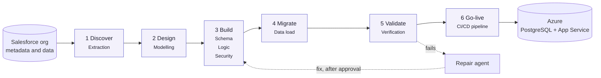
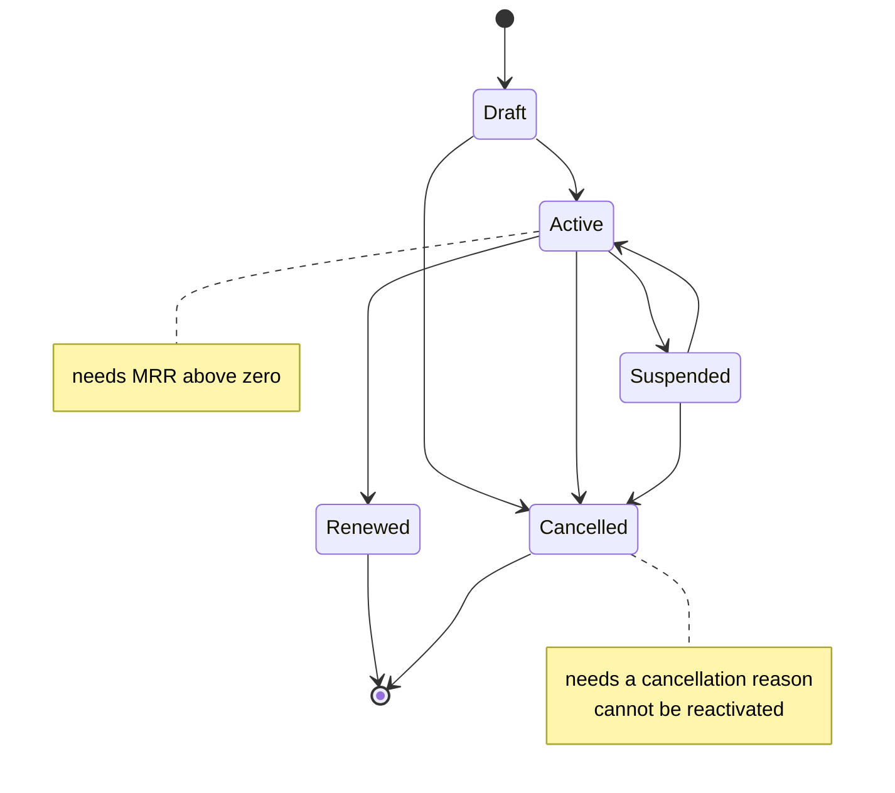
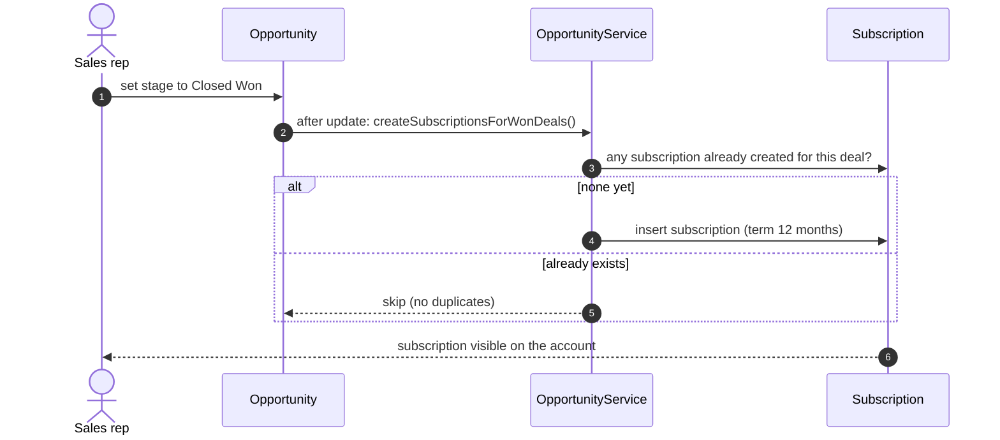
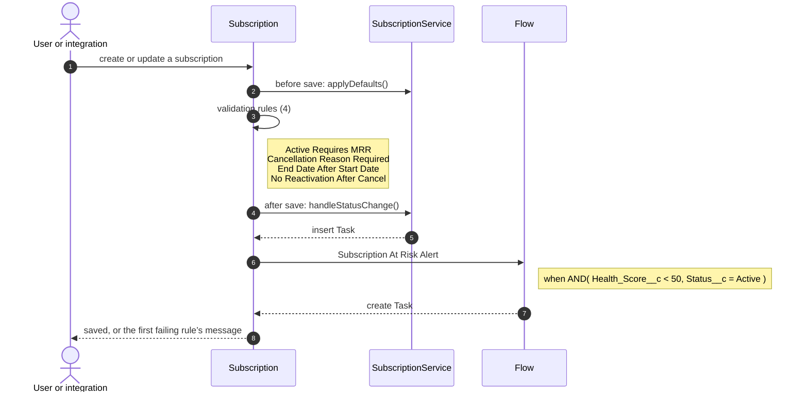
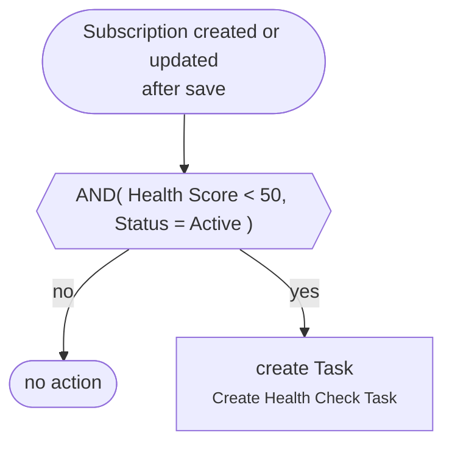
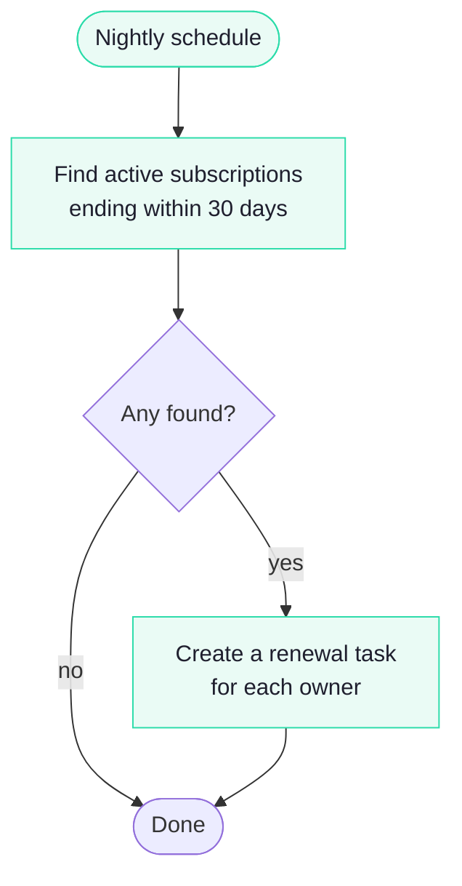
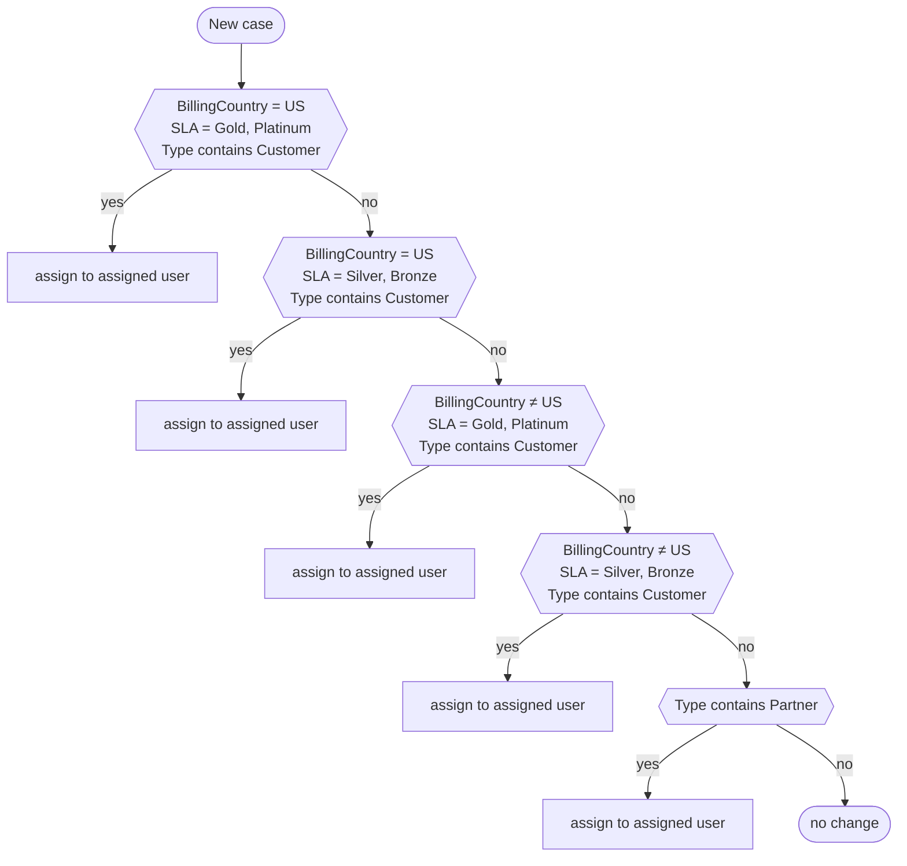
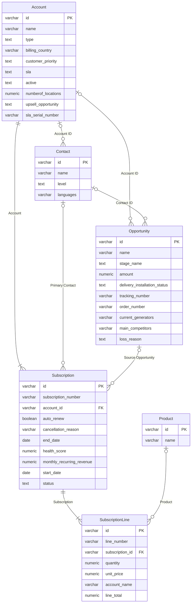
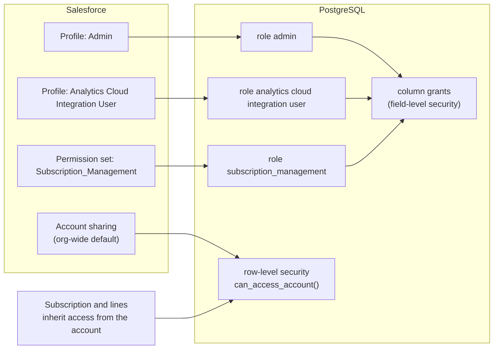
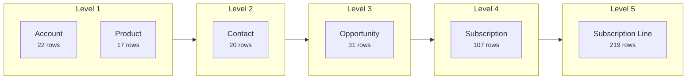

# High-level design: Subscription domain

Prepared 2026-10-07 from blueprint `fc71a1458dce`. Every diagram below is generated from the org’s own metadata; when the org changes, we regenerate this document.

## 1. Scope

|  |  |
|---|---|
| Source | Salesforce org, 505 objects described |
| Domain in scope | Subscription, Subscription Line |
| Reference objects | Account, Contact, Opportunity, Product |
| Target | PostgreSQL on Azure, services and admin app, released by CI/CD |
| Data | Account 22 · Contact 20 · Opportunity 31 · Product 17 · Subscription 107 · Subscription Line 219 |

## 2. How we move it

Six phases, one or more agents per phase, a review gate after each phase. A failed check goes to the Repair agent, whose fix is applied only after approval.

## 3. Business processes

### 3.1 Subscription lifecycle

Statuses come from the Status picklist; the notes come from the validation rules that guard each status.

### 3.2 Won deal becomes a subscription

When an opportunity is marked Closed Won, a subscription is created for the account, once per deal.

### 3.3 Saving a subscription

What happens, in Salesforce’s order, every time a subscription is saved: defaults, validation, status handling, the at-risk alert, and totals on the parent.

### 3.4 Subscription At Risk Alert

Raises a check-in task when an active subscription drops below the at-risk health threshold.

### 3.5 Renewal reminders

A scheduled job raises a renewal task before each active subscription ends.

### 3.6 Case routing and escalation

Assignment rules route each new case by country, service level and account type; escalation rules raise cases that miss their target time (outside the subscription domain; listed for completeness).

| Escalation rule | Applies when |
|---|---|
| 1 | BillingCountry = US; SLA = Platinum; Priority = High |
| 2 | BillingCountry = US; SLA = Platinum; Priority = Medium,Low |
| 3 | BillingCountry = US; SLA = Gold; Priority = High |
| 4 | BillingCountry = US; SLA = Gold; Priority = Medium,Low |
| 5 | BillingCountry = US; SLA = Silver |
| 6 | BillingCountry = US; SLA = Bronze |
| 7 | BillingCountry ≠ US; SLA = Gold,Platinum |
| 8 | BillingCountry ≠ US; SLA = Silver,Bronze |

## 4. Data model

## 5. Security

Each Salesforce profile or permission set becomes a database role. Field-level security becomes column grants. Subscriptions inherit access from their account, as in Salesforce.

## 6. Data migration

Records load parent first, in dependency order, keeping every Salesforce record ID.

## 7. Status and open items

| Item | Status |
|---|---|
| Formulas and roll-ups | 6 generated and checked against Salesforce values |
| Validation rules | 6 compiled (checks and guards) |
| Apex translated | SubscriptionService.applyDefaults |
| Automations still to translate | OpportunityTrigger, SubscriptionTrigger, SubscriptionRenewalBatch |
| Items Salesforce keeps | see the gap register (output/inventory/gap-register.md) |
