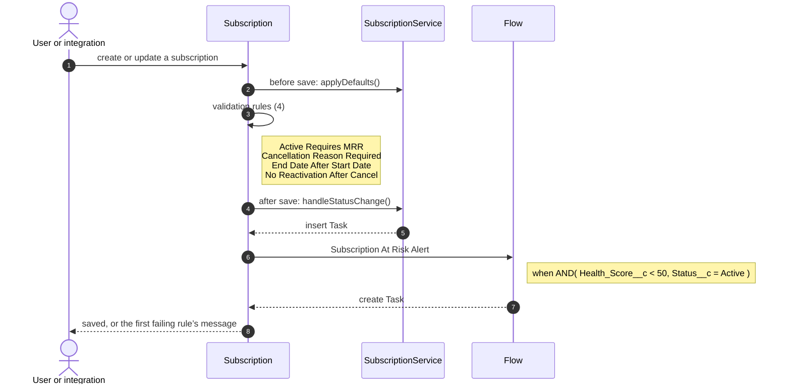
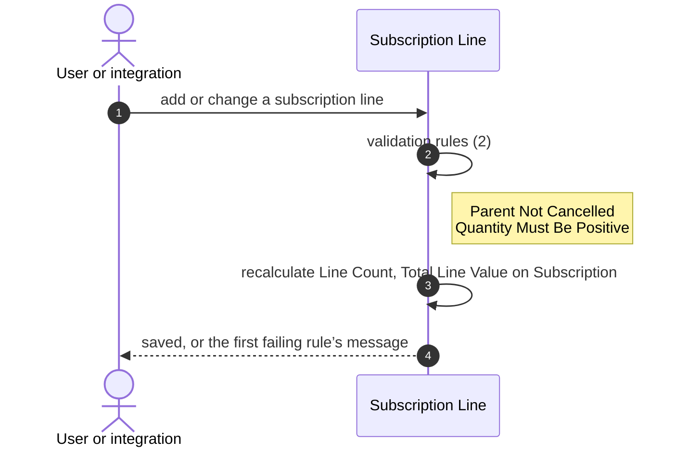
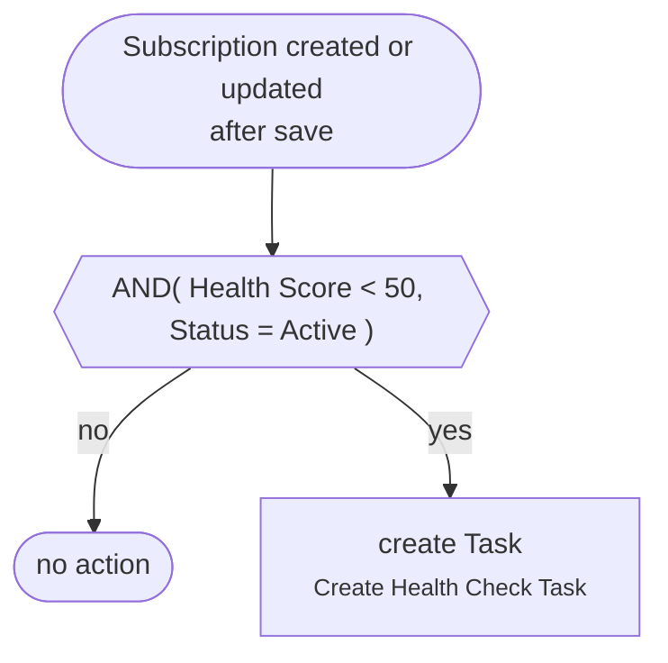
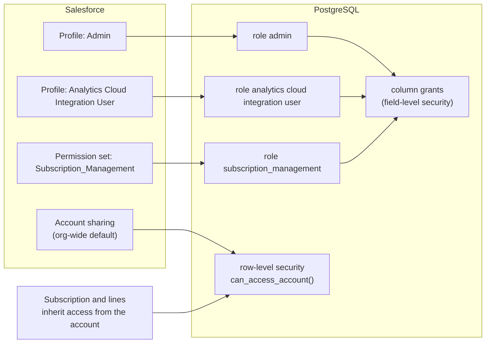
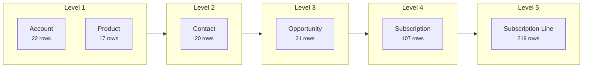

# Low-level design: Subscription domain

Prepared 2026-10-07 from blueprint `fc71a1458dce`. Field lists, rules and automations are generated from the org; the target design for each item is the strategy our generator applied.

## 1. Tables

### Account (`Account` → `account`)

22 rows. Sharing: ReadWrite.

| Salesforce field | Label | Salesforce type | Column | PostgreSQL type | Required | Notes |
|---|---|---|---|---|---|---|
| Id | Account ID | id | id | varchar(18) | yes |  |
| Name | Account Name | string | name | varchar(255) | yes |  |
| Type | Account Type | picklist | type | text |  | values: Prospect, Customer - Direct, Customer - Channel, Channel Partner / Reseller, Installation Partner, Technology Partner, Other |
| BillingCountry | Billing Country | string | billing_country | varchar(80) |  |  |
| SLA__c | SLA | picklist | sla | text |  | values: Gold, Silver, Platinum, Bronze |

### Contact (`Contact` → `contact`)

20 rows. Sharing: ControlledByParent.

| Salesforce field | Label | Salesforce type | Column | PostgreSQL type | Required | Notes |
|---|---|---|---|---|---|---|
| Id | Contact ID | id | id | varchar(18) | yes |  |
| Name | Full Name | string | name | varchar(121) |  |  |

### Opportunity (`Opportunity` → `opportunity`)

31 rows. Sharing: ReadWrite.

| Salesforce field | Label | Salesforce type | Column | PostgreSQL type | Required | Notes |
|---|---|---|---|---|---|---|
| Id | Opportunity ID | id | id | varchar(18) | yes |  |
| Name | Name | string | name | varchar(120) | yes |  |
| StageName | Stage | picklist | stage_name | text | yes | values: Prospecting, Qualification, Needs Analysis, Value Proposition, Id. Decision Makers, Perception Analysis, Proposal/Price Quote, Negotiation/Review, Closed Won, Closed Lost |
| Amount | Amount | currency | amount | numeric(18,2) |  |  |
| Loss_Reason__c | Loss Reason | picklist | loss_reason | text |  | values: Price, Timing, Competitor, No Budget, No Decision, Other |

### Product (`Product2` → `product2`)

17 rows. Sharing: ReadWrite.

| Salesforce field | Label | Salesforce type | Column | PostgreSQL type | Required | Notes |
|---|---|---|---|---|---|---|
| Id | Product ID | id | id | varchar(18) | yes |  |
| Name | Product Name | string | name | varchar(255) | yes |  |

### Subscription (`Subscription__c` → `subscription`)

107 rows. Sharing: ControlledByParent, inherited through Subscription__c.Account__c.

| Salesforce field | Label | Salesforce type | Column | PostgreSQL type | Required | Notes |
|---|---|---|---|---|---|---|
| Id | Record ID | id | id | varchar(18) | yes |  |
| Name | Subscription Number | string | subscription_number | varchar(80) |  |  |
| Account__c | Account | reference | account_id | varchar(18) | yes | →  |
| Auto_Renew__c | Auto Renew | boolean | auto_renew | boolean |  | default false |
| Cancellation_Reason__c | Cancellation Reason | string | cancellation_reason | varchar(255) |  |  |
| End_Date__c | End Date | date | end_date | date | yes |  |
| Health_Score__c | Health Score | double | health_score | numeric(3,0) |  |  |
| MRR__c | MRR | currency | monthly_recurring_revenue | numeric(16,2) |  |  |
| Primary_Contact__c | Primary Contact | reference | primary_contact_id | varchar(18) |  | →  |
| Source_Opportunity__c | Source Opportunity | reference | source_opportunity_id | varchar(18) |  | →  |
| Start_Date__c | Start Date | date | start_date | date | yes |  |
| Status__c | Status | picklist | status | text | yes | values: Draft, Active, Suspended, Cancelled, Renewed; default Draft |
| Term_Months__c | Term (Months) | double | term_months | numeric(4,0) |  |  |
| Line_Count__c | Line Count | double | line_count | numeric(18,0) |  |  |
| Annual_Value__c | Annual Value | currency | annual_value | numeric(18,2) |  |  |
| Days_To_Renewal__c | Days To Renewal | double | days_to_renewal | numeric(18,0) |  |  |
| Total_Line_Value__c | Total Line Value | currency | total_line_value | numeric(18,2) |  |  |

### Subscription Line (`Subscription_Line__c` → `subscription_line`)

219 rows. Sharing: ControlledByParent, inherited through Subscription_Line__c.Subscription__c.

| Salesforce field | Label | Salesforce type | Column | PostgreSQL type | Required | Notes |
|---|---|---|---|---|---|---|
| Id | Record ID | id | id | varchar(18) | yes |  |
| Name | Line Number | string | line_number | varchar(80) |  |  |
| Subscription__c | Subscription | reference | subscription_id | varchar(18) | yes | →  |
| Product__c | Product | reference | product_id | varchar(18) |  | →  |
| Quantity__c | Quantity | double | quantity | numeric(6,0) | yes |  |
| Unit_Price__c | Unit Price | currency | unit_price | numeric(16,2) | yes |  |
| Account_Name__c | Account Name | string | account_name | varchar(1300) |  |  |
| Line_Total__c | Line Total | currency | line_total | numeric(18,2) |  |  |

## 2. Calculated fields

| Field | Kind | Salesforce definition | Target design |
|---|---|---|---|
| Subscription_Line__c.Account_Name__c | formula | Subscription__r.Account__r.Name | view that joins the parent records |
| Subscription_Line__c.Line_Total__c | formula | Quantity__c * Unit_Price__c | generated column, stored |
| Subscription__c.Line_Count__c | rollup | count of undefined | column kept current by triggers, with a recompute job |
| Subscription__c.Annual_Value__c | formula | MRR__c * 12 | generated column, stored |
| Subscription__c.Days_To_Renewal__c | formula | End_Date__c - TODAY() | computed when read (depends on today’s date) |
| Subscription__c.Total_Line_Value__c | rollup | sum of Subscription_Line__c.Line_Total__c | column kept current by triggers, with a recompute job |

## 3. Validation rules

| Rule | Rejects when | Message | Target design |
|---|---|---|---|
| Opportunity: Closed_Won_Requires_Amount | AND( ISPICKVAL(StageName, "Closed Won"), OR( ISBLANK(Amount), Amount <= 0 ) ) | A won opportunity must have an Amount greater than zero. | CHECK constraint on the table |
| Opportunity: Loss_Reason_Required_When_Lost | AND( ISPICKVAL(StageName, "Closed Lost"), ISBLANK(TEXT(Loss_Reason__c)) ) | A Loss Reason is required before an opportunity can be marked Closed Lost. | CHECK constraint on the table |
| Subscription Line: Parent_Not_Cancelled | ISPICKVAL(Subscription__r.Status__c, "Cancelled") | You cannot add or change lines on a cancelled subscription. | BEFORE trigger guard (needs the previous row) |
| Subscription Line: Quantity_Must_Be_Positive | Quantity__c <= 0 | Quantity must be greater than zero. | CHECK constraint on the table |
| Subscription: Active_Requires_MRR | AND( ISPICKVAL(Status__c, "Active"), OR( ISBLANK(MRR__c), MRR__c <= 0 ) ) | An active subscription must have an MRR greater than zero. | CHECK constraint on the table |
| Subscription: Cancellation_Reason_Required | AND( ISPICKVAL(Status__c, "Cancelled"), ISBLANK(Cancellation_Reason__c) ) | Cancellation Reason is required when Status is Cancelled. | CHECK constraint on the table |
| Subscription: End_Date_After_Start_Date | AND( NOT(ISBLANK(Start_Date__c)), NOT(ISBLANK(End_Date__c)), End_Date__c <= Start_Date__c ) | End Date must be after Start Date. | CHECK constraint on the table |
| Subscription: No_Reactivation_After_Cancel | AND( ISCHANGED(Status__c), ISPICKVAL(PRIORVALUE(Status__c), "Cancelled"), NOT(ISPICKVAL(Status__c, "Cancelled")) ) | A cancelled subscription cannot be reactivated. Create a new subscription instead. | BEFORE trigger guard (needs the previous row) |

## 4. Automations

| Automation | Runs when | Does | Target design | Status |
|---|---|---|---|---|
| flow: Subscription At Risk Alert | after insert/update of Subscription | create Task | in_transaction_hook | pending |
| apexTrigger: OpportunityTrigger | after update of Opportunity | OpportunityService.createSubscriptionsForWonDeals | service hook in the same transaction | pending |
| apexTrigger: SubscriptionTrigger | before/before/after insert/update/update of Subscription | SubscriptionService.applyDefaults, SubscriptionService.handleStatusChange | service hook in the same transaction | partly translated |
| apexClass: SubscriptionRenewalBatch | on a schedule | writes Task | scheduled worker job | pending |
| duplicateRule: Account.Standard_Account_Duplicate_Rule | before insert/update of Account |  | rule engine hook in the service layer | pending |
| duplicateRule: Contact.Standard_Contact_Duplicate_Rule | before insert/update of Contact |  | rule engine hook in the service layer | pending |

### 4.1 Order of execution: subscription

### 4.2 Order of execution: subscription line

### 4.3 Flow: Subscription At Risk Alert

## 5. Services

| Class | Methods | Reads | Writes | Called by | Constants |
|---|---|---|---|---|---|
| OpportunityService | createSubscriptionsForWonDeals | Subscription | Subscription | OpportunityTrigger | DEFAULT_TERM_MONTHS = 12 |
| SubscriptionService | applyDefaults, handleStatusChange, totalActiveMrr | Subscription | Task | SubscriptionTrigger | DEFAULT_HEALTH_SCORE = 70, AT_RISK_THRESHOLD = 50 |

## 6. Security

| Role (from Salesforce) | Subscription | Subscription Line |
|---|---|---|
| Profile: Admin | read, create, edit, delete, viewAll, modifyAll | read, create, edit, delete, viewAll, modifyAll |
| Profile: Analytics Cloud Integration User | read, viewAll | read, viewAll |
| Permission set: Subscription_Management | read, create, edit, delete | read, create, edit, delete |

## 7. Data load

| Order | Object | Rows | Depends on |
|---|---|---|---|
| 1 | Account | 22 | — |
| 1 | Product | 17 | — |
| 2 | Contact | 20 | Account |
| 3 | Opportunity | 31 | Account, Contact |
| 4 | Subscription | 107 | Account, Contact, Opportunity |
| 5 | Subscription Line | 219 | Subscription, Product |

## 8. Verification cases

| Case | Comes from |
|---|---|
| apex.appliesDefaultHealthScoreAndEndDate | apex-test:SubscriptionServiceTest#appliesDefaultHealthScoreAndEndDate |
| apex.blocksReactivationOfCancelledSubscription | apex-test:SubscriptionServiceTest#blocksReactivationOfCancelledSubscription |
| apex.rollsUpLineTotals | apex-test:SubscriptionServiceTest#rollsUpLineTotals |
| apex.createsSubscriptionWhenOpportunityIsWon | apex-test:SubscriptionServiceTest#createsSubscriptionWhenOpportunityIsWon |
| apex.renewalBatchRaisesTasks | apex-test:SubscriptionServiceTest#renewalBatchRaisesTasks |
| rule.Active_Requires_MRR.blank | rule |
| rule.Active_Requires_MRR.zero | rule |
| rule.Active_Requires_MRR.draftWithoutMrrAllowed | rule |
| rule.Cancellation_Reason_Required | rule |
| rule.End_Date_After_Start_Date | rule |
| rule.No_Reactivation_After_Cancel.toSuspended | rule |
| rule.Parent_Not_Cancelled | rule |
| rule.Quantity_Must_Be_Positive | rule |
| platform.restrictedPicklist | rule |
| platform.masterDetailCascade | rule |
| apex.applyDefaults.termFromDates | rule |
| security.permsetEditsAllowedFields | rule |
| security.readOnlyFieldsNotWritable | rule |
| security.readOnlyProfileCannotEdit | rule |
